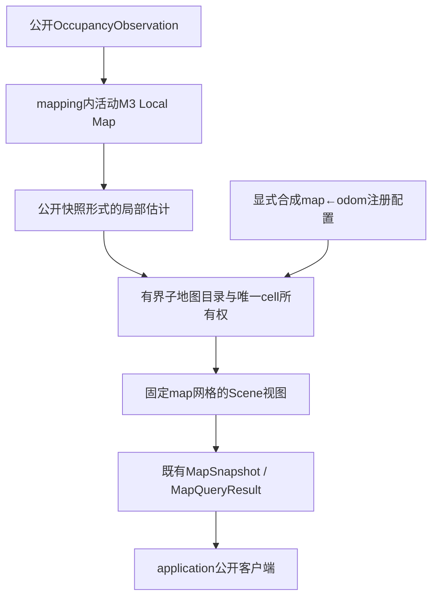

# M4 Scene Map与有界子地图软件试制方案

日期：2026-10-27；更新：2026-10-28；主责任：mapping_engineer。
状态：用户后续“继续”确认具体合成软件范围；DESIGN-01与SW-01/02/03/04已完成，仅关闭合成软件工作包。
依据：用户在M3合成软件交接后确认继续推进M4设计，
[M3交接](../experiments/2026-10-27-m3-ros-handoff.md)已完成。
不以合成软件交付提高正式M1/M2/M3/M4或Phase 4验收状态。
SW-01显式注册合同与配置、输入轨迹及独立生命周期表已实现，8场景/41输入/52查询预期
保存，24项定向及全仓594项通过；仅输入/预期，未运行Scene候选，见
[EXP-20261028-001](../experiments/2026-10-28-m4-fixture-contract.md)。
SW-02随后实现显式`SceneMap(spec, run_id, clock_id)`，直接读取SW-01保存答案：
8场景41输入52查询、所有权/FIFO及真实消息序列化一致；新增15项/M4共39项/全仓609项通过，
见[EXP-20261028-002](../experiments/2026-10-28-m4-scene-candidate.md)。未注册默认工厂或ROS。
SW-03随后对保存的140帧323查询预期通过，含120帧K=1/N=2/H=3周期序列、4个提交后段
故障点及1个域隔离探针；新增13项/M4共52项/全仓622项通过，见
[EXP-20261028-003](../experiments/2026-10-28-m4-time-resources.md)。仅逻辑计数/离线组合，非RSS或M4 ROS。
SW-04随后完成显式factory/ROS/回放与独立应用交接：15观测9快照20查询/174项检查、
旧入口与清理通过，新增7项/全仓629项通过，见
[EXP-20261028-004](../experiments/2026-10-28-m4-ros-handoff.md)。默认latest与公共字段保持。

## 1. 源码事实与验证边界

下表保留DESIGN-01（2026-10-27）的审计基线；SW-01—04交付状态见上文和工作包表。

| 真实入口/符号 | 审计时已有行为 | 当时M4缺口 |
| --- | --- | --- |
| [create_map](../mapping/ufm_mapping/factory.py#L5) | 默认latest，显式M2/M3；不识别m4_fixture | Scene Map创建、隔离配置与默认关闭 |
| [SparseLocalMap.snapshot/query](../mapping/ufm_mapping/local_map.py#L232) | 一套odom轴对齐网格、覆盖和五类单点查询 | 多子地图保留、场景级索引、map坐标 |
| [RollingProbabilityMap._prepare_grid](../mapping/ufm_mapping/rolling_probability_map.py#L16) | 重叠cell迁移，窗口外cell及私有状态丢弃 | 移出窗口的历史估计保留与资源淘汰 |
| [FixedProbabilityMap.update](../mapping/ufm_mapping/fixed_probability_map.py#L62) | 整帧校验/暂存、事件水位/有界去重、TTL及贡献时间 | Local Map与Scene目录的联合原子提交 |
| [RollingIntervalProbabilityMap](../mapping/ufm_mapping/rolling_interval_probability_map.py#L7) | 明确来源的M3概率区间随cell迁移/淘汰 | 子地图之间的质量保真；不是新一轮概率融合 |
| [MapSnapshot.msg](../ros_ws/src/uav_fusionmap_msgs/msg/MapSnapshot.msg)、[MapQueryResult.msg](../ros_ws/src/uav_fusionmap_msgs/msg/MapQueryResult.msg) | 单网格/单点、各cell概率/质量/原时间；无submap目录 | 不能直接公开任意多参考系图、子地图枚举或注册历史 |
| [SpatialContext.msg](../ros_ws/src/uav_fusionmap_msgs/msg/SpatialContext.msg) | 观测时刻source/body→mapping变换、calibration_id/state_source | 没有独立odom reset/epoch或map←odom关系字段 |
| [mapping main](../ros_ws/src/uav_fusionmap_mapping/scripts/perf01a_map_node.py#L21) | 同实例/锁更新查询，只订阅占据及可选clock | M4显式装配；不能新增状态/TF业务旁路补缺 |
| [replay_observations](../mapping/ufm_mapping/replay.py#L28) | 新实例、原接收顺序、按revision核对完整公开结果 | M4所有权/子地图淘汰与场景视图的重建 |
| [MapQueryClient.query](../application/ufm_application/query_client.py#L79)、[query codec](../ros_ws/src/uav_fusionmap_msgs/src/ufm_ros_contract/query_codec.py#L17) | 五类状态、身份/时间/quality保真；frame字段不硬编码odom | 没有M4运行证据，应用不能读取私有子地图目录 |

本轮9项探针核对上述事实及一个非单位注册算例，32项既有相关测试通过，见
[设计审查](../experiments/2026-10-27-m4-design-review.md)。
手工map坐标fixture实际消息序列化与应用保真通过，**只证明既有字段可承载一个场景网格**，
不是Scene Map类、注册算法、M4 ROS或真实定位已运行。

## 2. 首版选择与职责

选择默认关闭、纯合成的有界Scene Map：一个现有滚动M3活动地图，加至多K个固定几何
封存子地图；公开输出为同一map参考系下、固定范围和分辨率的一张稀疏场景视图。
Scene层只管理历史估计、唯一cell所有权及查询，不把累计快照重新作为逆观测证据。
它不是独立SLAM子图，不做回环、位姿图优化、动态注册、跨分辨率重采样或跨子地图概率融合。

下图为首版mapping模块内部组合，SW-02/04已实现合成候选与装配，主数据流/目录边界保持：

SW-02新增的`SceneMap`仅在mapping内显式创建，提供`update(observation)/snapshot()/query()`；
DESIGN-01时工厂/包装尚未注册它，SW-04已增加显式选型。
它拥有活动M3实例，只使用其公开更新/快照，不从application/ROS读取私有状态。
封存数据由同模块的公开快照值构造；没有新的快照订阅节点或跨层文件共享。
先仅支持M3显式fixture输入；普通placeholder、research后验及任意外部MapSnapshot
不能不经合同检查进入该候选。真实感知、真实注册与质量另行准入。

## 3. 拟用私有配置与坐标合同

SW-01已创建`configs/m4_fixture.yaml`，使用`m4_fixture.v1`；该时点仅显式测试工具读取，后续SW-04已注册显式M4选型。
配置含fixture_only=true、enabled_by_default=false、完整M3子配置、以下Scene参数及注册声明，
无隐式研究数据路径、GPU、checkpoint或第二份算法默认值。
具体键为local_map（完整M3配置）、scene（单网格）、registration及max_sealed_submaps。
注册run_id/clock_id在静态配置中显式为m4-fixture/sim:m4-fixture；生成工具为每个case
复制并绑定新的具名run/clock，完整保存每case配置，不在候选中自动重绑定。
checker只验证注册/输入，不维护事件水位、去重、目录或所有权，不能用无状态通过代替Scene验收。

| 项目 | 首版具体合成值/要求 |
| --- | --- |
| Scene身份 | map_id=m4-scene-fixture；单实例显式绑定run_id/clock_id |
| 活动后端 | 唯一RollingIntervalProbabilityMap，完整沿用m3_fixture.v1；其内部map_id仍m3-fixture，外部Scene另有身份 |
| Scene网格 | frame_id=map，resolution=[0.5,0.5,0.5]m，origin=[0,-16,-4]m，shape=[256,64,16] |
| coverage | [0,128)×[-16,16)×[-4,4)m；固定包围范围不是已观测域，缺cell仍unknown |
| 注册 | registration_id=m4_fixture_map_from_odom_v1，source_frame=odom，target_frame=map，source=fixture |
| 注册矩阵 | 显式T_map_odom=[I,(32,0,0)m;0,1]；旋转为已声明I，平移非零；不能缺省成I或仅改frame名 |
| 注册时间 | 显式绑定本run/clock，valid_from_ns=0、valid_until_ns=1000000000，区间左闭右开；输入和查询均须在域内 |
| 注册范围 | 同一run内不可变；仅平移且两网格同轴/同分辨率、整格对齐；任意旋转、非整格偏移、动态修正均拒绝 |
| 注册质量 | 数值条件化于所声明fixture变换，不传播位姿/安装误差；不声明真实全局精度 |
| 目录上限 | K=max_sealed_submaps=2；每个子地图cell上限继承完整M3配置N，活动身份限额继承H |
| 小型压力场景 | 显式覆盖K=1、N=2、H=3；仅用于限额验收，不能改真实运行预算 |
| 老化/分类 | 继承M3显式TTL和free/occupied阈值，Scene不另设冲突阈值；查询年龄=min(max_age_ns,TTL) |

变换方向与现有[坐标规范](COORDINATE_SYSTEM.md)一致：
`p_map = T_map_odom × p_odom`，
`p_odom = origin_local + (index_local+0.5)⊙resolution`。
在整格合同下，Scene索引为
`index_scene = index_local + (origin_local + translation - origin_scene) / resolution`，
括号项必须是整数三元组；先核对完整窗口覆盖，再变换，不按点中心四舍五入重采样。

独立算例：odom点[8.25,0.25,0.25]，局部origin[-16,-8,-4]时索引[48,16,8]；
经非零注册成为map点[40.25,0.25,0.25]，Scene索引[80,32,8]。
转换前后的概率、区间、confidence和last_observed_timestamp保持原值。
每个有效活动窗口转换后的完整coverage必须落在Scene envelope内，否则整帧拒绝；
不静默裁掉超界部分或扩大coverage。非法未来帧也不能推进Local Map水位。

这是固定注册条件下的Scene软件试制。动态map←odom或跨epoch重注册需后续独立设计，
不能将新变换藏进uncertainty/source、reason或字符串map_id，也不订阅最新TF补历史变换。

## 4. 子地图生命周期与唯一所有权

首版子地图定义为活动窗口在某次几何切换前保留的估计，不代表独立测量集合。
目录内部用(run_id,clock_id,递增序号)标识，不计算Hash；原点/coverage固定且不随飞机偏航旋转。

| 生命周期事件 | 拟行为 |
| --- | --- |
| 新实例 | 空目录/空活动地图；无历史继承或自动磁盘恢复 |
| 同窗口有效更新 | 仍只由活动M3累计一次，Scene用完整新活动视图替换活动所有权集合 |
| 窗口origin变化 | 先保留旧活动视图，再形成新活动视图；旧视图中未被新活动cell接管的cell成为封存子地图 |
| 重叠cell | 所有权转到新活动视图；原时间/概率/质量保留，不把同一累计估计再次更新或当作第二份证据 |
| 封存 | 几何固定，不再累计输入或改写cell估计；目录可以因所有权转移/资源淘汰删除cell，不能把“封存”误称为永不变的全量数据档案 |
| 新贡献接管封存cell | 新贡献的last_observed_timestamp更晚则整个载荷接管，旧目录副本移除；新quality不可用时不得沿用旧available范围 |
| 同时刻重复 | 坐标归一后概率/quality/时间完全一致则只保留一个owner；同刻不同载荷整帧拒绝，不能靠active优先掩盖冲突 |
| 较旧版本 | 不能替换更晚owner；若组合产生此矛盾则原子拒绝，不能自动选旧质量 |
| 空封存记录 | 不保留；空/无回波/observed=false也不能制造free或新的证据时间 |
| 超K | 按封存序号FIFO淘汰最早子地图及其owned cells；query不改变顺序 |
| 活动容量淘汰 | 同窗口完整新活动视图中缺少的cell从活动Scene所有权移除；不回搜更旧副本来复活旧值 |
| 离开后返回 | Scene可查询仍保留的历史owner；活动M3已丢弃的cell重新观测时从其先验开始，再以新时间接管；禁止用Scene旧累计值反灌活动M3 |

同一Scene索引至多一个owner。转移时旧目录条目删除，不在每次query重扫旧全量快照，
所以最新owner被淘汰后不能自动降级到早期副本。已保存的实验/原始收据不改写。
即使重叠占据值相等，也不能增加观测次数、刷时间或缩窄区间。
Scene仅展示所选M3估计及原质量来源，不把它改名成“跨子地图融合概率/置信区间”。

独立生命周期算例（K=1）：
初始窗口odom[-16,16)保留P=8.25；切到[24,56)后P仅在封存S0，活动观测Q=48.25；
再切到[64,96)并观测R=88.25后封存S1，S0被淘汰，P为unknown；
Scene中Q/R可按原时间查询，R不能让Q变新鲜。返回P的新free输入得到先验后的0.25，
不能把旧0.75再融合成0.5。SW-01须先保存此表的完整输入/预期，再运行候选。

## 5. 公开输出、查询与时间

公开Scene snapshot仍是既有MapSnapshot：Scene map_id、frame_id=map、固定网格与coverage，
按Scene索引排序的唯一cell列表、source_type=derived、source_types保留fixture来源。
输出是全量稀疏场景视图，不把多个origin的cell直接拼接；子地图内部ID/父子关系不进入业务消息。
MapQueryResult.index是Scene网格索引，与同revision公开snapshot一致，不是活动M3的局部索引。

Scene revision是本实例独立、单调的提交版本，不借用某个局部revision。
每个改变活动公开视图/目录/覆盖所有权的有效步骤至多增加一次；重复和拒绝不增加。
不改变公开视图的合法输入可像M3一样推进输入水位，不刷新公开证据时间。
header.timestamp记录最近一次有效占据贡献时刻，封存/淘汰/空移动/查询/重新发布不刷新它；
即使该贡献后来被淘汰也不把header时间倒退。私有最新Scene结构变化时刻单独保存。
无历史贡献时snapshot为unavailable；有历史贡献而当前无保留cell时可为空valid快照，
所有格子仍unknown，不能把valid等同于有障碍或有自由证据。

| 查询条件 | 结果 |
| --- | --- |
| 错map/frame/run/clock、注册不可用/已过有效期或尚无贡献 | unavailable，无cell载荷；frame不自动转换 |
| 早于最近贡献或Scene结构变化时刻 | unavailable；当前服务不提供历史版本旅行 |
| Scene envelope外或其中没有保留cell | unknown，reason区分outside_coverage/no_observation；不泄漏被淘汰载荷 |
| 有owner，年龄严格大于min(max_age_ns,TTL) | stale，保留完整历史概率/质量和原时间；恰边界仍新鲜 |
| 有新鲜owner | 沿M3显式阈值occupied/free/unknown；不因区间宽窄重新分类 |
| 所选owner区间unavailable | 概率可用时照常按原规则分类，quality仍unavailable，不能向其他子地图借范围 |

未知/不可用响应的数值槽按既有availability表示；不能用默认0概率/时间代替缺失。
应用只消费现有MapQuery，不枚举私有目录、读历史缓存或调用地图更新。
应用CLI在未来M4图必须显式`--frame-id map --map-id m4-scene-fixture`；旧odom请求不能悄悄改写。
区域查询、无限动态Scene范围及公开子地图拓扑不在此单点/单网格子集内。

## 6. 原子性、定位连续性与资源

一条OccupancyObservation是联合事务边界：校验配置/注册/输入身份，临时活动M3更新，
临时目录封存/所有权转移/淘汰，完整Scene快照/质量/索引校验都成功后，才一次替换已提交状态。
禁止先更新活跃M3再发现Scene超界/冲突而留下已推进的水位或私有概率。
首版可用一个有界临时副本验证该提交方式，不改M1/M2/M3累计算法；错误注入应落在
局部更新之后、Scene提交之前，验证局部与Scene、去重、时钟水位均可恢复。
致命内存分配/进程故障不承诺在原实例继续，停止并新run恢复；不能fallback成旧后端。

定位/注册的分界必须保留：

- 观测时刻T_odom_body变化是正常运动，不把每次转向或整格平移判为定位reset。
- 所声明的run/clock/calibration/state_source必须与fixture域一致；坏帧拒绝且不刷新旧地图。
- 已声明odom reset或注册修正按现有规则终止当前run，新的run/实例和显式注册从空开始；
  不自动重新配准旧子地图，不建立跨run链接。
- 现有SpatialContext不含独立reset/epoch。未改run且未声明的同域跳变无法可靠识别，
  不用距离门限冒充定位连续性证明。软件用例只验证显式新run/错域/变换失效的隔离；
  真实跳变识别、动态map←odom修正和历史子地图重注册继续作为正式M4缺项。

内存结构限于1个活动M3（N个cell及私有区间状态、H条有界身份）、K个至多N cell的封存记录，
一个至多(K+1)N条目的所有权索引。封存记录不复制历史帧/模型张量/私有概率账本。
若保留活动Scene导出副本、构造排序全量输出或临时事务，必须在SW-03分别计数，
包括临时重复载荷；不能只报最终unique cells而隐藏副本。
每帧最多1个临时活动/目录候选，禁止无界任务队列；在线不留全量查询或输入历史。
计数上界不是机载RSS/延迟或PERF-01结论，正式预算仍按既有门禁冻结与实测。

SW-03已在测试侧核对最终保留项、引用别名及mapping Python行/返回边界的可达对象。
身份上限H约束消息条数，不等于最多H*N个voxel：实际保留监督无关的占据输入副本上界为H*V，
V是单条输入voxel数，可能大于活动N；完整合法网格时V至多shape乘积，测试用V=2及3。
事务期间可临时存在H+1条身份和K+1个封存记录，提交后再受H/K约束。
导出快照至多(K+1)N个cell，query至多1条载荷；临时状态/前后快照/排序导出不计为第二份证据。
采样不覆盖解释器/分配器内部瞬时分配、字节大小或调用方主动保留的历史结果，不将对象数写成内存预算达标。

## 7. 兼容、运行装配与恢复

SW-04已在同一mapping工厂/ROS节点/回放增加私有`m4_fixture`及完整`m4_fixture_config`；
默认latest、显式M2/M3继续原语义。缺配置、混用候选配置、错注册或覆盖参数启动失败，
输入/运行错误保留拒绝事件，不自动切换到M1/M2/M3/placeholder。
mapping业务输入仍只有OccupancyObservation，可选clock仅属基础设施；
不添加SensorBundle字段、公共消息、TF/状态/原始Radar/IR或LiDAR订阅。

新生产者为mapping内部Scene候选；消费者为现有快照/MapQuery codec和application客户端。
兼容子集是一个固定map网格的完整稀疏视图，既有消息字段及五类状态不变。
私有目录不承诺成为公共schema。后续若需公开submap/epoch/动态注册，先另给生产者、
消费者、迁移/版本兼容、恢复方案并确认，再修改契约；不得挤进现有quality字段。
恢复为停止M4候选，显式选择旧后端、新run和新实例；不加载Scene目录到旧算法中。

## 8. 工作包、独立预期与验收

以下具体软件范围已获用户后续“继续”确认；DESIGN-01/SW-01/02/03/04已完成，仅关闭合成软件范围。
每项只有一名主责任，估计为开发工作量，不是正式阶段退出日期。

| 顺序 | 主责任 | 交付及完成条件 | 估计/状态 |
| --- | --- | --- | --- |
| M4-DESIGN-01 | mapping_engineer | 本方案、真实调用链审计、兼容与定位限制 | 已完成；9项审计/32项既有定向通过，仅设计 |
| M4-SW-01 | mapping_engineer | 显式m4_fixture配置/注册与输入checker、测试专用轨迹、独立网格/目录/所有权/时间预期；先保存输入和预期 | 原估计0.5—1工作日；已完成：8场景41输入52查询预期，24项定向/594项全仓通过，不执行Scene候选 |
| M4-SW-02 | mapping_engineer | 显式纯Python有界Scene候选；封存/所有权、非零注册、公开固定Scene视图与单点查询，对冻结预期一致 | 原估计1—2工作日；已完成：8场景41输入52查询、所有权/FIFO及消息承载一致；新增15项/M4共39项/609项全仓通过，不注册工厂或ROS |
| M4-SW-03 | mapping_engineer | 事件/TTL/容量/目录淘汰/返回/新run组合、坏未来帧和提交后段错误注入；活动与Scene联合原子性、状态项/临时副本有界 | 原估计1工作日；已完成（离线）：140帧323查询、4故障/1域探针，新增13项/M4共52项/622项全仓；无业务源码修改，仅对象计数而非RSS |
| M4-SW-04 | tester | 显式ROS/公开占据回放/独立应用map查询，五类状态与quality保真、默认与旧M1/M2/M3/placeholder兼容、Python/图/清理 | 原估计1—2工作日；已完成：15观测9快照20查询/174项运行检查、公开回放和五组旧ROS回归/清理通过，新增7项/全仓629项；[交付记录](../experiments/2026-10-28-m4-ros-handoff.md) |

| 独立验收组 | 必需预期与反例 |
| --- | --- |
| A 合同/注册 | 缺注册、方向颠倒、非整格平移、旋转、错run/clock/有效期、非fixture域、坏末尾quality、超Scene envelope拒绝；默认启动不导入候选 |
| B 坐标 | 上述非零平移算例；窗口平移/偏航下同一世界cell保持Scene index，边界半开、负坐标、map请求与odom请求明确分开；禁止仅改frame |
| C 子地图 | 活动→封存→FIFO淘汰→返回；空封存不占额、query不改变FIFO；新区域及淘汰后unknown |
| D 所有权/质量 | 重叠不二次累计；同刻同值只留一份、同刻冲突拒绝；新missing接管后不借旧范围；旧副本不能在最新owner淘汰后复活；返回新值不反灌历史累计 |
| E 时间 | 重复/同ID冲突/迟到/坏未来帧不改变状态；封存、空移动与query不刷新证据；恰TTL、超TTL、早于结构变化、不同cell年龄及新run空实例 |
| F 原子/资源 | 局部暂存后Scene构造故障可恢复；K=1/N=2/H=3反复移动长序列；细分真实保留项/索引/导出/临时副本，无隐藏无界目录或观测账本 |
| G 交接 | 现有字段真实序列化、float32均值/float64区间不修补、公开占据按revision回放、五类应用状态、错frame服务、默认/旧入口及清理 |

SW-01的独立预期用显式轨迹/所有权事件表和有理数坐标生成，不能调用候选目录/转换器生成答案。
数值累计复用已有M3冻结算例；Scene预期只选择/重索引整条载荷，不另造融合公式。
允许基于已保存M3公开收据做只读兼容输入，但不得把测试造出的未来子地图数据写成已有运行结果。
SW-02/03须先独立核对Scene数值/所有权，再走真实消息序列化；不能只做往返自证。

## 9. 完成范围与后续

通过上述工作包只能称“固定合成注册条件下的有界Scene软件试制通过”。
真实传感器/注册、定位reset识别、漂移/重定位修正、跨epoch历史重用、场景完整性、
区域查询、真实资源/性能与正式M4仍需独立证据。研究模型质量继续暂缓，research fail-closed。
当前已有固定合成注册下的离线及实际M4 ROS/回放/应用证据，没有真实模型或真实注册运行。
按阶段顺序下一项为M5-DESIGN-01，仅提出TerrainPrior准入/基准/no-data/质量、兼容与恢复方案；
不实现DEM，不新增公共字段，不开展科研对照、自主控制或机载部署，不重复已关闭的交接充作新任务。
