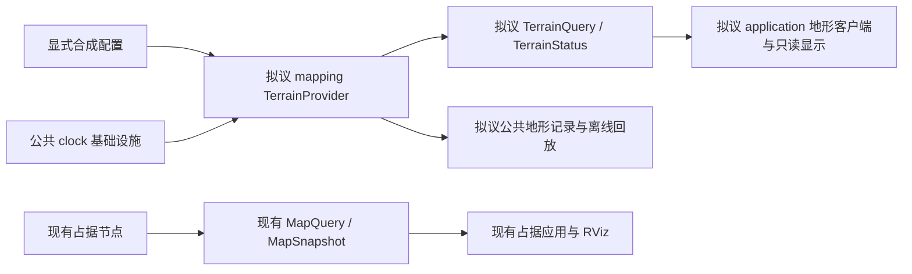

# M5-IFACE-DESIGN-01：独立地形公共接口具体方案

版本：提案v0.1；日期：2026-10-28；主责任：mapping_engineer。
状态：已完成（设计交付）；下文保留设计时点。用户后续已明确授权SW-01，
独立消息/codec/离线记录schema现已实现，见[SW-01合同](M5_IFACE_SW01_CONTRACT_20261028.md)。
后续SW-02已实现并验证Provider/实际服务，见[运行说明](M5_IFACE_SW02_PROVIDER_20261028.md)；
10-29 SW-03后续已实现并验证客户端、记录器/执行回放与可选地形显示，见
[交付说明](M5_IFACE_SW03_DELIVERY_20261029.md)；v1不可表达的失败标incomplete，正式DEM/融合/阶段门槛保持。
下文拟议措辞保留设计时点，当前实施证据以上述SW说明为准。
依据：[私有软件关闭证据](M5_SW03_TIME_RESOURCES_20261028.md)、
[总体设计§7](M5_TERRAIN_PRIOR_DESIGN_20261028.md#7-公共接口迁移闸门)。
审查证据：[EXP-20261028-011](../experiments/2026-10-28-m5-interface-design.md)。

## 1. 现状与设计目标

| 编号 | 当前源码事实 | 对方案的约束 |
| --- | --- | --- |
| A1 | [factory.py:5](../mapping/ufm_mapping/factory.py#L5)只选latest/M2/M3/M4 | 不把地形变成占据backend或更改默认选型 |
| A2 | [TerrainFixture:73](../mapping/ufm_mapping/terrain_fixture.py#L73)固定注册/run，构造后未安装 | 默认关闭，显式输入/时钟/安装后才可查询 |
| A3 | [install:124](../mapping/ufm_mapping/terrain_fixture.py#L124)整版准备、最后单次提交 | 查询/状态必须来自同一不可变版本，错误安装不替换旧版 |
| A4 | [query:164](../mapping/ufm_mapping/terrain_fixture.py#L164)不推进时钟，可查未来边界 | 公共live层另加运行时钟可用性及未来请求门控，不能让请求驱动时钟 |
| A5 | [snapshot:157](../mapping/ufm_mapping/terrain_fixture.py#L157)是私有诊断 | application不能读取其spec/私有缓存 |
| A6 | [MapQuery.srv](../ros_ws/src/uav_fusionmap_msgs/srv/MapQuery.srv)查询XYZ与max_age | 地形独立查询XY；不借占据观测年龄定义DEM时效 |
| A7 | [MapQueryResult](../ros_ws/src/uav_fusionmap_msgs/msg/MapQueryResult.msg)只有五类占据状态/概率/观测时间 | 不加入高度，不复用枚举值或来源/observed字段 |
| A8 | [CMakeLists:5](../ros_ws/src/uav_fusionmap_msgs/CMakeLists.txt#L5)只生成已有类型/MapQuery | 新类型独立包，旧消息定义与类型签名保持 |
| A9 | [map_node:66](../ros_ws/src/uav_fusionmap_mapping/scripts/perf01a_map_node.py#L66)只包装占据查询，[139](../ros_ws/src/uav_fusionmap_mapping/scripts/perf01a_map_node.py#L139)只收占据输入 | 独立可选节点，不修改旧map节点或增加传感器旁路 |
| A10 | [MapQueryClient:79](../application/ufm_application/query_client.py#L79)拒绝valid等地形状态 | 新增独立客户端；不让旧客户端误解地形 |
| A11 | [ROS客户端:29](../ros_ws/map_query_client.py#L29)只对等待服务设期限，调用直接阻塞 | 新传输层必须处理调用期限和迟到响应，不能只给wait_for_service设timeout |
| A12 | [terrain_replay:6](../mapping/ufm_mapping/terrain_replay.py#L6)只回放私有事件；[占据回放:28](../mapping/ufm_mapping/replay.py#L28)只回放占据 | 新公共记录不能冒充上述任一现成协议 |
| A13 | [RViz:91](../ros_ws/report_rviz.py#L91)消费clock/公开占据快照和查询 | 地形显示另走公开地形协议，保持原占据显示及唯一TF权威 |
| A14 | [m5_contract:7](../mapping/ufm_mapping/m5_contract.py#L7)限16样本/16KiB/64身份；[213](../mapping/ufm_mapping/m5_contract.py#L213)有界读取 | 延续小型fixture；ROS反序列化、记录及返回副本预算另计 |

本轮实际探针核对5种边界/样本结果、时钟/冲突/reset、监督字段拒绝及旧客户端拒绝地形状态；
实际生成的SensorBundle无LiDAR/target/observed_mask，新地形消息包不存在。
相关74项既有定向检查通过，均不是拟议协议序列化或新ROS运行证据。

## 2. 首版范围与生产消费

采用独立的`uav_fusionmap_terrain_msgs`包：4个消息、1个服务；另有结构化JSON回放合同。
首版仅`m5_fixture_v1`：DTM/fixture、一个tile、固定具名非零平移、同轴同格距整格注册、直接样本中心。
没有真实DEM读取、地理重投影、重采样、在线tile流或DEM占据融合。

| 主体 | 拟议职责与依赖 |
| --- | --- |
| mapping | `ufm_mapping/terrain_provider.py`定义公共逻辑对象/校验/串行化版本门控，内部调用已有TerrainFixture；`terrain_recording.py`只读公共记录重放 |
| ros_ws消息包 | 新包只依赖catkin/message_generation/message_runtime，消息相互引用；不依赖旧占据消息、GIS或模型 |
| ros_ws节点包 | 新`uav_fusionmap_terrain`仅依赖rospy/rosgraph_msgs/新消息包，薄包装调用mapping公开入口；不导入application |
| application | 新`ufm_application/terrain_client.py`只消费公共地形逻辑结果；ROS传输/Marker转换在ros_ws，不读取地形文件或mapping实现 |
| 记录器/回放器 | mapping记录结构化公开输入、版本及操作；ros_ws保存传输收据，回放显示只消费回放输出，必须标recorded |
| 旧链 | 继续原入口；不增加对新包的运行依赖，不订阅地形，不因地形失效停止占据服务 |

默认旧launch不包含地形节点。独立启动文件拟为`terrain_fixture.launch`，仅显式启用；
新节点唯一发布地形业务接口，只订阅`/clock`，不订阅Radar/IR、AircraftState、Odometry、TF或训练监督。
初始化配置只由mapping加载；`source_ref`是证据引用，不是客户端要打开的文件路径。
新节点不发布坐标TF，不发控制指令。真实外参/地理锚点/DEM准入仍在原门槛之外单独验收。
Clock消息本身不携带run/clock身份；装配配置必须绑定唯一受认可的clock发布者与本次run/clock，
启动与持续图审计核对来源，薄节点拒绝非预期连接来源，不能仅凭相似纳秒值认定同域。
这是拟议装配验证，不能写成设备采样时钟已经映射；既有发布者检查见
[sim01b_runtime:263](../ros_ws/sim01b_runtime.py#L263)。

## 3. 类型与字段提案

以下为拟议字段清单，不是已经生成的.msg/.srv。全协议`protocol_version=1`；不支持的版本直接拒绝。
所有纳秒为非负int64，revision/序号为uint64，溢出停止该实例；几何/高度/区间使用float64。
不存在probability、confidence、observed或last_observed_timestamp字段。

### 3.1 TerrainHeightQuality.msg

| 类型/字段 | 语义 |
| --- | --- |
| `uint8 status` | UNAVAILABLE=0、AVAILABLE=1；其他值拒绝 |
| `string kind` | 可用时仅height_interval或height_offset_interval，按字段角色验证 |
| `float64[2] value` | m制绝对上下界；不可用时线格式固定[0,0]，逻辑对象为null |
| `string unit`、`string source` | 可用时unit=m、source非空；不可用时kind/unit为空，source可保留缺失原因标签 |

源样本质量是源绝对高程界，注册质量是tz绝对平移界，结果质量是map绝对高程界；不可互换。
任一贡献缺失，完整结果质量不可用；不填0误差，不借用M3概率区间或m²方差。
端点保持已有向外float64舍入；名义高度最近舍入，无float32降精度。

### 3.2 TerrainContext.msg

只描述已提交版本。`context_available=false`时整个结构使用规范空值，不能解读其零数值。
为避免为单次查询新增多个嵌套类型，相关元数据分组列出，实际字段均为下列直接字段。

| 字段及类型 | 约束 |
| --- | --- |
| `string terrain_id, dataset_version, tile_id` | 已提交的稳定身份；与请求terrain_id一致 |
| `string profile, product_kind, source_kind, evidence_role, source_ref` | 固定m5_fixture_v1/DTM/fixture/prior；source_ref原样保留且不解析 |
| `string run_id, clock_id` | 本次注册/授权域；与结果/状态外层一致 |
| `int64 acquisition_ns, publication_ns, precision_ns` | dataset原时间，precision>0；不取文件mtime/加载时间/查询时间 |
| `string source_clock_id, dataset_epoch` | 当前只支持dataset:m5-fixture/fixture-epoch-0，不与sim时间相减 |
| `string source_horizontal_crs_id, source_frame`、`string[2] source_axis_order` | fixture:terrain_xy_v1、terrain_fixture、[x,y] |
| `string source_vertical_datum_id, source_height_type, vertical_operation`、`string[] required_grids` | fixture:terrain_height_zero_v1、local_height、fixed_translation_fixture_v1；required_grids只能为空 |
| `string target_horizontal_crs_id, target_vertical_datum_id, target_frame, length_unit` | fixture:map_xy_v1、fixture:map_height_zero_v1、map、m |
| `uint32 rows, columns`、`float64[6] affine`、`string sample_anchor` | 每轴≤4、总≤16；north-up、角点仿射+center采样，不带高度数组 |
| `float64[2] map_origin_xy, map_resolution_xy` | map格网，分辨率与源一致，整格对齐 |
| `string registration_id, registration_source, horizontal_alignment`、`float64[16] T_map_terrain` | fixture来源、exact_fixture_v1；行主序map←terrain固定非零平移，方向不能颠倒 |
| `int64[2] registration_valid_interval_ns`、`TerrainHeightQuality registration_quality` | 左闭右开；质量kind=height_offset_interval，名义值为T的tz |
| `string eligibility_policy`、`int64[2] eligibility_valid_interval_ns` | fixture_run_authorization_v1、区间包含于注册；不是DEM采集时间映射 |
| `int64 installed_timestamp` | 已提交时的run时钟；重复安装/查询/发布不刷新 |

空Context：字符串为空、定长数值数组全0、变长数组为空、行列/时间0、质量UNAVAILABLE。
可用Context必须完整校验；不允许部分缺基准的Context混入可用结果。

### 3.3 TerrainQuery.srv / TerrainQueryResult.msg

请求字段：

| 类型/字段 | 约束 |
| --- | --- |
| `string terrain_id, run_id, clock_id, frame_id` | 明确请求域，当前frame_id仅map；不能将odom改名map |
| `int64 query_timestamp`、`float64[2] point_xy` | 同run纳秒，有限XY米；直接中心，禁止自动插值/就近吸附 |
| `bool pin_version`、`string expected_provider_instance_id`、`uint64 expected_terrain_revision` | false时后两项必须空/0；true时实例ID非空、revision≥1，二者同时匹配 |

服务响应只有`TerrainQueryResult result`。结果字段：

| 类型/字段 | 语义 |
| --- | --- |
| `uint16 protocol_version`、`string provider_instance_id` | 新类型版本；每次进程启动新实例ID，不能只用revision识别重启 |
| `string terrain_id, run_id, clock_id, frame_id`、`int64 query_timestamp`、`float64[2] point_xy` | 原请求身份/时间/位置回显，不冒充已提交数据元信息 |
| `bool evaluation_timestamp_available`、`int64 evaluation_timestamp` | 服务串行化临界区捕获的实际run时钟；无时钟则false/0，不采用请求时间 |
| `uint64 terrain_revision` | 同一实例内提交次数；同域不可用可保留已知revision，外域结果为0 |
| `uint8 status`、`string reason` | VALID=0、UNKNOWN=1、STALE=2、UNAVAILABLE=3；不能与占据枚举强转 |
| `bool context_available`、`TerrainContext context` | 仅通过运行/注册/激活检查后携带，版本与revision原子对应 |
| `bool height_available`、`float64 height` | map米制高程；false时线格式0、逻辑null，0和负值本身合法 |
| `bool source_index_available`、`uint32[2] source_index` | [row,column]，false时[0,0]；不能从占据XYZ index推导 |
| `bool source_xy_available`、`float64[2] source_xy` | 源样本中心；false时[0,0] |
| `TerrainHeightQuality height_quality, sample_quality` | 完整map界/源样本界；注册贡献在Context，三个角色均保留 |

VALID必须有高度、源索引和中心、完整Context；质量仍可UNAVAILABLE。
UNKNOWN/no_data保留索引/中心与Context，高度缺失；outside_coverage无源索引/中心/高度。
STALE可带原高度/质量，也可因no-data/覆盖外无高度，不能因status=stale强行要求数值。
UNAVAILABLE清除Context、高度、源索引/中心及质量值；禁止返回缓存的旧高度当当前结果。
所有不可用数值槽都有限且为规范0，flag/status为唯一可用性依据；禁止用NaN、0高程或空数组猜缺失。
未知枚举/质量角色错误/NaN/不一致flag/身份或实例错配由客户端拒绝为unavailable，不修正成有效值。

### 3.4 TerrainStatus.msg

| 类型/字段 | 语义 |
| --- | --- |
| `uint16 protocol_version`、`string provider_instance_id, terrain_id, run_id, clock_id, frame_id` | 配置域/实例，不是传感器来源 |
| `uint64 status_sequence, terrain_revision` | 状态序号每次发布递增；与地形revision、回放event_sequence分别计数 |
| `bool evaluation_timestamp_available`、`int64 evaluation_timestamp` | 当前观察的run时钟，无时钟时false/0 |
| `uint8 state`、`string reason` | DISABLED=0、WAITING_CLOCK=1、EMPTY=2、CURRENT=3、EXPIRED=4、UNAVAILABLE=5、LOCKED=6 |
| `bool context_available`、`TerrainContext context` | 仅CURRENT/EXPIRED有完整Context；注册失效/终止门控均无Context |
| `uint64 last_attempt_id`、`uint8 last_install_outcome`、`string last_install_reason` | 安装尝试独立序号；NONE=0/INSTALLED=1/IDEMPOTENT=2/REJECTED=3；reason为稳定代码 |

CURRENT只表示层的运行授权有效，不保证所有样本存在或质量可用；全no-data仍可为CURRENT。
坏候选失败但旧版仍有效时：state=CURRENT、旧revision不变，last_install_outcome=REJECTED。
不能把安装失败隐藏为“成功使用新数据”，也不能因保留旧版就删除错误；旧版到期后仍EXPIRED。
没有旧版时安装失败为UNAVAILABLE，last_install_reason保留；所有reason代码≤128字节，不复制任意输入全文。

## 4. 运行、时间与一致性

拟议服务`/uav/terrain/v1/query`，状态话题`/uav/terrain/v1/status`。
启动顺序：明确fixture/config/run/clock→有界加载/校验→注册服务与状态→等待可信/clock→按授权安装。
首个ROS实现只启动装载一版，不开远程安装服务/话题；多版替换在离线Provider/公共回放验收。
启动前授权尚未开始可等待，到期/坏配置须报错，不无限重试或重绑时间使其“可用”。

实例ID拟由启动时UUID提供，仅用于区分提供者生命周期，不是数据摘要；不计算内容Hash。
注册/几何/产品/源引用/run/clock改变须新实例，实际恢复使用新run；新进程不能复用旧实例ID/revision。
同一把锁串行化clock、安装、查询、状态采样与事件序号，查询先捕获版本再生成全部结果。
状态发布/心跳不刷新采集/安装/授权时间、地形revision或占据revision。

公共live门控补足当前私有候选尚无的运行/传输语义：

| 条件，按顺序判定 | 拟议结果 |
| --- | --- |
| 请求语法/长度/非有限非法 | ROS ServiceException及稳定invalid_request代码；本地客户端非法请求在发送前抛ValueError，不伪造带NaN的结果 |
| terrain/run/clock/frame域错配 | UNAVAILABLE/request_domain_mismatch，无Context/高度；不查询旧实例 |
| disabled/reset锁定/无运行时钟/clock接收超时 | UNAVAILABLE及terrain_disabled/clock_reset_new_run_required/clock_unavailable/clock_transport_unavailable |
| 当前实际run时刻不在注册区间 | UNAVAILABLE/registration_unavailable；即使请求过去有效时刻也不返高程 |
| 请求时间晚于捕获的run时钟 | UNAVAILABLE/query_ahead_of_clock；查询不推进运行时钟 |
| pin_version与实例/revision不匹配 | UNAVAILABLE/provider_instance_mismatch或revision_mismatch，不自动查询新版本冒充旧版 |
| 未安装/请求早于当前版激活时间 | UNAVAILABLE/terrain_unavailable或query_before_terrain_activation |
| 已有版本但请求点非中心 | ServiceException/invalid_request，不自动就近吸附 |
| 当前run时刻或请求时刻已过eligibility结束，注册仍有效 | STALE/terrain_expired，原值/缺失域及原时间不变 |
| 其他合法中心 | 保持私有候选valid、no_data或outside_coverage及质量结果 |

live层的“当前注册失效拒绝历史”“未来请求拒绝”“以evaluation时间追加过期”是拟议新增门控，
不是已验证能力，也不修改现有私有query用于离线边界检查的行为。离线回放历史显示明确标recorded，不能接入live结果流。
格点检测在确认域/运行条件可用后执行，不用当前格网解释外域坐标。
真实采集dataset时间不与sim相减；本轮合成数值100/200/300是纳秒算例，不是ROS运行时长预算。

状态拟用墙钟2Hz心跳、queue_size=1、latched；实际clock消息接收墙钟期限1s，客户端状态期限1.5s。
这些是待验证的功能级默认值，不是设备时钟精度/实时门槛。重复相同sim值的clock包可维持传输在线，
表示暂停的仿真时间，没有产生新的地形证据；clock值回退仍立即锁定。
新客户端不能只把刚收到的latched状态当存活证明：须观察同实例status_sequence继续增长或成功主动查询；
超时/序号回退/实例切换立即清除当前可用显示，重建状态与版本绑定。

新传输拟设置服务发现2s、调用1s墙钟期限；最多一个未完成调用，不排队、不无限新增线程。
调用超时后本次结果unavailable；迟到响应按请求代次丢弃。期限不等于底层阻塞调用已取消，
若工作线程始终不返回，保持busy/unavailable并重启客户端恢复，不能堆积后续请求。
服务端业务最多一个处理中请求，忙时明确terrain_busy；ROS连接线程/接收缓冲不被此逻辑上限代表。
busy响应不无锁读取当前数据：revision=0、evaluation不可用、无Context/高程。
不可用结果中的revision=0不承诺当前目录状态，不能据此判定已清空或自动解除旧pin。
客户端传输失败形成的是本地unavailable封套，实际provider_instance_id为空、evaluation不可用；
不能用expected实例ID冒充已收到服务回应。

## 5. 独立公共记录与回放

拟议公开记录schema为`ufm.terrain.recording.v1`；不读取OccupancyObservation作为地形输入。
生产者是mapping记录入口；消费者是独立地形回放器及其公开结果显示，application不读取私有fixture缓存。
新记录目录只创建不覆盖，包括manifest.json、datasets.json、events.jsonl；路径由记录器分配，不采用输入source_ref作输出路径。

| 组成 | 必须字段/规则 |
| --- | --- |
| manifest | schema/profile、recording_id、原provider_instance_id/run/clock、记录模式recorded、event_count、recording_complete及限制；不以文件mtime替代事件时间 |
| datasets | 最多64个以整数dataset_ref引用的结构化`ufm.terrain.dataset.v1`对象；每个≤16KiB，不是塞入reason/source的JSON字符串 |
| dataset对象 | profile=m5_fixture_v1；identity/source_time/horizontal/vertical/grid/map_grid/registration/eligibility/limits字段及值沿用[SW-01字段合同](M5_SW01_CONTRACT_20261028.md)；删除私有schema/fixture_only/enabled_by_default，改为公开schema_version/profile；grid显式heights/no_data_mask/逐样本质量 |
| event公共头 | 从0连续的event_sequence、非递减record_elapsed_ns（记录进程单调时间相对起点）、operation；run时间单列且有可用flag，不能冒充采集时间 |
| clock/transport | clock_observed保存实际run纳秒；clock_transport保存在线/超时事件；以相对单调时间重建live门控，不在回放中用当前墙钟猜原失效 |
| install | attempt_id、dataset_ref、实际安装run时刻、outcome及reason、前/后revision；原样同版、异内容、退役版按相同规则判定 |
| query | 完整公共请求、捕获evaluation时间及公共结果；pin绑定原实例/revision；重放按记录顺序执行，不按预期结果驱动安装 |
| disable/status_change | 原因、状态及序号；只记录状态变化，不把每次重复心跳当成新地形事件；status_sequence可跳跃，event_sequence不能跳跃 |

公开dataset→私有候选的适配只改变上述schema/profile包装，保留每个数值编码/掩码/质量/身份语义，
构造私有固定标志；禁止丢弃额外字段后再声称合法。验证/安装仍由mapping完成，无公共ROS安装端点。
拒绝输入可保存有界的原attempt对象供重放验证，但不能当成已通过schema的dataset；训练监督字段只作拒绝用例，不进入已提交版本。
输入过大或无原输入时不保存截断版冒充原版：记录input_recorded=false及原因、manifest完整性=false。
严格重放对此返回incomplete，不以错误代码反造一次“已重放”成功；失败保护的单元用例另行验收。

每个记录≤64KiB、总共≤64事件、完整目录未压缩内容≤4MiB；读取先检查大小再解码，单条/总量均独立检查。
达到上限或记录写入失败时停止本次录制验收，标记incomplete；不循环覆盖/默默丢事件或把缺失记录判通过。
普通未录制服务无需维护事件历史；录制失败不改变已提交地形或占据，报告有效性与录制完整性分别表达。
离线重放不启动实时服务或向live话题发送数据；原实例ID作为记录身份保留，播放器另有会话ID。
提供者重启必须新建记录目录/manifest，不在原实例的事件流内继续编号拼接。
该合同验证结构完整性及结果一致性，不宣称记录具有外部独立真实性或正式归档证据。

## 6. 资源、显示与兼容恢复

继续1tile/≤16样本/每轴≤4/≤64身份/每个候选规范JSON≤16KiB。
新增业务请求序列化≤16KiB，单次结果/状态≤64KiB；所有字符串另限UTF-8≤16KiB，reason代码≤128字节。
超限整次拒绝，不能截断身份/基准/数组后返回成功；未知版本拒绝，语义转换不放宽精确大小门限。
ROS接收侧的业务检查发生在ROS反序列化后，不宣称能防止此前接收缓冲分配；正式RSS/连接资源仍需独立验证。
额外预算分别登记：状态queue=1、服务处理中=1、客户端未完成=1、显示结果≤16、记录≤64事件/4MiB、编码临时副本。
不把这些项目或SW-03候选对象采样直接写成机载RSS/正式PERF-01达标。

显示方案：客户端只用公开Context枚举≤16样本中心，并固定实例/revision查询一组结果；
任一点版本错配则整组弃用并重新取状态，不能拼接新旧地形。首版不新增完整地形快照服务。
拟议`/uav/terrain/v1/markers`只发布标准MarkerArray；有效高度用样本标记，过期/质量缺失明确区分；
no-data/覆盖外无高度，不以z=0画“地表”，不把样本连成填洞曲面或向下填实occupied体素。
unavailable/断流/reset清除当前有效标记；显式历史模式另标记。已有地图/Radar/IR显示保持独立开关。
若RViz固定帧不是map，必须由既有坐标权威提供具名变换；显示器不发布TF或默认map=odom。

| 组合/故障 | 兼容与恢复 |
| --- | --- |
| 旧发布者+旧客户端，无地形包 | 原行为；旧包/旧消息/旧launch无新增地形运行依赖 |
| 旧占据链+新地形客户端，服务未启动 | 仅地形unavailable，原地图/Radar/IR继续可用 |
| 新旧并行启用 | 话题/服务namespace隔离；旧MapQuery仍五状态、同类型签名，无观测时间/概率修改 |
| 错误remap到占据服务、未知schema/枚举/坏flag | 传输/编解码明确失败；不当成高度0或fixture成功 |
| 后续不兼容地形版本 | 新类型及/v2 namespace并行；不原位改v1字段后要求旧客户端猜语义 |
| 候选安装失败 | 错误单独可见；仍有效旧版可继续，过期不能因失败/重载恢复 |
| 地形服务/clock/客户端失败 | 只清除地形当前可用性；不修改占据revision、TF或感知模式 |
| reset、注册/几何/run改变、版本目录满 | 停止该地形实例，新run/新实例重新验证；不清身份/搬旧高度重标坐标 |
| 回退地形功能 | 停新节点/客户端、默认不包含新launch；保留记录及新生成物，旧包原样运行；不删除数据/checkpoint或重置工作区 |

未来构建只用指定Radar-Diffusion解释器生成消息；新包声明catkin/message_runtime依赖，
新节点包另声明rospy/rosgraph_msgs/新消息包。使用现有隔离.runtime/ros工作区，不构建外层catkin_ws、不安装大型依赖。
实施前按根规范确认新增公共类型清单；旧公共契约/.msg/.srv实际字段本轮均不变。

## 7. 验收矩阵与后续工作包

下表是拟议协议尚未执行的验收，不把本轮74项既有测试代替新协议验收。

| 编号 | 输入/触发 | 必须观察 |
| --- | --- | --- |
| I01 | 默认旧入口/地形关闭 | 不导入地形/GIS/研究环境，无新业务节点，旧图一致 |
| I02 | 4类型/1服务实际生成及往返 | 全字段/整数时间/float64界/版本/角色保真，坏枚举/版本拒绝 |
| I03 | 0/负高、no-data/覆盖外及缺失质量 | availability与数值分开；不生成free，不把[0,0]质量当零误差 |
| I04 | eligibility开始/结束、registration结束 | 左闭右开；注册结束无高程，即使请求过去有效时刻 |
| I05 | 未来请求/请求早于激活 | 不推进运行时钟；明确unavailable，无坐标重标 |
| I06 | 错terrain/run/clock/frame/非中心 | 域错配unavailable，非法语法/非中心服务错误；原请求不改写 |
| I07 | 同版重复/冲突/坏新版/退役版本/身份满 | 幂等不延寿；拒绝不花身份/改revision；最后安装错误独立可见 |
| I08 | 单次查询中替换及批查询版本切换 | 单结果原子；pin失败清载荷；16点显示不拼接新旧版 |
| I09 | /clock多发布者/来源不符、断流、暂停、回退及后续增大 | 明确来源与run绑定；墙钟超时与数据时效分开，暂停不刷新证据；回退锁定直至新run |
| I10 | latched旧状态/服务消失/阻塞及迟到响应 | 不从单次latched消息判断在线；超时清可用性，最多1未完成、迟到丢弃 |
| I11 | 提供者重启revision又从1开始 | 实例ID变化使旧pin失败，清旧显示/请求代次，不能以相同revision混用 |
| I12 | 公共记录正常、错误输入、缺event/dataset/超限/incomplete | 完整记录重放逐值一致；缺失/截断严格失败，不以私有输入重建成功 |
| I13 | 新旧组合/正常与失败恢复 | 旧消息/占据查询/回放、Radar/IR入口与唯一TF职责保持，正常退出清理通过 |
| I14 | LiDAR/target/observed_mask进入dataset或在线图 | 明确拒绝；无训练生产订阅，无forward/定位/mapping监督旁路 |
| I15 | 资源/字节/并发/队列满 | 按64身份/16样本与新增预算分别验证，坏输入/输出无截断；RSS另测 |
| I16 | RViz有效/过期/未知/失效、断流与截图 | 实际ROS/窗口像素核对、来源/时间标识；不把地形展示写成融合质量验收 |

| 下一工作包 | 主责任 | 拟交付/退出条件 |
| --- | --- | --- |
| M5-IFACE-SW-01 | integration_engineer | 经确认后新增独立4.msg/1.srv、公开逻辑合同/codec与记录schema；保存独立预期，真实消息往返及旧类型兼容回归；先不启ROS节点或界面 |
| M5-IFACE-SW-02 | mapping_engineer | 可选Provider/ROS节点/clock、pin、状态/单次启动安装及拒绝恢复；小型独立ROS图、旧占据兼容及清理通过 |
| M5-IFACE-SW-03 | integration_engineer | 独立客户端、公共记录重放与可选RViz地形显示；阻塞/断流/迟到/重启、版本/资源组合及旧场景/Radar/IR/占据链交接 |

本轮仅交具体设计与既有边界审计。真实DEM/标定/质量、DEM占据融合、研究模型质量、正式M1—M5/Phase 4、
机载资源/20ms/功耗与PERF-01门槛继续独立登记；不因设计或fixture协议可行而关闭。
