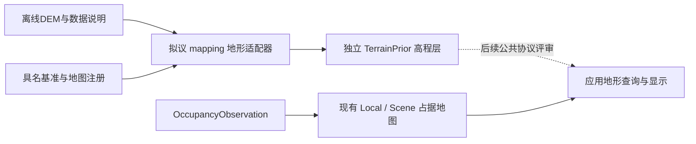

# M5-DESIGN-01：TerrainPrior/DEM准入与兼容方案

版本：设计v0.1；日期：2026-10-28；主责任：mapping_engineer。
状态：已完成（设计与既有边界审查）；M5实现、公共协议扩展和DEM融合均未实施。
后续进展：用户继续授权后[M5-SW-01私有合同/输入预期](M5_SW01_CONTRACT_20261028.md)已实现；
后续[SW-02独立地形候选/私有回放](M5_SW02_TERRAIN_CANDIDATE_20261028.md)也已实现，
[SW-03时序/资源/失败恢复组合](M5_SW03_TIME_RESOURCES_20261028.md)也已通过，私有离线软件子范围关闭；
公共协议与融合仍未实施。下文“本轮”事实保留DESIGN-01时点。
依据：[当前状态](../PROJECT_STATUS.md)、[阶段推进](STAGE_ADVANCE_PLAN_20261027.md)、
[DATA_FORMAT §10](DATA_FORMAT.md#10-terrainprior后期接口预留)。

## 1. 源码事实与本轮边界

| 审计项 | 真实证据 | 结论 |
| --- | --- | --- |
| A1 预留合同 | [DATA_FORMAT:451](DATA_FORMAT.md#10-terrainprior后期接口预留) | 只有terrain_id、基准、grid、no-data、时间和高度质量要求，未冻结详细编码 |
| A2 真实选型 | [factory.py:5](../mapping/ufm_mapping/factory.py#L5) | 仅latest、m2_fixture、m3_fixture、m4_fixture；m5_fixture仍明确拒绝 |
| A3 ROS生产消费 | [perf01a_map_node.py:139](../ros_ws/src/uav_fusionmap_mapping/scripts/perf01a_map_node.py#L139) | 业务输入只有OccupancyObservation；没有TerrainPrior订阅/装载入口 |
| A4 已有注册 | [m4_contract.py:61](../mapping/ufm_mapping/m4_contract.py#L61) | M4只支持具名fixture非零整格平移，不能充当地理参考或高程基准转换 |
| A5 Scene估计 | [scene_map.py:87](../mapping/ufm_mapping/scene_map.py#L87)、[同文件:97](../mapping/ufm_mapping/scene_map.py#L97) | cell要求observed和M3概率区间；update只接占据；没有地形层 |
| A6 公共承载 | [MapCell](../ros_ws/src/uav_fusionmap_msgs/msg/MapCell.msg)、[MapQueryResult](../ros_ws/src/uav_fusionmap_msgs/msg/MapQueryResult.msg)、[CMakeLists](../ros_ws/src/uav_fusionmap_msgs/CMakeLists.txt) | 没有地形消息、height、terrain_id或逐cell证据角色字段 |
| A7 编码与来源 | [query_codec.py:16](../ros_ws/src/uav_fusionmap_msgs/src/ufm_ros_contract/query_codec.py#L16)、[codec.py:7](../ros_ws/src/uav_fusionmap_msgs/src/ufm_ros_contract/codec.py#L7) | 查询只有占据五状态；header来源枚举也没有DEM类型，不能只添加一个字符串就接入 |
| A8 应用消费 | [query_client.py:79](../application/ufm_application/query_client.py#L79) | occupied/free须observed、概率、原观测时间；通用Uncertainty可承载数值不等于高度语义兼容 |
| A9 显示 | [visualization.py:16](../application/ufm_application/visualization.py#L16) | 只读占据快照/时间/来源，不能把二维高程列改名为占据体素 |
| A10 回放 | [replay.py:28](../mapping/ufm_mapping/replay.py#L28) | 只回放公开占据及对应查询，没有地形版本/注册/安装事件序列 |

本轮不改业务代码、ROS消息、默认参数、地图候选或可视化，不下载DEM/基准网格、不安装GIS依赖。
已有M4合成软件交接不等于真实地理注册完成；既有649项回归属于上一任务基线。
真实设备、研究模型质量、正式M1—M4/Phase 4、PERF-01门槛继续保留。

## 2. 接入方式与职责

选择**独立地形先验层**作为未来首个软件子范围：保存高度及其来源/质量，不生成占据观测。
没有高度→概率模型、证据角色及联合查询协议之前，不把地表以下标occupied，也不把地表以上标free。
DEM是2.5D表面，不能表示建筑内部、桥下空洞、树冠下空间或动态障碍；必须区分DTM、DSM和未知产品类型。
产品类型未知可登记元数据，不能成为可用地面高度。



图中地形链均为拟议设计；目前没有新增节点/模块/消息。后续职责：

| 主体 | 生产/消费及边界 |
| --- | --- |
| 外部数据提供方/实验配置 | 提供DEM、来源/许可、采集/版本说明、水平/垂直CRS、no-data和质量证据；不向在线传感器伪装输入 |
| mapping拟议适配器 | 只读指定小型数据集，校验元数据、单位、掩码、采样位置、注册和时效，输出独立地形版本 |
| 定位权威/配置责任方 | 提供地理锚点、map注册方向、适用run/clock/时段与质量；M5不反向订阅最新Odometry或AircraftState |
| mapping占据实现 | 首版保持原样；不能消费地形为逆观测证据，不能让地形安装/失效刷新占据revision或证据时间 |
| application | 后续只从公开mapping地形接口取得结果，不读DEM私有文件、原始传感器或地形缓存 |
| ros_ws | 仅在单独协议获确认后承载可选地形消息/服务；现有消息原样保留 |

LiDAR及target/observed_mask保持训练监督专用，不是地形接入的数据来源或注册捷径。

## 3. 拟议私有离线合同

以下是供M5-SW-01评审的**mapping内部离线记录**，不是已存在或已冻结的公共TerrainPrior消息。
首版仅小型同轴合成米制格网、固定具名平移、直接样本中心查询；不读取真实GeoTIFF或执行地理重投影。

| 字段组 | 拟议最小语义 |
| --- | --- |
| 身份 | schema_version、terrain_id、dataset_version、tile_id、product_kind、source_kind、source_ref；合成来源必须fixture |
| 原数据时间 | acquisition_time及其精度/是否未知、publication_time、dataset_epoch；不能用文件mtime或加载时间代替地形采集时间 |
| 水平基准 | source_crs的authority/WKT或具名fixture frame、axis_order、horizontal_unit；禁止把“WGS84”简称当作完整三维合同 |
| 垂直基准 | height_type、vertical_crs、height_unit、转换operation及依赖网格版本/本地可用性；local fixture必须声明高度零点 |
| 栅格 | rows、columns、row-major heights、6参数affine、sample_anchor、空间覆盖；数组下标为[row,column]，不是XYZ体素索引 |
| 缺失域 | no_data_mask为布尔数组，true表示无数据；高度槽为null，false对应有限数值；shape与高度/掩码严格一致 |
| 高度质量 | status、kind、value、unit、source、适用域；首版只支持具名样本高度界height_interval/m或unavailable，不接概率区间 |
| 注册 | registration_id、source_frame、target_frame=map、方向、固定变换、run_id、clock_id、valid_from_ns/valid_until_ns及注册质量 |
| 运行有效期 | eligibility_policy及显式run时钟区间；它表示本次运行允许使用的时段，不是原始DEM采集时间的跨钟映射 |
| 有界策略 | max_tiles、max_samples_per_tile、max_total_samples、max_input_bytes、max_receipt_events；超限拒绝，不先全量加载再检查 |

来源kind是私有合同字段，不修改ObservationHeader来源枚举。terrain_revision独立于occupancy revision。
同一版本相同身份/内容重放幂等；同一身份不同内容拒绝；替换必须使用新版本并整版校验。
不新增无用途Hash。首个不可变小数据集用保存的精确载荷与版本对账；未来远端数据完整性有实际消费者时另评审。

## 4. 水平/垂直基准和采样

### 4.1 源像素与地图格点

GDAL仿射的原点是像素角点；像素中心应在(c+0.5,r+0.5)求值。north-up栅格行方向通常使GT5为负，
不能把行号直接解释成地图y正向。公式及约定依据[GDAL官方说明](https://gdal.org/en/stable/tutorials/geotransforms_tut.html)：

```text
X = GT0 + (c + 0.5)*GT1 + (r + 0.5)*GT2
Y = GT3 + (c + 0.5)*GT4 + (r + 0.5)*GT5
```

实际源产品的point/area含义仍须记录，不能为了与地图对齐重复加半像素。
首版只接受声明的fixture中心样本，明确拒绝旋转/剪切、不同格距或需要插值的位置。
后续真实适配才选择重采样规则；不能在no-data洞、tile边缘或缺失邻域插值补全。
nearest或bilinear均不等于保守高度界；水平误差、坡度、亚像元地形起伏没有界时，重采样高度质量不可用。

M4的T_map_odom只解决已有局部格点注册。真实DEM需要另一条完整链：源水平/垂直CRS→
目标地理三维坐标→具名地理锚点/局部ENU→map。EPSG轴序、角度/米制单位、历元和覆盖域逐项明确。
PROJ使用authority CRS时轴序按其定义，不能默认总是longitude/latitude；见
[PROJ官方坐标操作接口](https://proj.org/en/stable/development/reference/functions.html)。

### 4.2 高度零点与失败条件

正高H、椭球高h和大地水准面高N的关系为h=H+N，不能把正高直接减椭球高原点；
公式依据[NOAA NGS](https://www.ngs.noaa.gov/GEOID/PRESENTATIONS/2004_04_19_ACSM_files/slide0025.htm)。
这不是可直接套用的任意CRS转换器：具体基准、模型、区域、operation方向和历元仍须明确。
真实局部ENU须走完整三维转换，不把大范围曲面上的h-h0当成精确局部z。

缺垂直基准、缺必须的校正网格、超适用区域、缺地理锚点或map注册时，必须unavailable。
不能使用零校正、默认单位阵、近似ballpark操作或以可选网格跳过关键校正；
[PROJ vgridshift](https://proj.org/en/stable/operations/transformations/vgridshift.html)规定@前缀网格可省略，
而正向偏移默认乘数为-1，不能把本节h=H+N直接替换成未经确认的PROJ命令方向。
后续需先核实本机库版本支持的严格操作选取选项，再锁定operation及网格；本轮不安装或运行PROJ。

## 5. no-data、时间、质量和冲突

| 条件 | 独立地形查询的拟议结果 | 对占据地图的影响 |
| --- | --- | --- |
| 关闭/没有已准入版本 | unavailable/terrain_disabled或terrain_unavailable | 原结果保持，不能声称地形已融合 |
| 基准/注册缺失或注册到期、错run/clock或时钟回退 | unavailable，height/quality无有效载荷；回退须新run | 不改占据身份、水位、证据时间 |
| 查询早于安装/适用开始 | unavailable/query_before_terrain_activation | 不用未来版本回答历史请求 |
| 地形eligibility到达valid_until或数据政策到期，但注册仍有效 | stale；只可显式保留历史高度、原版本和原时段 | 不刷新sensor时间，不把重新加载当新证据 |
| 覆盖外或no_data_mask=true | unknown，height=null；reason区分outside/no_data | 不构造occupied/free |
| 有效0m/负高度 | 返回对应有限高度，掩码仍false | 不是缺失或自动free |
| 有效高度但质量证据缺失 | 高度可作未校准显示，quality=unavailable，不能用于保守约束 | 不借用M3概率质量，不修复传感器缺失质量 |
| 显式有效中心样本、完整高度界和注册 | valid高度与独立质量/版本 | 仍不增加占据观测 |
| 同身份冲突、坏shape/NaN/超限 | 拒绝新候选，保留旧版，另报安装错误 | 不改变两层已提交状态 |
| 地形与传感器结果相矛盾 | 分别保留，记录冲突供后续研究；不静默平均 | 不覆盖传感器占据或清空未知域 |

上述valid/unknown/stale/unavailable是拟议地形结果状态，不占用现有MapQueryResult枚举。
校验先处理开关/请求身份，再处理基准和注册，再处理安装/运行时段，最后处理覆盖、掩码、数值和质量；
注册失效优先返回unavailable，不能以“历史地形”名义给当前错误坐标请求返回高度。
所有有效区间统一左闭右开[start,end)，到期边界与现有传感器max_age语义分别记录。
采集UTC/历元与sim:run时钟是两个事实：只有经明确审批的eligibility政策可为本次run授权使用；
未提供真实资料时只允许fixture，不能伪造“DEM现在采集”或宣称时钟已映射。

height_interval用m，variance若未来引入则用m²；RMSE、标准差、置信水平与确定性误差界不能互换。
首版只对显式区间做保守区间运算，不假设独立性；已知H∈[a,b]、N∈[c,d]、h0∈[e,f]时，
合成同轴fixture的z范围为[a+c-f,b+d-e]。任一必需项未知，完整注册高度界不可用。
真实水平配准误差需要坡度/地形起伏和变换误差传播依据，不能直接加到m²方差或只乘分辨率蒙混。
Uncertainty虽有通用字符串槽，也不得把高度界装入占据cell、把M3概率区间改成高度质量。

## 6. 生命周期、资源与恢复

未来私有实现采用“验证候选→生成完整新地形版本→一次提交”的顺序，安装与查询串行化或持有不可变版本。
一次查询固定同一terrain_revision/registration_id，不能拼接新旧tile或注册。首版一个小数据集整体替换，
不实现在线tile流、重叠拼接、热修改注册或地形与占据联合累计。
重复安装、读取、截图、封存和重新发布均不改变采集时间/有效期；到期旧版不能因新候选失败而重获有效性。

limit含已提交+暂存候选、解码数组、掩码、输出拷贝及版本去重记录；按输入字节与逻辑样本分别核对。
回放事件也有限额，超限明确失败，不悄悄遗忘去重身份；对象计数不声称RSS、GPU或正式性能。
首版拟议fixture上限为1个tile、rows/columns各≤4、合计≤16样本、输入≤16KiB、收据≤64事件；
同时存在的旧版/候选、解码和结果必须另计，不能用16样本冒充峰值或字节数。SW-01明确冻结配置，
SW-03再核对实际实现的临时副本；这不是机载资源预算。

恢复：地形开关关闭后显式unavailable，保留原始占据地图；新候选失败继续使用仍在有效期内的旧版，
报告候选安装失败，不能静默忽略错误。没有旧版时保持unavailable，不fallback到Gazebo地面、DEM=0或placeholder地形。
更换map注册、run/clock、地理锚点或源产品类型要求新实例/运行；旧缓存不得自动迁移。
原始DEM/历史收据只读保留，回退代码不回写、修补或删除旧数据。

## 7. 公共接口迁移闸门

首个软件子范围完全离线私有合同，不新增ROS消息、话题/服务，不让application读取私有地形文件。
现有SensorBundle、OccupancyObservation、MapSnapshot、MapQuery及Uncertainty字段原样保持。
不能将DEM的高度/采集时间塞进probability/last_observed_timestamp，也不能用reason或source_types拼接JSON冒充结构化协议。

若需要ROS/RViz地形显示或应用地形查询，以下是**待单独确认的候选**：新增可选、独立版本的地形查询/快照协议，
保留terrain_id/version、terrain_revision、registration_id、height、height_quality、采集时间与运行有效期、状态和证据角色。
生产者为mapping地形层，消费者为application地形客户端/只读显示，ros_ws只承载；不替换旧MapQuery或复用其status。
迁移时并行运行旧占据接口，缺失新服务的旧客户端不受影响，新客户端明确地形unavailable；
先做消息往返与新旧组合矩阵，默认关闭，回退只停止新服务并恢复新实例，不改旧消息MD5。
字段/命名、生成依赖、消费者列表、兼容时间和恢复验收须形成独立方案，经确认后才生成消息/节点。

后续M5-IFACE-DESIGN-01已形成[4消息/1服务与公共记录具体方案](M5_IFACE_DESIGN_20261028.md)，
生产消费、字段/空值、实例/revision/时钟、并行兼容与恢复、16组未来验收均已列明；
仍是设计交付，实际类型生成及ROS/应用接入须确认后分步实施。

若未来要“DEM辅助占据融合”，还需逐cell区分prior与measurement、两个时间域、贡献版本/撤销、
相关证据去重和冲突政策；当前单一probability/observed/观测时间无法无损表达，本设计不批准融合。
真实占据回放也不能承担地形事件回放，必须另记install/replace/reject/expire/disable及地形版本的独立收据。

## 8. 独立合成预期与分步验收

下表为冻结前的具体验收预期，非已运行M5结果。独立oracle先于候选实现保存，禁止候选源码反算预期。

| 编号 | 输入/操作 | 独立预期 |
| --- | --- | --- |
| T1 像素中心 | GT=[100,2,0,200,0,-2]，c=r=0；同轴注册平移[10,-20,3] | 源中心[101,199]，map样本[111,179,height+3]，不是角点[100,200] |
| T2 行方向 | 同GT，r=1,c=0 | 中心[101,197]，行增加使y减小 |
| T3 有效零高 | mask=false,height=0 | 返回0及原质量，不是unknown/free |
| T4 no-data | mask=true,height=null；改为mask=false,height=NaN | 前者unknown；后者拒绝候选，旧版不变 |
| T5 正向基准 | fixture H=100,N=20,h0=95 | h=120,z=25；不是H-h0=5 |
| T6 负N与质量 | H=100,N=-20,h0=95；H∈[99,101],N∈[19,21],h0∈[94,96] | 首个z=-15；第二组z∈[22,28]m，名义值25 |
| T7 缺基准/网格 | 省vertical_crs、必须网格缺失、operation区域外 | unavailable，不以N=0或ballpark成功 |
| T8 时段边界 | eligibility=[100,200)，registration=[0,300)，在100/199/200查询 | 前两者可用，200为stale；99为unavailable，300因注册到期为unavailable |
| T9 源时钟 | 原数据UTC时间+sim:run，无eligible政策 | 不跨钟相减，不得启用；fixture必须显式fixture政策 |
| T10 域/注册 | 错run/clock、odom点冒充map、run回退、注册替换 | 拒绝/不可用，新run重建，不重标旧地形 |
| T11 重放/冲突 | 原样同版本、同身份异内容、新版本坏tile | 依次幂等、拒绝、拒绝；已提交版本/占据不变 |
| T12 超限/事务 | 输入/样本/候选峰值限额，提交前故障 | 拒绝且无半版提交，不越界分配，不重置去重身份蒙混 |
| T13 观测隔离 | 安装/过期/移除地形，传感器断流、unknown或free | 原占据快照、revision、时间/质量逐值不变；地形不能修复失效 |
| T14 产品/采样 | 未知产品、DSM冒充DTM、需要插值、旋转或不同格距 | 明确不支持/不可用，不自动当裸地或补全洞 |
| T15 质量缺失 | 高度有效，注册/源/重采样高度界缺失 | 完整height_quality unavailable，不借用occupancy_interval或填0误差 |
| T16 旧入口 | 默认latest/M2/M3/M4、旧CLI/消息/回放/应用/RViz | 不加载地形依赖或DEM文件，旧行为保持 |

| 工作包 | 拟交付及验收门槛 | 本轮状态 |
| --- | --- | --- |
| M5-DESIGN-01 | 本方案、真实链证据、数字算例、生产消费/兼容恢复评审 | 已完成设计；不是DEM验收 |
| M5-SW-01 | 私有fixture合同/输入校验器，保存T1—T16输入及独立预期；候选行为留待SW-02/03，不执行候选或ROS | 后续已完成，见[合同](M5_SW01_CONTRACT_20261028.md)及[记录](../experiments/2026-10-28-m5-fixture-contract.md) |
| M5-SW-02 | 独立纯Python地形层/中心采样/原子版本与私有回放，对保存oracle一致；占据逐值不变 | 后续已完成，见[候选说明](M5_SW02_TERRAIN_CANDIDATE_20261028.md)与[记录](../experiments/2026-10-28-m5-terrain-candidate.md) |
| M5-SW-03 | 时序/到期/去重/资源/失败恢复组合及旧入口回归，明确逻辑上界与RSS区别 | 后续已完成，见[说明](M5_SW03_TIME_RESOURCES_20261028.md)和[记录](../experiments/2026-10-28-m5-time-resources.md)；非RSS/实际ROS或真实DEM验收 |
| 公共协议评审 | 真正需要ROS/应用地形交接时先交迁移方案并确认，再安排消息/客户端/可视化 | 具体设计后续已交付，见[M5-IFACE-DESIGN-01](M5_IFACE_DESIGN_20261028.md)；实际类型/运行实施待确认 |
| 真实DEM准入 | 实际区域/产品、完整CRS/垂直模型、锚点/注册/时间政策及独立控制点、质量与依赖证据 | 阻塞，输入尚无 |
| DEM占据辅助融合 | 独立高度→占据模型、分源协议、质量/对照及正式地图门槛 | 未开展，不属于本批软件范围 |

推进的是总体阶段顺序中的设计，不恢复暂缓的研究模型质量任务，也不反复拿已有fake联调替代真实证据。
本轮设计检查和已执行验证详见[EXP-20261028-007](../experiments/2026-10-28-m5-design-review.md)。
