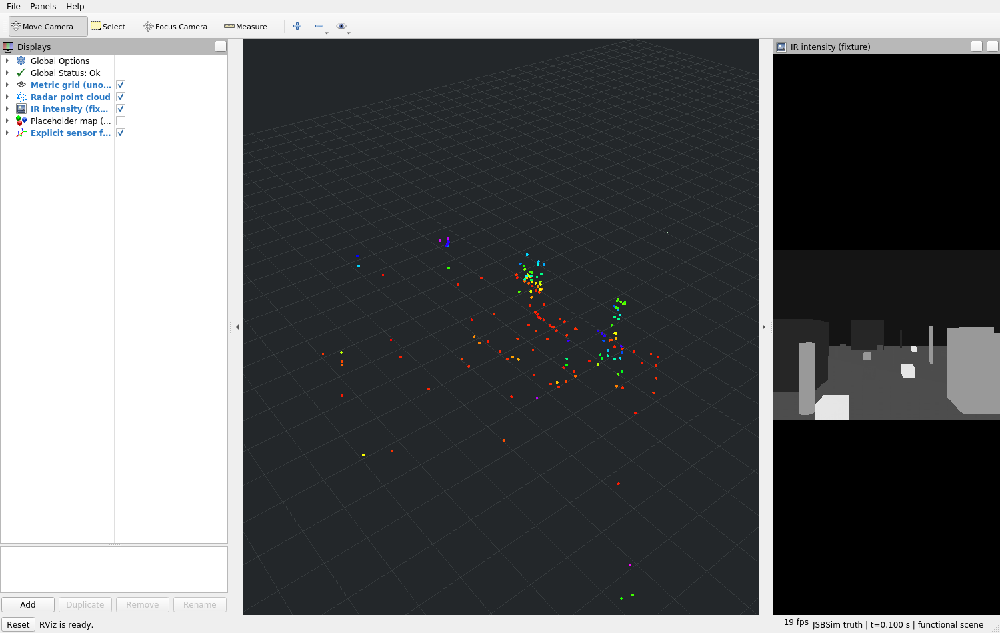
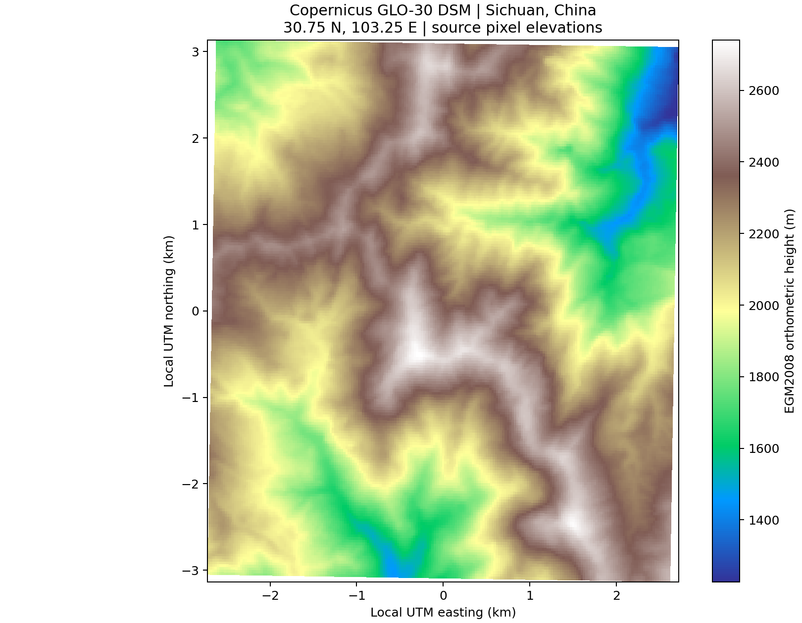
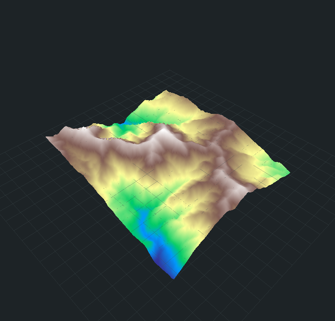
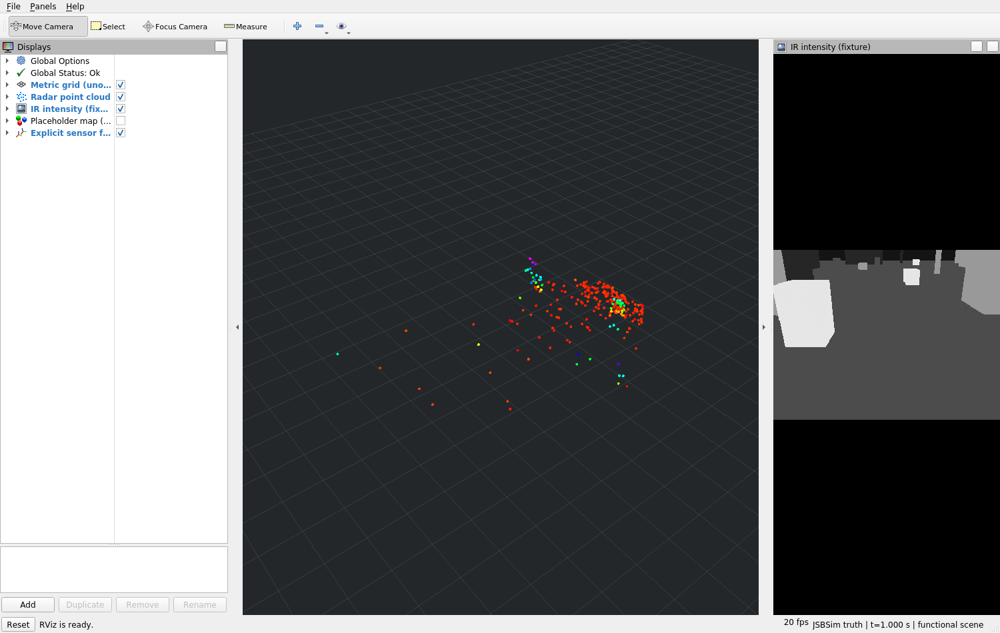
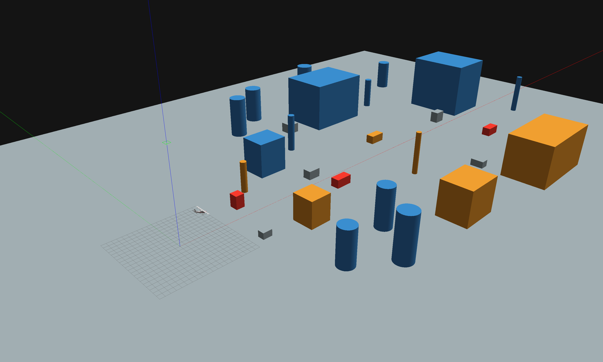
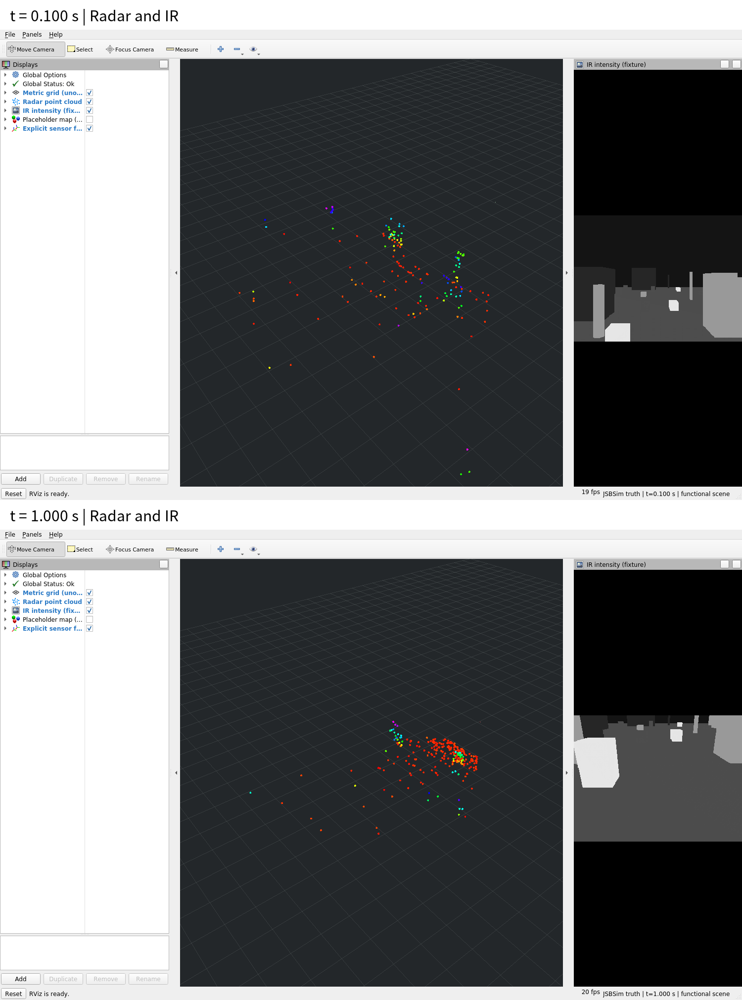
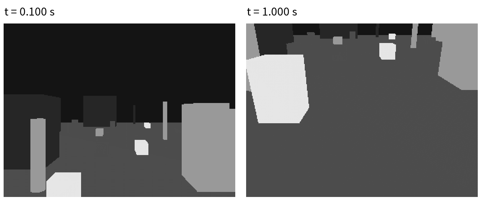

# 贴地飞行进度汇报——2026年10月30日

## 1 基于机载传感器融合的障碍物地图构建与场景地图更新

### 1.1 当前进展

#### 1.1.1 总体进展

在上一阶段总体架构设计和多传感器仿真方案的基础上，本阶段围绕固定翼无人机的仿真状态、Radar与热红外数据生成、三维占据表达和局部场景地图更新，开展了各模块的软件实现与系统联调。项目已建立从仿真环境、传感器观测到地图查询和可视化的工程链路，形成了能够运行、观察和回放的感知地图验证平台。

与上次报告主要介绍技术路线和模块设计相比，本阶段工作的重点转向系统实现。已完成典型三维障碍物场景、Radar和热红外仿真、传感器时间与坐标适配、感知工程入口、局部占据地图、合成观测下的概率更新与区间质量传播，以及场景子地图和独立地形高程层的软件实现。进一步完成了Radar参数化观测和真实公开高程的小区域接入测试。

在此基础上，进一步完成了JSBSim运动状态驱动的场景与传感器联动，使飞机位姿变化能够传递到Radar点云、红外图像和占据地图。同步建立了原生Gazebo场景查看与RViz数据显示环境，可以直接观察障碍物、传感器视场及地图更新结果。

| 工作方向 | 本阶段完成内容 |
| --- | --- |
| 仿真与状态 | 统一状态和时间输出，完成运动场景联动及10秒无控制初始化准备 |
| 环境与传感器 | 建立分散障碍物场景，实现稀疏Radar点云、测量误差与热红外图像生成 |
| 感知与地图 | 接通占位感知链路，完成局部地图及概率、质量、子地图软件验证 |
| 地形与应用 | 完成合成地形接口、真实高程读取与查询测试，以及地图回放和原生可视化 |

目前，工作已由总体方案设计推进到分模块实现和仿真数据链路联调，为下一阶段连续运行、飞行联动和复杂场景验证提供了基础。

<!-- pagebreak -->

#### 1.1.2 飞行状态与仿真基础

飞行状态与仿真基础承担无人机位置、姿态、速度和时间信息的统一输出。本阶段完善了PX4、JSBSim与ROS之间的状态交接，使传感器数据生成、坐标转换和地图更新能够使用明确的状态来源与仿真时间。

在仿真组织方式上，采用单一动力学来源驱动无人机运动，由JSBSim计算运动状态，场景显示与传感器采样跟随同一状态推进。Gazebo主要负责环境呈现和几何观测，减少不同仿真模块各自推进时间所造成的状态差异。

围绕飞控初始化准备，已完成一次10秒的无控制仿真运行，累计完成2500个动力学步进，并完成98项状态与初始化观测。运行中检查了传感器输入、估计状态、姿态输出及执行器输出链，完成了该工况下初始化准备状态的确认。

| 对象 | 已完成工作 |
| --- | --- |
| 动力学状态 | 统一位置、姿态、速度及源时间，支撑场景和传感器同步推进 |
| 仿真时钟 | 建立与动力学步进一致的时间传递，支持数据时序检查 |
| 初始化准备 | 完成10秒连续准备过程，检查输入稳定、初始化状态和输出链 |
| 状态表达 | 统一运行身份、状态有效性及时间信息，支持停止和重新运行 |

上述工作使仿真平台具备了更完整的启动准备和状态检查流程。后续将在这一基础上延长连续运行窗口，逐步衔接场景采样、感知地图更新与飞行控制联调。

<!-- pagebreak -->

#### 1.1.3 三维环境模型与典型障碍物场景

针对上一阶段提出的参数化环境建模方案，本阶段已建立可直接运行的三维障碍物场景。场景扩展为180×140米的场地，布置30个分散的建筑、柱体、车辆及岩石几何代理，并为不同目标配置热强度属性，用于同时生成Radar几何观测和红外投影。飞机外观尺度同步调整，使环境与机体之间的比例更便于观察。

场景中的可见模型与传感器采样使用一致的几何描述。这样既可以在Gazebo中观察目标位置和遮挡关系，也可以在传感器输出中检查相应的点云和图像变化，建立环境、观测与地图之间直观的对应关系。

图1 扩展后的障碍物场景。近、中、远距离目标分区布置，保留开阔空间和不同尺度的遮挡关系。

当前场景已支持目标位置变化、近远遮挡和视场变化等工况。通过调整目标布置，可以检查目标移入、移出以及重新出现时传感器与地图的响应，为复杂环境下的局部场景更新提供可重复的验证条件。

<!-- pagebreak -->

#### 1.1.4 Radar与热红外仿真

本阶段完成了Radar和热红外仿真模块，使上一阶段的传感器设计形成了实际数据输出。Radar以场景几何和传感器位姿为输入，生成带有空间位置、径向速度、强度和时间信息的点云；热红外模块依据同一场景的目标热强度属性与相机投影关系生成二维图像。

在几何观测基础上，Radar已加入随距离变化的检测概率、随机漏检，以及距离、角度和Doppler测量误差。本次运动场景每帧输出161～256个回波，形成疏密变化的目标观测。热红外图像呈现不同热属性目标的轮廓、遮挡和投影变化，两类数据通过统一接口送入后续适配模块。

图2 RViz中的稀疏Radar点云和同场景热强度图像，点云单独显示以便观察采样分布。

在场景联调中，已观察到障碍物位置变化同时引起Radar回波和红外像素变化。两类传感器由此形成共同场景下的同步观测，为后续Radar–IR融合算法接入提供了可控的输入条件。

<!-- pagebreak -->

#### 1.1.5 传感器数据适配与时间、坐标统一

Radar、热红外和无人机状态在数据结构、采样时间与坐标表达上具有差异。本阶段完成了传感器数据适配链路，将原始点云、图像、位姿和标定信息组织为统一的感知输入，减少感知模块对具体仿真节点和设备形式的依赖。

在时间处理方面，适配模块保留各传感器的采样时间，检查Radar、红外图像和位姿之间的对应关系。运动场景使用观测时刻的飞机状态进行处理，使点云与图像能够对应同一次场景采样，并将该时刻的空间信息传递给地图模块。

在坐标处理方面，统一表达Radar、相机、机体和地图坐标之间的转换关系，保留传感器安装外参及变换方向。动态坐标变换由统一状态适配环节发布，场景显示、数据适配和地图使用同一套空间关系。

| 数据内容 | 适配后的主要信息 |
| --- | --- |
| Radar观测 | 点坐标、Doppler、强度、采样时间与有效性 |
| 热红外观测 | 图像、采样时间、相机参数与有效性 |
| 无人机状态 | 位置、姿态、速度、状态来源与运行身份 |
| 空间与时间关系 | 标定引用、坐标变换、时间对应及质量信息 |

同时，系统已分开组织在线感知和训练数据生成。在线链路以Radar与IR为传感器输入；训练生成模式独立保存LiDAR监督、占据标签及观测区域信息。两种配置形成明确的数据边界，便于后续分别开展工程联调与模型训练工作。

通过上述适配，感知和地图模块可以围绕统一的数据表达开展开发，后续替换传感器来源时能够延续现有的输入输出关系。

<!-- pagebreak -->

#### 1.1.6 融合感知工程入口与占据表达

在已有Radar–IR融合研究基础上，本阶段重点完成了感知模块的工程入口与输出规范。感知输入统一包含Radar、热红外、观测时刻位姿和标定信息；输出采用三维占据观测表达，将空间位置、占据概率、观测状态、质量及时间信息交接给地图模块。

为支持系统分模块推进，已经建立占位感知运行方式，用于验证传感器到地图的数据传递。场景观测经过感知入口形成占据结果，再通过统一接口进入局部地图，使场景、传感器、感知和地图之间具备了可实际运行的连接。

感知运行同时具备关闭、占位和研究后端等模式的统一管理。各模式使用一致的业务接口，并明确输出可用性。当输入缺失、处理超时或算法不可用时，状态能够传递到后续地图与应用查询，系统可以据此区分当前观测和历史结果。

| 环节 | 工程作用 |
| --- | --- |
| 统一感知输入 | 组织Radar、IR、位姿、标定及时间信息 |
| 占据观测输出 | 交接体素、概率、观测区域和质量信息 |
| 占位运行模式 | 支持传感器、地图与应用接口独立联调 |
| 状态传递 | 反映忙碌、超时、不可用和恢复等运行状态 |

目前已完成感知工程入口、占位链路和状态传递的联调。Radar–IR融合模型后续可沿这一入口接入，继续使用既有占据输出与地图查询接口，从而将算法研究与系统工程联调连接起来。

<!-- pagebreak -->

#### 1.1.7 局部三维占据地图

地图构建方面，已完成基础局部三维占据地图与滚动更新机制。地图接收感知模块输出的占据观测，依据观测时刻的空间关系将体素转换到地图坐标，并维护局部范围内的占据状态、观测时间和质量信息。

局部地图采用面向当前工作区域的稀疏表达，支持随无人机位置变化调整保留范围。新的有效观测更新对应区域，窗口外数据按规则淘汰，应用端可以查询指定位置的地图状态。这样可以将传感器视角下的单帧观测转化为面向空间位置的地图表达。

在地图状态设计上，已经统一占据、自由、未知、过期和不可用等查询结果。对于已观测目标，地图保留相应占据信息；对于尚未形成有效证据的区域，保持未知状态；历史观测超过有效时间后，则以过期状态提供其时间信息。

| 地图能力 | 本阶段实现内容 |
| --- | --- |
| 空间组织 | 观测坐标转换、稀疏体素维护与局部范围管理 |
| 滚动更新 | 随观测位置变化调整窗口，保留与淘汰对应数据 |
| 时间管理 | 保存证据时间，区分当前数据与过期历史 |
| 位置查询 | 返回空间状态、概率、质量及观测时间 |
| 记录回放 | 使用公开占据记录重新执行地图更新 |

局部地图已与占位感知、应用查询及RViz显示接通。在运动场景中，新的传感器观测能够继续形成占据快照，使飞机运动、视场变化和地图更新之间建立了可观察的联系。

这一部分完成了基础地图的数据承载与更新流程，为后续多帧概率累计、质量传播和场景子地图维护提供了共同基础。

<!-- pagebreak -->

#### 1.1.8 概率地图与区间质量传播

在基础局部地图之上，本阶段使用合成观测完成了概率更新与区间质量传播的软件实现。概率地图将具有明确含义的多帧观测按时间顺序累计，支持占据证据、自由证据和相互冲突证据的更新，用于检查地图随连续输入变化的行为。

概率更新采用显式配置的先验、累计范围和分类阈值。连续同向证据会推动概率向相应状态变化，反向证据则使结果重新调整；重复输入和过时输入按身份与时间规则处理，保持累计过程的顺序性。

在质量表达方面，进一步实现了合成概率区间随多帧观测的传播。地图同时维护名义概率及其输入范围，并将质量信息带入快照、查询和回放，使应用端能够同时获取占据状态和相应的质量描述。

| 验证工况 | 已实现的地图响应 |
| --- | --- |
| 连续占据或自由证据 | 按给定模型累计概率并保持数值范围 |
| 相互冲突的观测 | 更新名义概率，按阈值返回相应状态 |
| 质量完整或缺失 | 保留对应区间或明确的质量可用状态 |
| 观测过期与窗口移动 | 同步处理时间状态、体素保留和质量信息 |
| 记录重新输入 | 重现对应概率与区间更新结果 |

概率地图与质量传播已完成固定网格、滚动窗口和ROS接口交接，应用查询能够读取相应结果。通过这一工作，地图表达由单次占据观测扩展为带有时序累计和质量信息的空间状态，为后续融合观测接入提供了更完整的软件基础。

<!-- pagebreak -->

#### 1.1.9 场景地图与子地图管理

为支持更大范围内的场景维护，本阶段完成了Scene Map的软件实现。场景地图在局部地图基础上组织多个子地图，并通过明确的坐标注册关系将局部观测放入统一场景表达，支持子地图目录、数据归属和生命周期管理。

在合成场景验证中，已实现局部数据向场景坐标的转换，检查不同子地图之间的空间对应关系，并完成子地图建立、更新、保留和淘汰流程。每个地图单元具有明确归属，使场景查询能够定位到相应的子地图数据。

随着观测推进，场景地图可以管理当前活动范围与历史子地图。对超出保留范围或满足淘汰条件的数据，按统一规则释放；在更新过程中，坐标注册与地图内容保持一致提交，使查询端能够读取完整的场景版本。

| 管理对象 | 已完成内容 |
| --- | --- |
| 子地图目录 | 建立子地图身份、归属和保留关系 |
| 空间注册 | 按给定地图与局部坐标关系组织观测 |
| 生命周期 | 支持活动更新、历史保留和有界淘汰 |
| 场景查询 | 输出地图位置对应的状态、时间与质量 |
| 重启与回放 | 区分运行身份，重现已保存观测的更新过程 |

场景地图已完成独立ROS运行与公开记录回放，应用端能够沿统一地图接口查询场景结果。概率、区间质量和时间信息也随场景组织继续传递，形成从局部体素更新到场景级维护的连续软件链路。

这一进展为后续更长距离运动和复杂环境下的地图组织提供了基础。后续将结合连续运动场景，进一步检查子地图切换与空间注册过程。

<!-- pagebreak -->

#### 1.1.10 地形高程层与查询接口

围绕上一阶段提出的DEM先验接入方向，本阶段完成了独立地形高程层的软件实现，并开展真实公开高程数据的读取、查询和显示测试。地形层保留高程基准、坐标、数据来源、有效时间与版本，支持按二维位置获取高度信息。

本次使用Copernicus GLO-30公开数字表面模型，选取四川东经103.25°、北纬30.75°附近约5×6公里的山地区域，读取201×201个原始高程样本。数据分辨率约30米，高程采用EGM2008基准，区域高度约为1226～2741米。

图3 Copernicus GLO-30真实高程分布。颜色对应EGM2008高程，横纵坐标为局部UTM距离。

已完成49个位置的查询核对，结果与原GeoTIFF对应像元高度逐值一致。真实高程由此形成了从公开数据、局部坐标转换到位置查询的独立测试链路。

<!-- pagebreak -->

#### 1.1.10 地形高程层与查询接口（续）

在真实高程读取基础上，已建立原生RViz连续地表显示。地形以高程样本构成三角网格，能够直接观察山脊、谷地和坡面的空间结构；平面色彩图与三维地表来自同一份裁剪数据。

图3b 同一地区的RViz三维地表。显示高度以1226.33米为局部零点，保持水平与垂直尺度一致。

| 数据与处理 | 本次结果 |
| --- | --- |
| 数据来源 | Copernicus DEM GLO-30 Public，四川山地区域 |
| 高程产品与基准 | DSM数字表面模型，EGM2008高程，单位米 |
| 地理坐标处理 | WGS84经纬度转换至UTM 48N及局部米制坐标 |
| 原始高程与查询 | 40,401个有效样本，49个位置与源数据逐值一致 |
| 展示方式 | 平面高程色彩图与原生RViz连续地表 |

此前合成地形已完成版本更新、质量表达、ROS查询与记录回放。后续将结合真实高程继续完善地形服务与空间注册，建立地形和障碍物地图之间的对应关系。

<!-- pagebreak -->

#### 1.1.11 原生场景与地图可视化

本阶段已建立Gazebo与RViz配合使用的原生可视化环境。Gazebo用于观察飞机、障碍物及其空间关系；RViz用于查看Radar点云、热红外图像、坐标变换和地图结果，使系统联调具有直接的观察入口。

地图工作台支持三维与俯视查看、图层选择、位置查询和公开记录回放。查看地图时可以读取对应状态、概率与时间信息，并区分当前观测和历史数据。独立地形显示则呈现高度、质量及有效时间状态。

图4 运动后的RViz观测。点云和红外图像来自同一采样时刻，地图沿公开占据接口同步更新。

目前已整理静态场景、运动场景以及障碍物移出和返回等工况的报告素材。通过这些视图，可以连续检查环境变化在传感器观测和地图中的表现，也能够为后续算法对比与场景分析提供统一展示方式。

<!-- pagebreak -->

#### 1.1.12 动力学驱动的运动场景联调

在静态场景与传感器链路完成后，本阶段进一步接通了JSBSim动力学状态驱动的运动场景。飞机位置与姿态随动力学计算变化，Gazebo中的飞机模型和传感器采样位姿跟随更新，观测结果继续进入感知与地图链路。

图5a 仿真时间0.1秒，飞机位于分散障碍物场景前方。

图5b 仿真时间1.0秒，同一次动力学运行中的飞机位置与姿态，传感器视场随之变化。

已完成1秒运动窗口内的端到端联调，产生10组Radar与IR配对观测，并形成对应占据输出、地图快照和位置查询结果。运动前后点云与红外图像随视角变化，公开观测回放能够重现相应地图更新，为进一步延长运行时间和接入飞行控制提供了基础。

<!-- pagebreak -->

#### 1.1.12 动力学驱动的运动场景联调（续）

同一次运行的RViz观测对比如图6所示。前后保持一致的显示视角与红外灰度范围，分别查看飞机运动前后的回波分布和目标投影。

图6 上图为0.1秒、下图为1.0秒的实际RViz窗口，与图5的两个场景时刻对应。Radar回波分布和IR目标投影随运动变化。

<!-- pagebreak -->

#### 1.1.13 多场景变化与系统运行验证

在运动链路基础上，本阶段完成了多场景组合验证，覆盖近远遮挡、目标移出、重新进入视场、空观测、数据过期以及异常停止和新运行恢复等情况。通过组合不同场景，检查了环境变化在传感器、感知、地图与应用查询之间的传递关系。

其中，障碍物移远与返回工况能够直接展示场景变化过程：目标移出探测范围后，Radar回波和IR目标投影相应消失；目标返回后，两类传感器重新形成观测，地图继续接收新的占据结果。

图7 本次运动场景的原始IR图像，左为0.1秒、右为1.0秒，使用相同灰度范围，可见目标投影随视角变化。

目前已完成9组核心场景和3组兼容工况的运动验证。同时，感知、地图、地形及应用接口完成了37组软件组合用例，检查了状态传递、时间有效性、版本更新和恢复行为，形成了覆盖单模块到组合链路的验证基础。

<!-- pagebreak -->

#### 1.1.14 记录回放与阶段工作归纳

为支持实验复现与场景分析，本阶段完善了公开观测、地图查询和地形数据的记录回放。运行过程中保存输入、时间和版本信息，回放时重新执行对应更新流程，并对地图与查询结果进行比较，使一次场景运行能够被重复检查。

记录回放已用于局部地图、概率地图、区间质量、场景地图和独立地形层。对于停止、超时、数据过期及重新启动等工况，系统保留相应状态，便于从数据变化与运行状态两个方面理解地图结果。

对照上次报告提出的阶段任务，本阶段形成了以下进展：

| 上一阶段工作方向 | 当前新增进展 |
| --- | --- |
| 环境与传感器模型设计 | 已完成分散障碍物场景、参数化稀疏Radar及IR输出 |
| 多传感器数据适配 | 已完成时间、坐标与状态组织，形成统一感知输入 |
| 感知和地图链路设计 | 已接通占位感知、局部占据、查询与回放 |
| 概率与场景地图 | 已完成合成观测下的累计、质量传播和子地图管理 |
| 地形先验接口 | 已完成合成高程接口及真实公开高程的读取、查询与显示 |
| 仿真平台联调 | 已完成短窗运动场景和10秒无控制初始化准备 |
| 结果展示 | 已形成Gazebo场景与RViz点云、IR、地图查看环境 |

总体上，项目已将上次报告中的主要软件模块设计转化为可运行的仿真数据链路，并完成基础地图、场景组织和原生可视化的衔接。下一阶段将围绕连续运行、飞行联动和地形接入继续推进，使现有模块在更完整的场景过程中协同工作。

<!-- pagebreak -->

### 1.2 下一阶段计划

（1）完善连续仿真与场景采样。以已完成的初始化准备和短窗运动链路为基础，先完善长窗口运行的数据交接与采样约定，再开展更长时间的场景采样与地图联调。重点检查持续运行中飞机状态、传感器观测和地图时间的一致性。

（2）完善飞控执行器与动力学响应验证。在已完成动力学驱动观测链路和初始化准备的基础上，核对执行器输出的周期与动力学响应，逐步开展非零控制输入、状态反馈和受控飞行场景的联调。

（3）扩展运动场景与地图更新。围绕障碍物遮挡、视场切换、目标出现与消失等典型工况，延长连续观测过程，进一步检查局部地图滚动、历史数据管理和场景子地图切换，完善复杂环境下的空间组织与更新流程。

（4）推进真实高程服务与空间注册。在已完成公开高程读取、查询和显示的基础上，完善真实高程服务接入、数据来源与质量表达，继续处理地形坐标与仿真场景的注册关系，逐步衔接障碍物地图。

（5）完善感知算法接入条件。继续维护Radar–IR统一输入、占据输出及质量表达，整理仿真场景与观测记录，为后续融合模型接入、数据适配和效果分析准备一致的接口与评价条件。

（6）持续完善系统运行与展示。将场景查看、传感器显示、地图查询和记录回放组织到一致的运行流程中，结合连续运行检查计算开销与数据规模，形成便于演示、分析和重复实验的工程平台。

下一阶段近期重点是连续仿真、场景采样和飞行联动，随后结合数据条件推进地形接入与融合感知。通过逐步扩展运行时间、场景范围和模块协同程度，继续完善面向贴地飞行的感知与地图构建系统。
