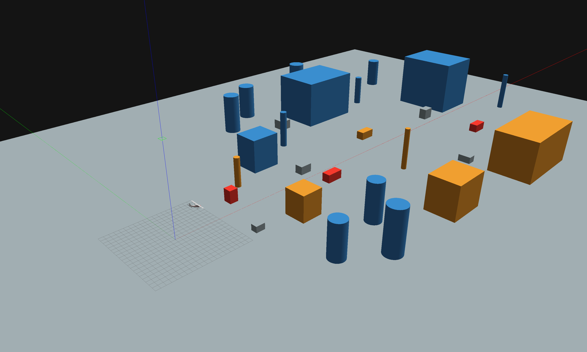
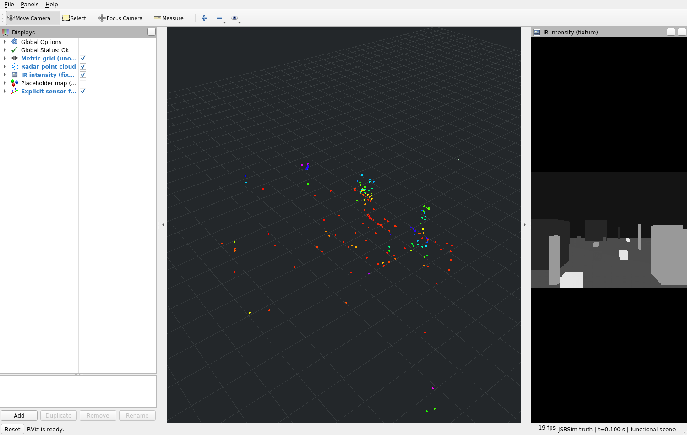
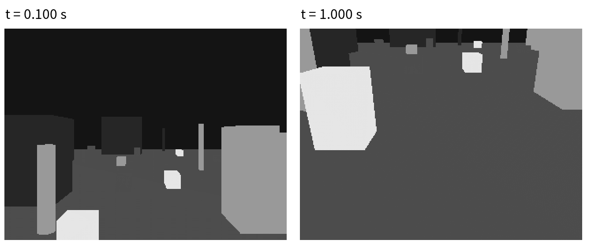
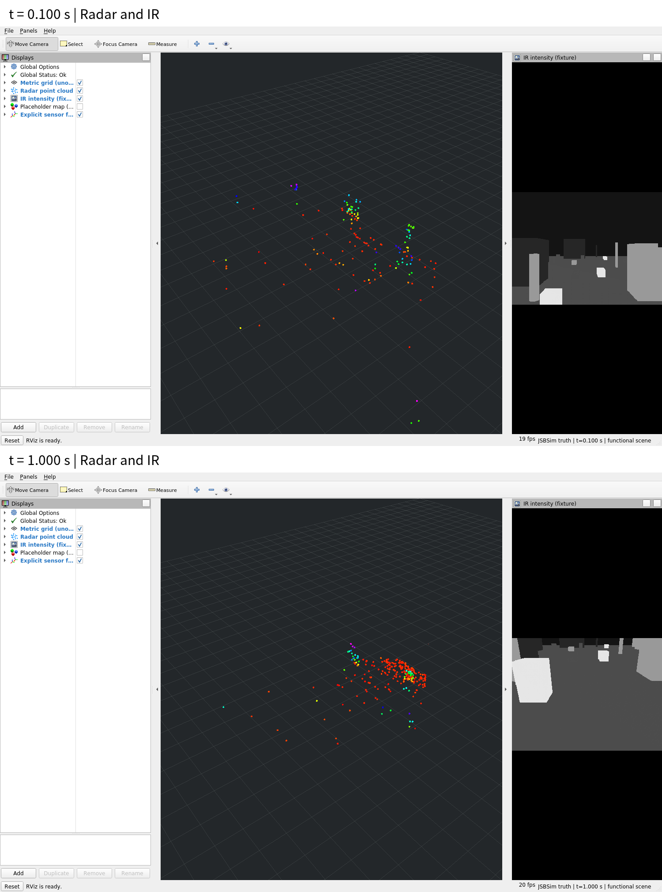
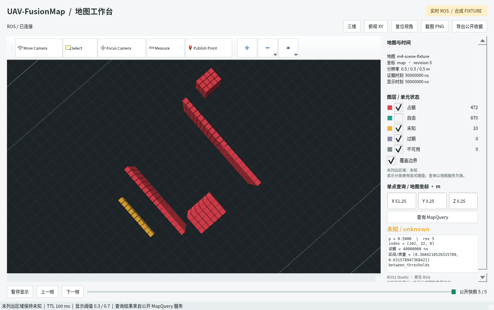
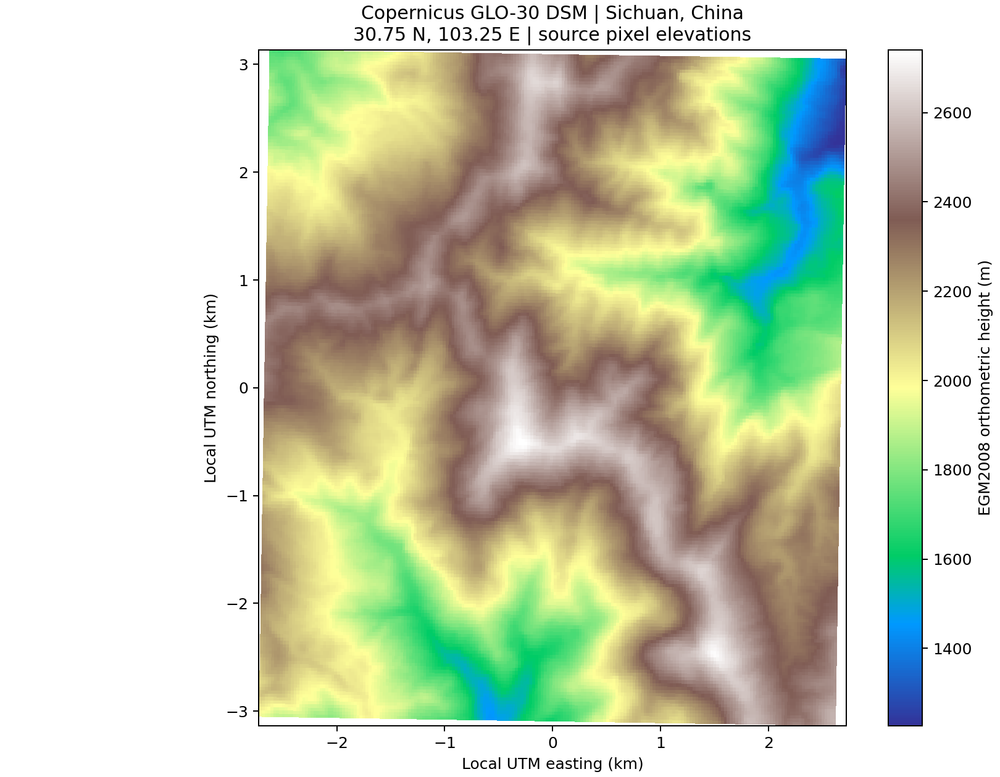
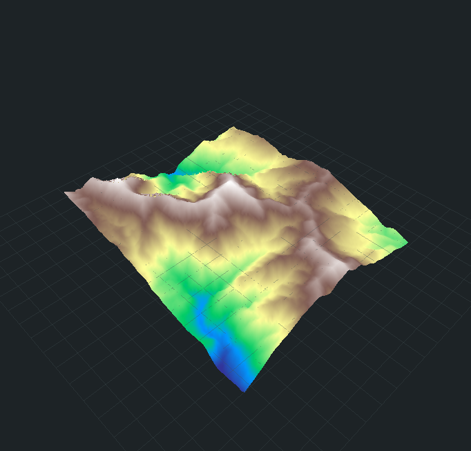
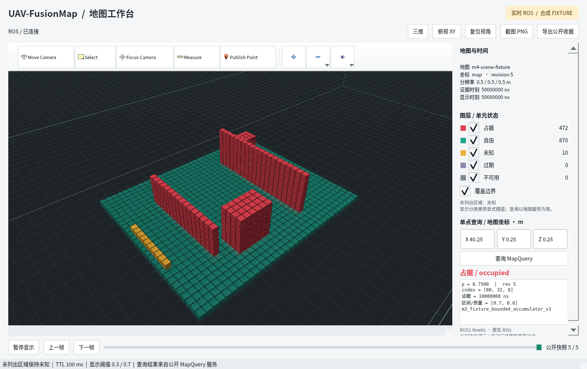

# 贴地飞行进度汇报——2026年10月30日

基于机载传感器融合的障碍物地图构建与场景地图更新

## 一、总体进展

本阶段围绕固定翼无人机的仿真状态、多传感器观测、三维占据表达和局部场景地图更新，完成了主要模块的软件实现与系统联调。在上一阶段总体架构和技术路线设计的基础上，已建立从无人机仿真、Radar与热红外数据生成，到占据地图更新、位置查询和原生可视化的运行链路。

工作按照“仿真与状态、环境与传感器、感知与地图、地形与应用”四个方向展开。仿真侧完成了统一状态和时间输出、动力学驱动的运动场景联动，以及飞控初始化准备；传感器侧建立了分散障碍物环境，实现带有稀疏采样和基础误差的Radar观测及同场景热红外图像；感知与地图侧接通了占位感知、局部占据、概率累计、区间质量和场景子地图的软件链路；地形与应用侧完成了独立地形接口、真实公开高程测试、地图查询、记录回放和RViz显示。

| 工作方向 | 本阶段主要进展 |
| --- | --- |
| 仿真与状态 | 统一位置、姿态、速度与仿真时间，完成动力学驱动观测链路和10秒初始化准备 |
| 环境与传感器 | 建立180×140米分散障碍物场景，实现参数化稀疏Radar和热红外图像生成 |
| 感知与地图 | 完成统一感知入口、占位链路及局部、概率、质量、场景地图的软件实现与联调 |
| 地形与应用 | 完成真实高程读取、查询核对和连续地表显示，形成地图查询与记录回放能力 |

目前，Gazebo能够呈现无人机与障碍物的空间关系，RViz能够查看同次观测的Radar点云、红外图像和地图结果。飞机运动、传感器视场变化、占据观测和地图更新之间已有实际运行数据对应；真实高程也完成了从公开GeoTIFF到局部坐标查询和三维地表显示的独立测试。

## 二、仿真与状态

仿真与状态部分完成了PX4、JSBSim和ROS之间的状态交接，统一输出无人机位置、姿态、速度及仿真时间。JSBSim负责动力学计算，PX4承担飞控状态与相关输出，ROS负责状态发布、数据传输和模块装配。场景显示与传感器采样使用同一运动状态，观测数据保留对应的时间和空间信息。

在运动场景中，无人机的位姿由单一JSBSim动力学过程产生，Gazebo中的飞机外观和传感器位姿随之更新。系统按照动力学步进推进场景，在采样时刻完成Radar与IR观测，再将同一时刻的状态传入后续感知和地图链路。这样可以在同一次运行中检查飞机运动、场景投影和地图更新的对应关系。

本阶段已完成1秒运动窗口内的端到端联调，产生10组Radar与IR配对观测，并形成对应的占据输出、地图快照及位置查询。该次动力学运行中，飞机在场景坐标内的位移约为6.40米，同时发生高度和姿态变化。图1、图2分别呈现0.1秒和1.0秒时的场景状态，后续传感器对照使用这两个采样时刻的数据。

图1 仿真时间0.1秒，飞机位于分散障碍物场景前方，场景与传感器使用该时刻位姿。

图2 仿真时间1.0秒，飞机位置与姿态随动力学计算变化，传感器视场同步更新。

运动数据的组织保留了状态来源、运行身份、坐标系和采样时间。系统可以区分仿真真值与PX4估计状态，并由统一状态适配环节发布动态坐标变换。地图更新使用随占据观测交接的观测时刻位姿，各层对同一帧数据的空间解释保持一致。

针对高速运动中时间误差引起的空间偏差，已完善仿真时钟与动力学步进的对应关系，检查状态、传感器及场景数据的时间顺序。运动观测采用同一采样时刻的位姿，Radar与IR配对后继续保留各自时间信息。暂停、停止和重新运行也有明确的状态表达，重新启动后的数据使用新的运行身份。

飞控启动准备方面，已完成一次10秒无控制仿真运行，共2500个动力学步进，并完成98项状态与初始化观测。检查内容包括传感器输入、估计状态、姿态输出和执行器输出链，确认了该工况下的输入稳定、初始化就绪及输出链状态。两次末段检查点均完成对应检查，形成了独立于短窗场景展示的初始化准备结果。

仿真运行同时完成了暂停、断连、超时、源停止和新运行恢复等工况检查。源停止后，传感器链路终止继续生成新的业务观测，地图查看切换为历史状态；原始记录保留最后的有效采样时间。正常运动运行、旧默认入口及各自进程清理均已完成实际核对。

## 三、环境与传感器

环境与传感器部分围绕共同三维场景组织Radar和热红外观测。场景中的可见模型与传感器采样使用一致的几何描述，目标位置、尺度和遮挡关系可以同时在Gazebo、点云和图像中观察。不同目标配置独立热强度属性，使同一场景能够产生具有结构对应关系的三维回波与二维红外投影。

当前演示场景为180×140米场地，布置了30个分散的几何目标，分别表达建筑、柱体、车辆和岩石等障碍物。目标分布在近、中、远不同距离，保留开阔区域和通行空间，并通过不同高度与横向位置构成遮挡关系。飞机外观尺度同步调整，场景中可以同时观察机体、附近目标和更远处环境的相对位置。

环境参数已经与传感器观测参数分别组织。场景负责目标几何、空间位置和热属性，传感器负责视场、量程、采样频率及测量误差。改变目标位置时，两类传感器重新采样当前环境；改变传感器参数时，使用同一场景检查观测范围和数据分布的变化。

Radar以目标几何和传感器位姿为输入，输出点坐标、径向速度、强度与采样时间。几何采样首先处理目标表面和遮挡关系，再通过距离相关的检测概率形成稀疏回波，并加入距离、方位、俯仰及Doppler测量误差。运动场景中的径向速度同时考虑传感器运动和安装位置的影响。

在本次参数化场景中，Radar探测量程设置为90米，每帧最多保留256个回波。实际10帧输出在161～256点之间，点云随目标距离、可见表面和随机漏检形成疏密变化。测量误差作用于实际传感器输出，后续感知与地图接收到的也是这一组带有误差的观测。

图3 仿真时间0.1秒的RViz窗口，左侧显示稀疏Radar点云，右侧显示同场景热强度图像。

热红外模块依据相机内外参、目标热强度属性和场景遮挡关系生成320×240图像。不同热属性目标呈现不同灰度，建筑轮廓、柱体、箱体和地面背景在图像中形成相应投影。图像与Radar使用共同的场景和采样时刻，便于核对目标在两类观测中的位置关系。

在运动前后对照中，红外图像使用相同的0～1强度范围映射灰度，保留目标投影变化。同次运行的两个时刻共有69,136个像素发生变化，近处目标的轮廓位置和可见区域随飞机位姿改变。图4直接展示原始IR数据的灰度结果。

图4 左为0.1秒、右为1.0秒的原始IR图像，前后采用一致灰度范围，目标投影随视角变化。

数据适配环节已将Radar、IR、无人机位姿和标定信息组织为统一感知输入。Radar保留Doppler方向、强度含义和采样时间，IR保留图像编码、相机参数和曝光时刻；配对结果附带传感器时间差及位姿对应信息。传感器安装外参明确区分Radar、相机光学轴与机体坐标，空间关系随同一帧观测向后传递。

在线感知和训练数据生成采用分开的配置。在线链路使用Radar与IR，训练生成模式独立保存LiDAR监督、占据标签和观测区域信息。当前场景联调沿在线链路运行，感知输入与地图更新使用Radar、IR及相应状态信息。

图5将同次动力学运行的两个RViz窗口放在一起，显示视角和红外灰度范围保持一致。上图对应图1的场景时刻，下图对应图2；可以同时观察回波分布、目标投影和视场覆盖的变化。

图5 上图为0.1秒，下图为1.0秒。Radar点云与IR图像分别来自对应时刻的实际采样。

参数化观测已采用固定随机种子和源采样时间组织随机过程，保持帧间变化与重复运行的对应关系。两次实际运行的10帧Radar和10帧IR原始消息逐字节一致；点云中的空间误差、Doppler变化、传感器安装关系和同帧位姿也完成了独立检查。

多场景验证覆盖近远遮挡、目标移出、重新进入视场及空观测等工况。目标移远后，Radar回波和IR目标投影随可见性改变；目标返回后，两类传感器重新形成观测。已完成9组核心场景和3组兼容工况的运动验证，并保留对应原始记录与原生窗口截图。

## 四、感知与地图

感知与地图部分完成了统一感知入口和占据输出，并接通局部地图、应用查询与记录回放。感知输入包括Radar、热红外、观测时刻位姿和标定信息，输出使用三维占据观测表达，交接空间位置、占据概率、观测状态、质量及时间信息。

当前工程联调采用占位感知方式，将场景观测经过统一入口形成占据结果，再送入地图模块。该链路已在静态和运动场景中运行，能够检查传感器数据适配、占据输出和地图更新的对应关系。研究后端沿相同输入输出接口组织接入，运行模式同时具有明确的状态管理。

当输入缺失、处理忙碌、超时或算法不可用时，感知状态能够传递到地图与应用查询。后续模块保留当前可用性和历史时间信息，区分新观测与已有结果。恢复运行后，新的有效观测继续按照运行身份和时间顺序进入地图。

基础局部地图采用稀疏三维体素表达，依据占据观测携带的空间关系，将传感器视角下的单帧结果转换到地图坐标。地图保存对应单元的状态、概率、证据时间和质量信息，并支持随无人机位置变化调整局部保留范围。

滚动更新中，新的有效观测更新对应区域，窗口外数据按规则淘汰，历史观测按有效时间管理。应用端可以按指定位置和查询时刻读取地图结果，返回占据、自由、未知、过期或不可用状态。尚未形成有效证据的区域保持未知，已有目标的证据时间随有效观测更新。

在基础地图上，已使用合成观测完成多帧概率累计。概率更新采用明确的先验、累计范围和分类阈值，连续同向证据推动概率向相应状态变化，反向或冲突证据使结果重新调整。重复输入、过时输入和新运行数据分别按身份与时间处理，固定网格与滚动窗口已完成相应检查。

质量表达进一步扩展为合成概率区间传播。地图同时维护名义概率与对应输入范围，将区间信息带入快照、位置查询和回放；质量缺失时保留其不可用状态。区间随概率更新、窗口移动和历史过期一起变化，与所对应的地图单元保持一致。

| 地图表达 | 已实现的主要内容 |
| --- | --- |
| 基础局部地图 | 最新占据维护、坐标转换、稀疏体素和滚动保留范围 |
| 概率地图 | 合成观测的多帧累计、冲突处理、重复与时序管理 |
| 区间质量 | 名义概率及合成区间传播、缺失表达、查询与回放交接 |
| 场景地图 | 子地图组织、坐标注册、数据归属、生命周期与场景查询 |

场景地图在局部表达之上管理多个子地图，通过明确的注册关系将局部观测组织到统一场景坐标。在合成场景中，已完成子地图建立、更新、历史保留和有界淘汰，检查不同子地图之间的空间对应和数据归属。坐标注册与地图内容按同一版本提交，查询端读取完整场景状态。

地图工作台可以从三维或俯视角度查看公开地图快照。图6为合成地图的俯视显示，突出占据结构和冲突未知单元，便于检查空间分布、图层选择及位置查询。地图颜色和单元状态来自公开数据，界面同时保留版本和证据时间信息。

图6 原生RViz地图工作台的俯视图，显示合成占据与冲突未知单元，以及对应位置的查询结果。

局部、概率、区间质量和场景地图均已完成独立ROS接口交接与公开记录回放。在本次参数化运动场景中，10组配对观测分别形成占据输出和地图快照，14次位置查询完成核对；原始占据记录重新执行地图更新后，与运行中的快照和查询结果一致。

感知、地图、地形和应用接口还完成了37组软件组合用例，覆盖输入变化、数据过期、版本更新、源停止及重新运行等情况。地图更新、应用返回状态和回放结果保持对应，停止后的历史查看保留最后有效观测时间。

## 五、地形与应用

地形与应用部分完成了独立地形高程层、真实公开高程测试及地图应用接口。地形按二维位置组织高度信息，保留坐标、高程基准、数据来源和版本；应用端提供位置查询、状态读取、原生查看和记录回放。

独立地形接口已使用合成数据完成加载、版本更新、高程查询、质量表达和录制回放。查询能够区分有效高程、质量缺失、无数据区域和过期历史，零高程与负高程均保留数值本身的含义。地形结果使用独立查询与状态接口交接，客户端保留对应来源和版本信息。

真实数据测试采用Copernicus GLO-30公开数字表面模型，选取四川东经103.25°、北纬30.75°附近的山地区域，范围约5×6公里。原始数据为GeoTIFF，分辨率约30米，裁剪得到201×201个高程样本，共40,401个有效高度，区域高程约为1226～2741米。

高程保留EGM2008基准，地理位置由WGS84经纬度转换至UTM 48N，并以声明原点建立局部米制坐标。按局部二维位置查询时，返回原GeoTIFF对应像元的高度。已完成49个位置的独立核对，查询结果与源数据逐值一致。

图7 Copernicus GLO-30真实高程分布。颜色对应EGM2008高度，横纵坐标为局部UTM距离。

图7中的颜色反映连续地表的高程分布，山脊、坡面和谷地在同一坐标范围内呈现。读取过程保留源数据的空间分辨率和无数据标记，位置查询使用原像元高度；当前裁剪区域的全部40,401个样本均有效。

同一份高程裁剪进一步生成了原生RViz三维地表。三角网格用于显示地形起伏，颜色与平面高程图采用相同高度范围。显示高度以1226.33米为局部零点，水平和垂直方向保持相同米制尺度；原始查询继续返回EGM2008高度。

图8 同一山地区域的原生RViz三维地表，可观察山脊、谷地与坡面的空间结构。

这组真实高程已完成数据读取、坐标转换、位置查询和连续地表显示。地形来源明确保留为DSM数字表面模型，局部UTM坐标和仅用于显示的相对高度分别记录。现有合成地形服务继续承担版本、时间、质量和恢复等接口验证，真实高程测试独立保存源文件、裁剪及查询结果。

应用查询接口已与占据地图和独立地形层分别连接。占据查询返回指定位置的空间状态、概率、质量和证据时间；地形查询返回高度、有效性及相应数据版本。界面可以读取这些公开结果，并按查询时刻呈现当前数据与过期历史。

原生可视化采用Gazebo与RViz配合使用的方式。Gazebo负责查看飞机、障碍物和场景运动；传感器RViz窗口同时显示Radar点云、IR图像及坐标关系；地图工作台提供三维、俯视、图层选择和位置查询。图9为地图工作台的三维查看界面，右侧显示同一公开地图的位置查询信息。

图9 合成地图的原生RViz三维查看界面，右侧显示地图状态、版本、观测时间和位置查询结果。

记录回放已覆盖占据观测、地图查询和合成地形结果。运行时保存输入、采样时间和版本，回放时重新执行对应更新流程，并核对地图与查询输出。界面支持公开快照的暂停、步进和历史查看，原生窗口可以直接导出报告图片。

## 六、下一阶段计划

仿真与状态方面，近期将延长连续运行窗口，完善初始化准备之后的场景采样和状态交接，检查较长运行过程中状态、传感器和地图时间的一致性。在已有动力学驱动观测链路基础上，继续核对执行器输出周期与动力学响应，逐步开展非零控制输入、状态反馈和受控飞行场景联调。

环境与传感器方面，将结合连续运动扩展目标遮挡、视场切换和不同距离的观测工况，完善Radar采样密度、漏检和误差参数的配置与对比。场景、Radar和IR继续使用共同几何与同源状态，重点观察连续视角变化下的目标轮廓、点云分布和观测覆盖。

感知与地图方面，将保持Radar–IR统一输入和占据输出，整理场景及观测记录，完善后续融合模型接入所需的数据条件。地图侧结合更长距离运动检查局部窗口滚动、历史管理、子地图切换和坐标注册，继续核对概率、质量与时间信息在查询和回放中的传递。

地形与应用方面，将在已完成真实高程读取、查询和显示的基础上，推进真实高程服务、数据来源与质量表达，处理地形坐标和仿真场景之间的空间注册。同步完善场景查看、传感器显示、地图查询和回放的运行组织，并结合连续运行检查数据规模与计算开销。
