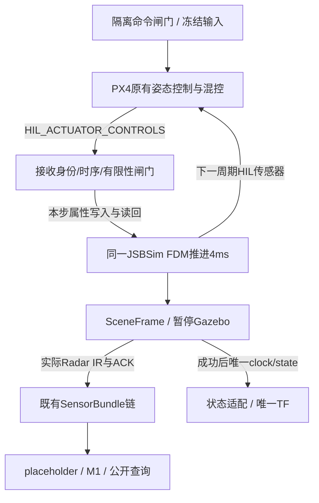

# PX4受控短窗与同FDM联动具体方案

日期：2026-10-29；版本：v0.1；任务：SIM-FLIGHT-DESIGN-01；主责任：simulation_engineer。
状态：已完成（具体方案及只读核验）；下述SW-01—04均为计划，尚无新飞行实现或运行。
依据：[SW-04C交付](SIM_MOTION_SW04C_DELIVERY_20261029.md)、ADR-044。
本轮只改文档，不发解锁/起飞/控制指令，不延长现有profile，不修改第三方源树或研究仓库。

## 1. 目标与分界

先补上可核对的PX4执行器→JSBSim属性→同FDM步的因果证据，再使用PX4已有STABILIZED
姿态控制做有界SITL实验。目标是验证仿真控制接续、传感器与地图软件行为，
不开发规划器、避障控制器、实机控制或研究模型，不把命令发送成功当飞行成功。
人工输入和冻结脚本均经过同一命令闸门，首批只接冻结脚本；交互遥控另立任务。

当前SW-04C是最长1s、无自动控制的自由动力学：有真实FDM/采样，不等于PX4闭环稳定飞行。
903项全仓是上一轮软件基线，本轮未重跑全仓；本轮84项既有运动定向及真实消息往返通过。
真实设备/研究质量/DEM/正式PERF继续分别跟踪，不重新把这些外部缺项当本方案前置。

## 2. 实际链路与19项源码事实

下表引用本机确实存在的源码；第三方文件只读。快照见
[source-evidence.json](../.runtime/runs/flight-design-20261029T233844868507/source-evidence.json)。

| 编号 | 源码证据 | 当前事实及设计影响 |
| --- | --- | --- |
| F01 | [宿主](../simulation/jsbsim_scene_host.cpp#L31) | 只创建一个FGFDMExec，桥接持有同一指针；新路径不得另起动力学实例 |
| F02 | [宿主next循环](../simulation/jsbsim_scene_host.cpp#L44) | next/quit与index≤250；无命令/执行器来源收据，不能只放大Python时长 |
| F03 | [桥接Run](../.runtime/src/px4-v1.13.3/Tools/jsbsim_bridge/src/jsbsim_bridge.cpp#L169) | 同步顺序为HIL传感器发送→poll→属性写入→FDM Run；步n使用步前状态n−1的控制反馈 |
| F04 | [poll](../.runtime/src/px4-v1.13.3/Tools/jsbsim_bridge/src/mavlink_interface.cpp#L334) | 首执行器前非阻塞；首次后lockstep等待；1s poll超时直接返回，外层仍可推进 |
| F05 | [HIL接收](../.runtime/src/px4-v1.13.3/Tools/jsbsim_bridge/src/mavlink_interface.cpp#L471) | 记录armed和16路值；未绑定time_usec、sysid/compid、序号或有限性，旧值可留存 |
| F06 | [执行器写入](../.runtime/src/px4-v1.13.3/Tools/jsbsim_bridge/src/actuator_plugin.cpp#L48) | 按index/scale写FDM属性，未据armed禁止写入；不能只看GetArmedState就推断已安全施加 |
| F07 | [rascal通道表](../.runtime/src/px4-v1.13.3/Tools/jsbsim_bridge/configs/rascal.xml) | rudder=2×−1、aileron=5×−1、elevator=7×−1、throttle=4×1，不能套用通用0/1/2/3通道 |
| F08 | [PX4发送](../.runtime/src/px4-v1.13.3/src/modules/simulator/simulator_mavlink.cpp#L92) | 发送时使用PX4时钟；非动态混控分支未armed时16路置0，固定翼第4路为0..1；接收端仍须校验 |
| F09 | [PX4 HIL时钟](../.runtime/src/px4-v1.13.3/src/modules/simulator/simulator_mavlink.cpp#L489) | HIL_SENSOR时间设置PX4单调时钟；控制回包时间应由实际发送/接收证据绑定，不能用墙钟替代 |
| F10 | [airframe 1033](../.runtime/src/px4-v1.13.3/ROMFS/px4fmu_common/init.d-posix/airframes/1033_rascal)、[mixer](../.runtime/src/px4-v1.13.3/ROMFS/px4fmu_common/mixers-sitl/plane_sitl.main.mix) | 旧静态混控有两个空槽，相关通道与F07相符；须冻结SYS_CTRL_ALLOC及实际mixer |
| F11 | [模型](../.runtime/src/px4-v1.13.3/Tools/jsbsim_bridge/models/Rascal/Rascal110-JSBSim.xml#L139) | JSBSim有独立舵面缩放及trim；属性值、实际舵偏角与机体响应必须分开记录 |
| F12 | [LSZH IC](../.runtime/src/px4-v1.13.3/Tools/jsbsim_bridge/scene/LSZH.xml)、[安装头文件](../.runtime/deps/jsbsim-1.1.13/usr/include/JSBSim/initialization/FGInitialCondition.h#L153) | v1 altitude为AGL，elevation=419.2m，源IC初始AGL0.5m；旧运动改为8m，不能解释为8m MSL |
| F13 | [生成IC](../simulation/ufm_simulation/multiscene_world.py#L36) | 非零theta须避免后应用gamma覆盖；新IC要同时冻结AGL、地面高程和初始实际姿态 |
| F14 | [固定profile](../ros_ws/src/uav_fusionmap_sim_scene_msgs/src/ufm_scene_contract/profile.py#L49)、[原生闸门](../simulation/gazebo_scene_step.cpp#L53) | Python/C++/宿主都限制250步，原生z>0.5与锚点8m；地面启动0.5m会被旧闸门拒绝 |
| F15 | [旧装配](../ros_ws/sim_motion_gate_run.py#L230) | 原始FDM→SceneStep成功后才提交公共clock/state；无隐藏预热，新模式沿用此提交责任 |
| F16 | [状态适配](../sensors/ufm_sensors/state_adapter.py#L132) | scene_ground_truth经显式scene_world→odom注册，state_adapter仍唯一TF；估计状态不能冒名替代真值 |
| F17 | [MANUAL_CONTROL接收](../.runtime/src/px4-v1.13.3/src/modules/mavlink/mavlink_receiver.cpp#L2070)、[输入选择](../.runtime/src/px4-v1.13.3/src/modules/manual_control/ManualControlSelector.cpp#L66) | 接收值除1000，数据源/新鲜度还受COM_RC_IN_MODE等条件约束；发送非ACK式消息不代表控制器选中 |
| F18 | [STABILIZED](../.runtime/src/px4-v1.13.3/src/modules/fw_att_control/FixedwingAttitudeControl.cpp#L147) | roll取manual.y，pitch取−manual.x并加FW_PSP_OFF；不是x=roll/y=pitch，不能套错符号 |
| F19 | [桥接接口](../.runtime/src/px4-v1.13.3/Tools/jsbsim_bridge/include/jsbsim_bridge.h#L67) | Run返回void，内部FDM Run结果未导出，MAVLink成员私有；需新隔离适配，不能只用当前public getter补齐证据 |

AGL与gamma读取顺序另核对[JSBSim 1.1.13原始实现](https://raw.githubusercontent.com/JSBSim-Team/jsbsim/v1.1.13/src/initialization/FGInitialCondition.cpp)。
F08是源码分支事实，SW-04C没有HIL执行器原始收据，不能由“未发arm”反推旧run实际armed位已被验证。

## 3. 必须先完成的离线合同

直接下一任务SIM-FLIGHT-SW-01只新增私有逻辑合同、小型字面量fixture与有界校验/测试。
拟文件为configs/sim_flight_fixture.json、simulation/ufm_simulation/flight_contract.py和tests对应oracle。
不生成新消息，不启动FDM、ROS或命令客户端，不改旧profile、公共字段和入口。

私有schema拟为sim_flight_fixture.v1，固定mode=px4_stabilized_sitl、simulation_only=true，
包含IC/模型/混控来源、4ms步长、阶段表、commands_enabled/observation_only、状态来源、采样激活点及预算。
不是通用飞行配置器；拒绝未知字段、bool伪整数、非有限、隐式基准和任意路径/命令。
profile/recording头部JSON≤256KiB、深度≤8、节点≤8192、身份≤128 UTF-8字节；事件流另按总预算约束。

私有执行器收据sim_flight_actuator_record.v1记录：

- run/clock、step_index=n、source_step=n−1、接收递增序号、实际socket peer与MAVLink sysid/compid；
- 实际发送HIL_SENSOR time_usec、接收HIL_ACTUATOR_CONTROLS time_usec/flags/mode与原始16路float32；
- has_actuator及缺失reason；缺失时mode/armed/controls不可用，禁止以false/0冒充已观测disarmed；
- 目标4个FDM属性、实际施加前/后的读回、FDM Run结果与前/后原始时间；
- 单调墙钟收/施加/完成时间仅做deadline诊断，不替换源时间。

每记录≤16KiB，流式写入有总字节/条数界；原始数据与解释后的值同时保存。
字段不进入SensorBundle、forward、OccupancyObservation或地图。不加消费方不明的Hash。
独立预期先保存：16路探针中c2=−.25/c5=.3/c7=−.2/c4=.6，
四属性应依次为+.25/−.3/+.2/.6；x=−178、FW_MAN_P_MAX=45且FW_PSP_OFF=0时pitch=+8.01°。
后者只是坐标/量纲算例，不是本轮已发送的控制指令或已验证飞行姿态。

## 4. 隔离桥接与逐步控制准入

拟新增simulation/flight_bridge/的小型、有上下文的源适配patch和本仓宿主。
只把需要适配的已有桥接源复制到.runtime/sim-flight-build后应用patch；不改.runtime/src/第三方库，
不用#define private/public，也不重写控制器。新构建单独产物名，旧sim-motion-build继续消费原源。
patch若上下文不匹配或构建失败，明确停止，不能回退旧桥接并宣称有严格控制闸门。

新适配在FDM Run之前暴露HIL传感器发送、执行器接收及属性读回边界；状态机：
INITIALIZED → BOOTSTRAP → PREPARING → COMMAND_PENDING → ACTIVE → TERMINAL。
宿主每次只接一个明确step，记录本步控制来源，不预读/多步推进。

BOOTSTRAP允许尚未收到第一执行器时以声明的零初始属性推进，最长2s源时间/5s墙钟，
必须observed=false而不是伪造HIL零包；收到第一合法包后永久转入严格新鲜度要求。
只读诊断使用旧1秒范围，因此可在尚未结束bootstrap时以“诊断未就绪”关闭，不当作控制门通过。

严格运行要求当前回包绑定实际本周期HIL_SENSOR时间，时间戳不按step重写。
已有bridge用原始double×1e6后截断，先记录真实wire时间；不擅自规定回包必等于n×4000。
SW-02先测并冻结该版本的对应关系；若不能在同周期建立可证关系，停在诊断阶段，
不能扩大时间窗口、只凭到达墙钟或复用上一包通过。相同内容/时刻重复包可记诊断，不能计为新控制。
错peer/身份、回退/未来时间、未知flags、非有限或超出舵面[−1,1]/油门[0,1]直接拒绝。
未armed合法包须16路为零；非零则拒绝，不由接收端静默清零掩盖异常。

收到合格控制后写属性并读回：容差1e-6（float32写入），再FDM Run一次并检查返回true、
原始时间推进4ms±1ns。失败不再推进，不提交该tick公共clock/state；已发生的原始动作保留，
不能回滚FDM、改戳、重新计算轨迹或把失败tick写成成功。

## 5. 拟议新窗口与公共承载

以下只用于后续SW-03/04，不改v1。独立flight profile拟固定总长≤40s/10000步，
前30s为真实地面准备及命令确认，ACTIVE最多10s；ground IC为LSZH同经纬度、
elevation=419.2m、altitude AGL=.5m、vt=0、phi/theta=0、psi=90°。
初始化后读取实际AGL/ASL/大地位置/姿态及速度，分别核对，不默认ASL=AGL+某个DEM。
不在空中悬住模型预热、不写回FDM姿态，也不重置/裁剪前30秒源时间。

地理注册保持初始ECEF/大地纬度固定ENU，但新flight锚点[0,0,.5]、注册ID
jsbsim_cg_to_flight_enu_v1；同一已声明scene_world/odom注册仍由原state_adapter发布唯一TF。
纯真值链为本批唯一业务状态，PX4估计/健康仅诊断和控制准入，不发布第二/uav/sim/state或TF。
平坦地面来自该fixture的显式初始地面基准，不是DEM或全球注册；地球曲率与平面差另记诊断。

保留旧25份消息定义；后续拟复用SceneFrame/SceneStep/SceneCaptureAck的现有生成类型，
但使用显式protocol_version=2、独立ufm_flight_contract codec及/uav/flight/scene/step、
/uav/flight/scene/frame_applied、/uav/flight/scene/capture_ack。
旧codec/端点继续只接受v1，新端点只接受冻结flight v2，不以ROS类型相同推断语义兼容。
新原生插件单独编译选择此配置；旧v1的250步/8m锚点/z>0.5/首次采样规则保持。
新闸门拟AGL初始.5m、局部z>.2m、距初始锚点≤250m；活动飞行安全界另外检查真实AGL。
这需要SW-03具体codec/插件双侧实现与真实生成消息往返后才可启动，不是当前能力。

为使准备期完整可追踪且限制IR负载：所有0—40s的FDM原始样本/SceneFrame/公共clock/state均保留；
公共Radar/IR采样仅在固定step>7500且step%25=0启用，首帧30.1s，末帧40s，最多100组。
准备期没有raw/ACK/Bundle不是valid空观测，也不产生free；地图查询为unavailable。
Camera可内部准备，但不提前发布raw；ACTIVE首采样≤3s墙钟、后续事务≤1s。
不等准备成功后把时间清零，也不把30.1s第一帧改成100ms；缺ACK失败仍不提交该业务tick。
SW-03使用observation_only=true/commands_enabled=false，只进入SAMPLING_ONLY诊断阶段，
确认实际armed=false并按同一时刻表采样；不要求arm、不进入ACTIVE、不标为飞行就绪。

## 6. 命令范围、准入与停止

后续命令客户端只接本次本机SITL：命令/诊断使用独占loopback UDP peer 14540↔14580，
HIL TCP4560单独使用，不在仿真链注入伪HIL包。端口冲突、非本次PX4 PID、远端peer、
额外命令源或错误sysid/compid拒绝。现有默认绑定不等于只接受loopback，新监督器必须实际验证。
不启MAVROS第二控制源，不连接硬件、QGC或网络广播转发。

SW-02完全只读诊断，无heartbeat/参数写/arm/manual发送；只记录本次HIL原始流及属性。
SW-04才允许显式simulation_only且commands_enabled=true的冻结运行；默认false。
可发送的首批集合为HEARTBEAT、MANUAL_CONTROL、MAV_CMD_DO_SET_MODE、正常arm/disarm。
禁止force参数21196、绕过preflight、动态调参、AUTO任务/起飞/降落/offboard、任意shell和自动重试arm。
使用现有PX4 STABILIZED与固定输入不构成自主规划/避障能力。

PREPARING必须实际读回airframe=1033、静态mixer/SYS_CTRL_ALLOC、COM_RC_IN_MODE、
FW_MAN_P_MAX/FW_PSP_OFF及空速参数，EKF/姿态/传感器/供电状态满足PX4正常arming检查，
地面AGL稳定、无非零控制残留。源码默认10/15/20m/s的FW空速参数不是Rascal失速或已验证速度范围。
READY最迟29s源时间形成；随后以零油门切STABILIZED，确认COMMAND_ACK及实际模式，再正常arm。
最迟30s确认实际armed及对应HIL mode，单有ACK不算成功；失败停止，不推迟30.1s采样起点。
等待ACK期间继续合法逐步HIL/FDM循环，不暂停唯一源时钟等待依赖该时钟的PX4状态，避免锁步死锁。

首批主动脚本拟：t=30—31s油门0→0.7线性上升、pitch目标约+8°/roll0/yaw0；
31—38s保持，最晚38s必须实际离地AGL≥3m且空速达到实测冻结的离地门槛，否则失败；
最后≤2s仅做小角度响应核对。输入50Hz（每5步），heartbeat 1Hz，控制源年龄≤200ms。
该数值是待验证试制约束，不保证起飞；实施前参数与独立预期冻结，失败不能临时加油门/延长窗口凑成功。
受控飞行验收必须同时有actual armed/模式、选择到的manual输入、变化的非零执行器/属性、
实际离地、规定短窗的姿态响应及同tick传感器/地图；只有地面舵面变化最多关闭控制响应子范围。

硬停止条件拟为|roll|>30°、|pitch|>25°、空速>25m/s、源/控制超时、越界或坏载荷；
离地后AGL<1m或下降穿越地面也停止。数值是该仿真短窗上限，不是实机安全包线。
地面滑跑不套用“离地后AGL”条件；障碍只作传感器几何，不声称Gazebo碰撞反力已作用于JSBSim。
若要以障碍碰撞为停止依据，必须独立检查飞机扫掠体与显式box，而不是把无回波当未碰撞。

TERMINAL先停止新命令/next，锁住本run、传播最后提交时刻的unavailable并让RViz进入History。
正常disarm/零油门停止请求可记录，但源时钟停止后PX4未必处理，空中普通disarm也可能拒绝；
只有实际回读才记disarmed，绝不为得到ACK继续推进失败FDM或使用force。
最后停止本次PX4/宿主/ROS/Gazebo并核对PID/端口，关机不当作成功着陆；客户端/daemon退出码分开。
恢复只能新run/new clock/新rootfs/空地图；迟到ACK、旧命令和旧身份不能恢复已失败实例。

## 7. 预算与验收矩阵

新profile拟源步≤10000、每条高频流≤12288条（10001个时刻加terminal与少量边界收据），
控制/阶段事件≤4096、单逻辑记录≤16KiB、控制日志≤64MiB；旧4096字节Scene单线格式界保持。
全订阅wire≤128MiB/case、全部产物≤512MiB/case，观察外部日志每0.5s，超限停止。
墙钟启动≤60s、控制回包≤1s、case≤240s；资源不足即失败，不关掉关键收据绕界。
首批真实核心为1只读诊断/1地面准备/1主动/3故障，外加3旧入口兼容；最多9例串行，
套件≤2400s/5GiB，失败留存且停止。预算是拟议上限，尚无新profile实测，不代表RSS/20ms/PERF。

| 用例 | 独立预期与通过条件 |
| --- | --- |
| FC01 通道/坐标 | 非对称16路探针、mixer、scale、属性及舵偏角方向，不能用同一实现生成答案 |
| FC02 IC/地理 | 0.5m AGL/elevation/实际姿态、地面接触与速度分别核对；MSL/AGL混用、gamma冲突拒绝 |
| FC03 首包/未armed | 缺首包显式不可用、bootstrap有限；实际未armed包16路0，不能推断模式 |
| FC04 严格控制 | 旧/未来/错peer/坏枚举/非有限/超限在FDM之前拒绝，属性不变且无新业务clock |
| FC05 因果回读 | 当前周期HIL→实际属性→一次FDM Run，控制时戳/量纲、返回值、4ms与原始时间可对账 |
| FC06 READY/ACK | 模式/arm拒绝或ACK但无实际状态不进ACTIVE；等待状态仍驱动合法锁步，不死锁 |
| FC07 真飞行分界 | 地面响应与实际离地分开；短窗姿态误差、持续时长与空速条件先冻结，不以接收命令充飞行 |
| FC08 采样激活 | 预热0—30s全源留证；仅30.1—40s最多100组；无改戳/重置，准备期无raw不当空观测 |
| FC09 地图/失效 | 10Hz同tick Context、合法空帧unknown/保留旧证据、源停止History；公开占据/查询独立执行回放 |
| FC10 故障/清理 | 执行器超时、Camera ACK缺失、主动停止各新run；最后提交tick锁定/迟到拒绝/新身份空地图，完整PID/端口清理 |
| FC11 兼容/资源 | 旧v1字节/250步/profile、旧估计与静态原生保持；v1/v2交叉拒绝，新增预算及只读收据无越层消费 |

## 8. 分步实施与直接下一任务

| 任务 | 主责任 | 允许实现范围 | 完成条件 |
| --- | --- | --- | --- |
| SIM-FLIGHT-SW-01 | simulation_engineer | 私有flight/IC/执行器记录逻辑合同、小型冻结fixture及独立oracle/限额测试 | 先存独立预期，再实际校验/既有线格式兼容；无新ROS/宿主/命令或新profile运行 |
| SIM-FLIGHT-SW-02 | simulation_engineer | 新隔离构建适配与只读执行器/属性诊断；仍≤1s/250步、无命令发送 | 实际原始HIL时间/身份/16路、属性和FDM结果收据，明确bootstrap/未就绪；不能宣称已严格闭环飞行 |
| SIM-FLIGHT-SW-03 | integration_engineer | 显式v2 codec/独立插件端点、新ground/40s有界profile与观察链 | 先真genpy往返/交叉拒绝，再无控制地面准备及采样激活/预算实际证据；默认旧入口保持 |
| SIM-FLIGHT-SW-04 | tester | 经确认的命令许可/状态机、冻结STABILIZED脚本、主动与故障/原生/公开回放及兼容交接 | 先完成FC01—06/08/11；再单独判FC07实际离地/响应，9例同源码矩阵和实际清理，失败保留 |

直接下一项仅SW-01。此表不授权本轮发送命令，不要求一次跨越四步；
SW-03公共语义/端点与SW-04命令能力按具体方案确认后实施，不能借“继续”跳过未完成依赖或质量门。
如新profile不能正常初始化/就绪，继续修正本仓同范围工程缺陷并保留失败，
不放宽旧合同、不接研究模型或真实数据替代此验证，也不扩大为自主控制开发。

## 9. 2026-10-30实施更新

SW-01已完成[私有离线合同与有界校验](SIM_FLIGHT_SW01_CONTRACT_20261030.md)，
新增25项/旧运动84项/全仓928项通过，原公共定义及运行入口保持。
ground IC/40s/采样表只是元数据，没有执行新仿真；真实执行器绑定仍unverified，控制门固定false。
SW-02直接下一项仅≤250步/1秒隔离HIL/属性/FDM诊断，无heartbeat/arm/manual/参数写。
明确补充：AGL=.5m只接私有诊断宿主，不接有z>.5门禁的旧Gazebo v1端点；
该短诊断不验证新40s profile或采样激活。v2/长准备与命令仍留SW-03/04，不能跳过依赖。

随后SW-02已完成[隔离诊断与实际未就绪交接](SIM_FLIGHT_SW02_DIAGNOSTICS_20261030.md)：
250步/1s及断连接停止通过，飞行32项/旧运动84项/全仓935项通过。
实际执行器0包，缺少当前周期对应证据，不能宣称严格控制门通过。
下一项先SIM-FLIGHT-DIAG-DESIGN-02只读归因/最小补证方案，SW-03长窗与SW-04命令继续保持未开放。
