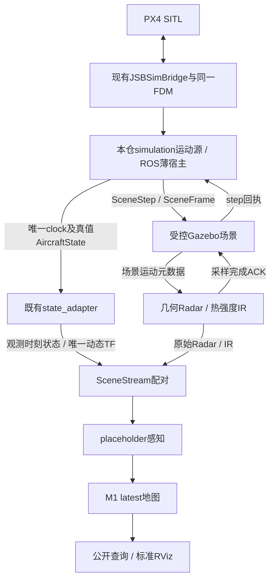

# PX4/JSBSim与Gazebo传感器场景运动联动设计

日期：2026-10-29；版本：v1；任务：SIM-MOTION-DESIGN-01；主责任：simulation_engineer。
状态：已完成（具体设计）；SW-01—03为计划，未新增消息、运行节点、联动插件或飞行脚本。
后续SW-01已完成[固定输入/独立预期、2.msg/1.srv及严格codec](SIM_MOTION_SW01_CONTRACT_20261029.md)：
20组真实消息对账、26项新增/全仓845项通过。下文保留设计时计划；状态机/实际引擎及窗口联动仍待SW-02/03。
后续[SW-02引擎/采样闸门](SIM_MOTION_SW02_ENGINE_20261029.md)已完成：同FDM、250步/10对/20 ACK、
运行期故障、唯一clock/state/TF、856项回归通过；具体调度修补及失败见该记录，原生运动窗口留SW-03。
依据：用户确认完成交付整理后设计运动联动；[当前交付](SOFTWARE_DELIVERY_20261029.md)、
[场景说明](SENSOR_SCENE_VISUALIZATION.md)、[坐标](COORDINATE_SYSTEM.md)、ADR-042。
核验：[EXP-20261029-006](../experiments/2026-10-29-software-delivery-motion-design.md)。

## 1. 问题、目标与范围

已有PX4/JSBSim与Gazebo传感器场景分别运行，不能同时原样启动：两者各有clock/状态来源，
当前飞机固定，Ray/IR采样时刻属于Gazebo，PX4局部估计原点也没有注册到Gazebo场景。
仅把模型移到最新估计位置、重写原始消息时间，不能形成同一时刻的可核对观测。

首版选用显式`jsbsim_scene_truth`运行模式：JSBSim是唯一动力学与时间源，PX4保留既有
SITL执行器交互，Gazebo只作为受控几何/相机采样与显示后端。在线位姿在此模式明确为
仿真真值，沿既有场景真值分支进入sensors，不伪装成PX4估计定位。
默认`px4_estimated`和旧静态场景保持原样；新模式不自动fallback到任一旧模式。

首版只做有界运动短窗与感知/地图/显示联动。不发送解锁、起飞、航点或offboard指令，
不开发控制器；初始速度与高度来自明确的JSBSim初始条件，由真实动力学演化。
这可以验证PX4在环连接及JSBSim运动采样，不能称为受控固定翼飞行或自主飞行验收。
不接真实DEM、M2/M3/M4累计、研究模型、训练LiDAR、高真实性传感器或正式PERF-01。

## 2. 当前源码事实审计

| 编号 | 当前事实与源码 | 对设计的约束 |
| --- | --- | --- |
| F01 | [create_world](../simulation/ufm_simulation/sensor_scene.py)把sensor_aircraft设为static | 新联动必须显式驱动代理模型，旧静态配置保留 |
| F02 | [scene_state_source.main](../ros_ws/scene_state_source.py)将Gazebo Odometry标ground_truth并发布/uav/sim/state | 新模式不启动此发布者，防止两份状态权威 |
| F03 | [FusionScenePose::Update](../simulation/gazebo_scene_pose.cpp)使用Gazebo SimTime及模型速度 | 新模式不把此时钟/速度当JSBSim真值来源 |
| F04 | [SceneStream.add](../sensors/ufm_sensors/scene_stream.py)只接受ground_truth/odom状态 | 不直接塞入estimated或改名绕过来源检查 |
| F05 | SceneStream.set_clock在回退时锁定 | 新run恢复；不能回写旧时间后继续处理 |
| F06 | SceneStream.ready使用IR差≤5ms、历史pose年龄≤10ms、等待≤40ms | 保持门槛；联动对齐必须在采样端完成 |
| F07 | [FusionSceneRadar::Update](../sensors/gazebo_scene_radar.cpp)取LastMeasurementTime | 原始采集时间必须真实保留 |
| F08 | Radar速度包含WorldLinearVel与角速度外参杆臂 | 静态代理的Gazebo速度不能默认等于JSBSim速度；需显式运动元数据 |
| F09 | [FusionSceneInfrared::OnNewFrame](../sensors/gazebo_scene_ir.cpp)使用相机LastMeasurementTime并丢重复 | 图像发布晚于world step，需确认完成再继续运动 |
| F10 | [decode_source_packet](../simulation/ufm_simulation/mavlink_source.py)只接受IMU/ODOMETRY，后者固定estimated | 当前不存在该入口提供的JSBSim完整真值流 |
| F11 | [state_clock.main](../ros_ws/src/uav_fusionmap_simulation/scripts/state_clock_node.py)拥有另一/clock | 新模式不能同时启动此公共clock发布者 |
| F12 | [state_adapter.main](../ros_ws/src/uav_fusionmap_sensors/scripts/state_adapter_node.py)显式选择px4_estimated/scene_ground_truth | 新模式沿真值分支，唯一动态TF仍在此处；真值terminal传播须补齐 |
| F13 | [桥接main](../.runtime/src/px4-v1.13.3/Tools/jsbsim_bridge/src/main.cpp)将FGFDMExec指针传给JSBSimBridge | 可在本仓薄宿主持有同一FDM并读回，不复制动力学引擎或修改研究仓库 |
| F14 | [JSBSimBridge::Run](../.runtime/src/px4-v1.13.3/Tools/jsbsim_bridge/src/jsbsim_bridge.cpp)发送传感器、接执行器后真正Run FDM | 真值定义为一次Run完成后的状态，不混用前一步IMU时刻 |
| F15 | [FGPropagate头文件](../.runtime/deps/jsbsim-1.1.13/usr/include/JSBSim/models/FGPropagate.h)提供ECEF位置、GetTb2ec、UVW/PQR | 明确feet→m、FRD→FLU、地固与惯性参考差异，不靠欧拉角猜方向 |
| F16 | 本机Gazebo11 World.hh有Step/SetPaused接口 | 可以设计暂停world的受控步进；实际Ray/相机同步仍必须做SW-02原型验证 |

本轮只读核对以上16项源码事实及现有64项相关测试，不据此宣布新宿主或受控渲染已可运行。
本机jsbsim_bridge_ros的statusloop仍TODO，不能把它当成已有真值状态发布器。

## 3. 拟议生产消费链与唯一权威



simulation拥有动力学、固定场景注册、step状态机；sensors拥有测量模拟、标定、配对及状态适配；
ros_ws只做宿主/协议包装与启动监督；mapping/application保持现有公开输入。
采样ACK属于仿真推进基础设施，只含身份/时刻/完成状态，不携带点云、图像或地图业务。
simulation不订阅原始Radar/IR业务载荷或生成占据；感知不读FDM/场景对象。

新模式只允许运动源发布`/clock`、`/uav/sim/state`。Gazebo ROS API插件的clock显式remap到
独立诊断名，图审计验证实际结果；其内部时间仍只随受控step推进。旧scene_state_source、
scene_pose业务发布、state_clock公共发布均不装配。若另留PX4估计遥测，只能进入诊断域，
不得成为第二个在线状态/TF来源。在线图仍无LiDAR、target或observed_mask。

## 4. 坐标、机体原点与独立预期

固定一次run的JSBSim初始ECEF位置x0（feet）、初始大地纬度phi0与经度lambda0，
必须读取GetGeodLatitudeRad，不能误用地心GetLatitude。定义ECEF→初始ENU的固定旋转Q：

```text
Q = [-sin(lambda0),                 cos(lambda0),                0;
     -sin(phi0)*cos(lambda0),      -sin(phi0)*sin(lambda0),       cos(phi0);
      cos(phi0)*cos(lambda0),       cos(phi0)*sin(lambda0),       sin(phi0)]

p_scene = p_anchor + Q * (x_ecef - x0) * 0.3048
R_scene_flu = Q * R_ecef_frd * diag(1,-1,-1)
v_flu = diag(1,-1,-1) * UVW * 0.3048
omega_flu = diag(1,-1,-1) * PQR
```

矩阵从GetTb2ec读取；UVW/PQR是相对ECEF的机体量，不能改用惯性PQRi。
四元数输出xyzw、归一化，先以轴向及已知旋转核对矩阵/四元数主动被动方向。
初始地球椭球、纬经度/高度来源、Q、x0、p_anchor完整保存，不自动重置到“首个到达帧”。
这是局部fixture注册，不是Gazebo与真实地理/DEM注册；离初始点超过200m即拒绝本profile。

`base_link`在本模式明确选为JSBSim质心的虚拟FLU原点，名称`jsbsim_cg_virtual_flu_v1`，
不假定等于pilot IMU点或真实机体安装点。Gazebo外观网格只是显示，不提供物理标定。
已有body←Radar平移[0.8,0,0]m及body←thermal_optical旋转继续显式配置；
scene_world到odom同原点同轴只在本profile记录后使用既有真值适配分支，PX4估计odom不参与。

独立冻结算例：NED[1,2,3]→ENU[2,1,-3]；FRD[4,5,6]→FLU[4,-5,-6]；
body位于[10,20,8]且ENU绕z旋转90度时Radar原点为[10,20.8,8]。
静态目标、速度[5,0,0]m/s、LOS为+x时Doppler为-5m/s（away为正）；
再加omega_z=1rad/s和0.8m杆臂，LOS为+y时杆臂分量给出-0.8m/s。
独立预期先存盘再执行实现，不能从新转换器输出反推expected。

## 5. 时间与逐帧事务

候选JSBSim dt=4ms、Gazebo步长1ms、Radar/IR 10Hz，均为功能profile值。
JSBSim GetSimTime原始double与整数step_index分别保存；需核对实际时间与n*4ms之差≤1ns，
通过后才构造该原采样时刻的整数timestamp。超限拒绝，不裁剪或把不规则时间强填网格。
新run从0初始化两个引擎；初始化状态不产生观测证据，不跳过失败首帧后另选成功窗口。

每个tick按以下顺序进行，最多一个未完成事务，无待执行队列：

1. 真实调用JSBSimBridge::Run，读取同一FDM完成后的姿态/位置/UVW/PQR与时间。
2. 发SceneStep，接收端验证run/clock/连续step、注册和有限值，设置静态代理的准确目标pose；
   不让Gazebo另算一套飞机动力学。运动速度另外作为场景元数据，禁止从静态模型零速度猜Doppler。
3. 从非world-update线程请求暂停world前进4个1ms子步；不能在回调线程阻塞等待自身step。
   在当前profile中100ms整点触发成对传感器；非采样tick只回读应用pose与world时间。
4. 采样tick必须等Radar与IR各自实际发布后的完成ACK，两者measurement_timestamp均为该目标时刻，
   代理pose与注册保持不变直到ACK完成。IR延迟渲染时不先推进下一tick，不重写LastMeasurementTime。
5. 验证step回执中的实际world时间、pose与采样完成后，运动源才发布本tick真值状态和唯一公共clock。
   raw消息可先到达并在既有有界配对器等待clock/state；不把ROS到达顺序当成采样同步。

更新Gazebo代理时，运动元数据必须在采样前由sensors插件确认可见；Radar使用同tick的
`R*v_flu + R*(omega_flu × mount)`计算静态场景目标的径向速度。
缺少匹配元数据、旧ACK或相机产生其他时刻图像，均为事务失败，不能用上一tick载荷充当成功。
world Step与渲染线程的可实现性是SW-02进入下游接通前的实测闸门；若失败，保留失败并修订该段设计，
不悄悄改成双自由时钟、定时set_model_state或最新位姿覆盖。

## 6. 拟议承载与限额（尚未实现）

后续SW-01拟新增独立`uav_fusionmap_sim_scene_msgs`，只定义场景推进基础设施的2.msg/1.srv，
不改任何旧公共字段或旧包依赖。具体字段草案如下，逻辑合同/availability空槽和真实线格式须在SW-01冻结：

| 类型 | 拟议字段与含义 |
| --- | --- |
| SceneFrame.msg | uint8 protocol_version=1；既有AircraftState state（scene_world/ground_truth，body/velocity=base_link）；uint64 step_index；string registration_id；float64[3] angular_velocity_flu（rad/s） |
| SceneCaptureAck.msg | uint8 protocol_version；string run_id/clock_id；uint64 step_index；int64 measurement_timestamp；uint8 sensor_kind（1 Radar、2 IR）；bool published；string reason。ACK只证明该插件完成发布，数据质量由原合同校验 |
| SceneStep.srv | 请求SceneFrame frame；响应bool accepted、string reason、bool has_applied_frame、SceneFrame applied_frame、bool radar_captured/int64 radar_timestamp、bool infrared_captured/int64 infrared_timestamp。无采样tick flags为false且时间空槽0，不能把数值0本身当缺失 |

拟议`/uav/scene/step`为simulation服务，`/uav/scene/frame_applied`为simulation到传感器的同帧
元数据，`/uav/scene/capture_ack`为传感器到step握手的基础设施回执。按实际发布者/callerid审计来源。
原raw消息无run字段，严格绑定该次独占Master/进程/发布者与ACK域，不给旧raw换新run继续使用。
ACK若只完成发布但codec/配对失败，端到端用例仍失败，不将ACK当Bundle已消费的证明。

候选限制：文本身份≤128 UTF-8字节、reason≤256字节，拒绝未知版本/枚举/非有限/超限/训练字段；
计数与时间严格整数，step从0开始连续且同run不回退；重复相同事务返回原回执、不重复采样，
同step内容冲突锁定。只保留一个未完成/最后完成事务，旧step拒绝；不建无限去重表或Hash。
软件测试每流最多512条收据、总16MiB，超限失败；短窗默认1s、250个动力学tick、10次采样，
初始前向速度5m/s、scene锚点[0,0,8]m，超覆盖或撞击场景代理接近地面时停止该profile。
这些是待SW-01冻结的工程测试上界，不是高速、射频、机载RSS或传感器精度目标。

## 7. 失败、暂停、清理与恢复

启动就绪≤60s（既有PX4连接及GUI资源），首个采样ACK≤3s墙钟、后续事务≤1s，
整个短窗含启动/显示/清理≤120s；不使用仿真时间等待自身未产生的clock。
pause不推进FDM/Gazebo或重复发旧raw；wall watchdog区分测试pause和未请求的源断流。
resume只能继续下一个step，不补发已完成采样；reset、身份/注册变化要求新run。

事务失败后停止clock推进，发布带具名terminal原因的不可用状态；真值适配分支需补齐
terminal的非几何传播，禁止发布新的TF或用其无效几何生成Bundle。
当前SceneStream会拒绝非valid状态，联动装配还须锁定该次stream，不能释放积压旧Radar。
地图停止新增证据，旧M1查询按显式请求时间老化；现有scene_map_viz在3s墙钟clock失联后
显示历史不可用，不假称地图服务新增了墙钟liveness门。Radar/IR标准显示的历史须同步清空
或明确history状态，不把冻结画面标成当前测量。

在新隔离目录保存源/step/ACK/原始与业务消息、地图快照/查询、暂停/故障时刻、
实际墙钟、参数/版本、图片和清理。进程各自独立组，只停止本轮创建者；端口占用直接拒绝。
ROS/Gazebo候选端口11801/11802，PX4/bridge既有TCP/UDP也必须预检，不假设另换ROS端口就可并行PX4。
不改第三方原仓或现有.runtime源码；薄宿主链接既有桥接类/库或独立编译其源码到新构建目录，
使用原已披露补丁版本，旧二进制保留。接口/构建失败不改Conda、不安装大型依赖。

## 8. 待实施验收与工作包

| 用例 | 独立预期与可观测证据 |
| --- | --- |
| M01 单位/坐标 | 非零ECEF差、地心/大地纬度区别、旋转/四元数、feet→m及质心原点匹配冻结答案 |
| M02 杆臂/Doppler | 平移/转动两个已知符号算例；实际Radar保留m/s/away与同tick速度 |
| M03 两引擎步进 | n*4ms、Gazebo四子步与实际LastMeasurementTime匹配；IR迟到必须等待；无改戳 |
| M04 小运动实采 | JSBSim真实位移、Gazebo回读、Ray/IR变化与观测时刻Context一致；不可用轨迹替身替代此验收 |
| M05 同步边界 | IR差5ms/5ms+1ns、pose年龄10ms/10ms+1ns、等待40ms及乱序，保留既有拒绝语义 |
| M06 来源/图冲突 | 第二clock/状态/TF、坏run/注册/ACK来源与缺消费者启动前拒绝 |
| M07 坏载荷 | 枚举/版本/布尔伪整数、非有限/超限、训练字段、坏quaternion、重复冲突原子拒绝 |
| M08 ACK缺失/迟到 | 不推进下一tick，不发布新业务clock/状态；迟到ACK不能恢复失败run |
| M09 pause/resume | 仿真时间不偷走、不重发旧采样；resume从下一step继续，单调墙钟分别记录 |
| M10 reset/new run | 流锁定、terminal非几何传播；新run空地图、旧身份/旧ACK不得复活 |
| M11 地图/回放 | M1 latest公开占据/快照/查询独立执行回放；无回波/失效不free，原证据时间不刷新 |
| M12 原生/清理 | 原生Gazebo+标准RViz非空且前后可辨，点云/IR/地图各有来源；正常/故障清理及非自有进程保留 |

| 次序 | 主责任角色 | 修改范围与交付 | 完成条件 |
| --- | --- | --- | --- |
| SIM-MOTION-SW-01 | simulation_engineer | configs/tests的小型profile、输入/独立预期与公开场景推进合同；ros_ws独立消息/codec及限额 | 先存预期，真实生成消息往返，坐标/时间/杆臂及坏输入反例；不创建动力学/GUI运行器 |
| SIM-MOTION-SW-02 | simulation_engineer | simulation同FDM真值读取/推进状态机、ros_ws薄宿主/受控Gazebo；sensors同帧运动元数据与ACK、真值terminal传播 | 实际PX4/JSBSim+Gazebo步进及相机ACK闸门通过，单clock/状态/TF、故障停止；独立构建不改旧入口 |
| SIM-MOTION-SW-03 | tester | 显式ROS装配、公开回放/应用查询、原生窗口及中文交接 | M01—12对应实际收据、旧静态/估计入口回归、相关及全仓轻量检查、失败/清理均可复核 |

当前直接下一项为SW-01；不得把本设计或64项旧定向通过写成以上新用例已执行。
各步仍遵循根AGENTS及模块边界，公共字段以本提案实施时冻结版本为准。
只关闭设计任务；已有报告可继续使用固定场景，联动完成后另生成带来源的新图，不替换历史图。

2026-10-29 SW-02实施补充：SceneFrame同帧元数据在同一Gazebo进程同步安装并发布ROS镜像，
不以异步话题到达推定传感器已读到元数据；ACK仍走ROS实际回路。自动Ray与暂停world的竞争
经真实运行暴露后改为四子步完成后强制真实Ray更新；Camera内部1kHz准备子步缓冲，
只有实际100ms整点发布公共10Hz raw/ACK，不改戳、首帧或冻结门槛。
第250步控制端丢IR ACK的运行期故障已通过；首采样立即故障时PX4启动中断255仍保留失败。
当前直接下一项SW-03，见[交接](SIM_MOTION_SW02_ENGINE_20261029.md)；不据此关闭全部M01—12或正式飞行。

2026-10-29 SW-03后续实施：已完成[单profile运动感知地图/原生窗口交接](SIM_MOTION_SW03_DELIVERY_20261029.md)，
10组/14查询/独立公开回放、精确pose Context、首采样/运行期ACK故障、第二clock拒绝、
新run空地图恢复和原生History均有证据；M01—12按真实/离线/继承证据分开列在实验记录。
下一项先做SIM-MOTION-SW-04-DESIGN，多场景独立预期/遮挡/无回波/恢复，不自动加入控制或长飞行。
