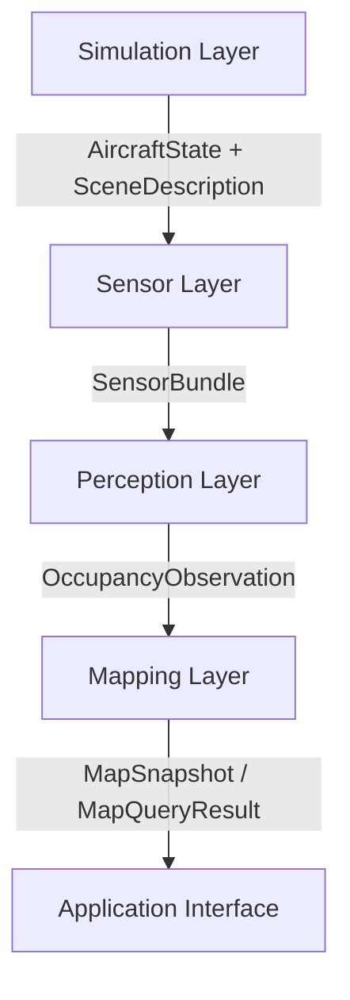

# UAV-FusionMap 系统架构

版本：v0.1；更新日期：2026-10-30；责任角色：system_architect。
状态：工程设计基线；SIM-00A/B、SIM-01A/B/C/D及SIM-SPEED-01已完成；SIM-01C历史证据
保护偏差已由用户明确接受并保留完整记录；
完整Phase 1及感知/地图运行能力仍待阶段验收。

## 1. 目标与范围

面向高速固定翼无人机，形成仿真状态、传感器、融合感知、三维占据、概率地图、场景
更新及应用接口的数据闭环。计划周期为2026年9月至2027年3月。

工程初始化已完成，当前推进仿真状态与传感器入口。系统应支持无研究算法启动、
占位感知和后续替换算法。
2027年3月的计划验收以仿真条件下感知—地图—应用接口为基线；自主控制、实飞和
完整传感器物理仿真的需求、资源与验收需独立评审，不能从数据闭环推导这些能力。

## 2. 分层与主数据流



| 层 | 职责 | 输入 | 输出 | 责任角色 |
| --- | --- | --- | --- | --- |
| Simulation | PX4、JSBSim、场景及仿真时间 | 飞机/环境配置与运行任务 | 状态、场景和明确标识的真值 | simulation_engineer |
| Sensor | 功能级Radar/IR/IMU、标定、同步、状态适配 | 场景/状态或设备数据 | SensorBundle及原始采集记录 | sensor_engineer |
| Perception | 预处理、多模态融合、占据预测、后端适配 | SensorBundle | OccupancyObservation | perception_engineer |
| Mapping | Local Map、概率、不确定性、Scene Map、后期DEM | 占据观测及上下文、显式地形先验 | MapSnapshot、MapQueryResult | mapping_engineer |
| Application | 规划数据接口、地图查询、可视化适配 | 地图公开接口与查询请求 | 带有效性/时间的应用数据 | integration_engineer |

运行数据字段以[DATA_FORMAT](DATA_FORMAT.md)为准，生产消费及超时行为以
[SENSOR_INTERFACE](SENSOR_INTERFACE.md)为准，变换以[COORDINATE_SYSTEM](COORDINATE_SYSTEM.md)为准。

10-28 APP-VIS-01新增原生RViz报告适配：application的SnapshotView只读转换公开
MapSnapshot；ros_ws承载既有MapQuery客户端、标准MarkerArray及原生RViz/Qt界面。
只消费公开地图与基础设施clock，点击PointStamped仅为本界面查询输入；没有原始传感器、
模型或地图私有状态旁路。live不启动模型/地图或另一个master，demo显式为独立fixture。
截图读回本窗口与Ogre渲染目标，实际ROS/回放/live及失效证据见
[APP-VIS-01记录](../experiments/2026-10-28-rviz-report-delivery.md)。公共业务字段和主数据流保持。

用户随后明确要求场景和Radar/IR传感器模拟，新增独立[SENS-VIS-01入口](SENSOR_SCENE_VISUALIZATION.md)：
Gazebo同源可见/碰撞几何与热材质→sensors几何Radar/热强度相机→既有SensorBundle→placeholder→Local Map。
Gazebo原生窗口与RViz内置PointCloud2/Image/TF并行查看，地图显示器只读公开snapshot。
该显式模式的simulation真值经既有state_adapter的scene_ground_truth分支注册到odom，
仍由该节点唯一发布动态TF，PX4默认estimated路径不变。不是PX4/JSBSim联动飞行或物理传感器验收。

10-29 [P5-DESIGN-01](PHASE5_SOFTWARE_COMBINATION_DESIGN_20261029.md)定义后续软件组合测试：
paired-M1传感器链、显式逆观测M4和独立地形层分开装配，原生场景没有DEM共同地理注册。
本轮仅设计，不改变上述层边界、公共字段或运行默认值；新场景/测试装配尚未实现。
后续P5-SW-01已交付[tests私有输入/独立预期/schema及离线消息往返](P5_SW01_INPUT_CONTRACT_20261029.md)，
未实现新运行装配或改层间协议；生命周期声明与公共可观测字段分开，实际组合仍属SW-02/03。
随后[SW-02显式测试入口](P5_SW02_ROS_COMBINATION_20261029.md)完成33个A/B实际ROS组合/公开回放：
A经源状态/传感器/感知/M1，B显式逆观测/M4，独立地形只接clock。仅新增tests薄适配与监督器，
旧公共字段、业务节点/default launch保持；S09原生显示/图故障与新run交接仍属SW-03。
随后[SW-03显式验收入口](P5_SW03_NATIVE_DELIVERY_20261029.md)已补齐S09/C：真实图前检拒绝、
自有进程清理/非子例哨兵保留、新run空地图/新实例/旧pin拒绝及分开的原生场景/地形窗口通过。
复核A/B源码与收据后完成37例软件矩阵；只新增测试控制台，不改变生产层边界或公共协议。

随后已归并[软件交付清单](SOFTWARE_DELIVERY_20261029.md)与[报告正文](REPORT_20261029.md)。
[SIM-MOTION-DESIGN-01](SIM_SCENE_MOTION_DESIGN_20261029.md)是下一功能的具体设计：
同一JSBSim FDM提供真值/时间，Gazebo只受控采样，逐step/传感器ACK后提交单一公共clock/状态；
新显式真值模式沿sensors状态适配保持唯一动态TF，旧PX4估计与静态场景默认不变。
场景推进协议只承载仿真基础设施；设计阶段没有实现宿主/插件，不据设计宣称运行。
后续[SIM-MOTION-SW-01](SIM_MOTION_SW01_CONTRACT_20261029.md)已生成独立场景基础设施2.msg/1.srv，
新包单向依赖旧AircraftState，逻辑合同/profile不导入ROS运行，严格codec只在显式调用时加载生成类型。
后续[SW-02](SIM_MOTION_SW02_ENGINE_20261029.md)已实现同FDM真值、固定注册、暂停Gazebo逐步服务及
真实Ray/Camera ACK，250步/10对/20 ACK和运行期故障通过；新入口显式装配，默认入口保持。
进程内同步安装公开SceneFrame元数据并发同内容话题镜像，消除元数据回调竞争；
ACK通过ROS实际发布/订阅确认，mailbox不携带raw业务数据，simulation不消费点云/图像。
truth terminal沿sensors适配非几何传播并锁定SceneStream，动态TF仍只有原state_adapter。
新模式端到端感知/地图及原生运动窗口留SW-03；不是第二个估计定位源或受控飞行验收。

2026-10-29 [SW-03](SIM_MOTION_SW03_DELIVERY_20261029.md)已接通显式真值模式的
SceneStream→placeholder→M1 latest→MapQuery/公开回放。运动入口要求同采样时刻pose，
保留5ms IR、10ms旧模式pose和40ms等待门槛，不能以旧历史pose掩盖同帧几何误差。
实际10组Bundle/占据/快照、14条查询和独立回放逐值核对；首采样/运行期ACK故障、
第二clock图冲突、新run空地图和History显示均有独立证据。placeholder只输出observed
占据，不由无回波推导free；源停止后的RViz历史显示不改变MapQuery显式时间语义。
SW-03只关闭单profile软件交接，下一项先设计有界多场景回归，不自动进入受控飞行。

随后[多场景具体设计](SIM_MOTION_SW04_MULTISCENE_DESIGN_20261029.md)已交付，尚未实施新场景。
拟增加独立测试清单，不放宽固定motion profile或修改公共字段；保持同FDM/原始时间/唯一权威。
显式空碰撞域去除默认ground，独立box最近相交校验真实回波；有效空帧不刷新历史cell证据或产生free。
按SW-04A输入/独立预期、B装配/几何屏障、C矩阵/原生交接推进，不延长1秒窗口或加控制。

随后[SW-04A](SIM_MOTION_SW04A_CONTRACT_20261029.md)已实现独立清单/有界逻辑校验及具名几何数据，
由离线测试消费；测试侧独立预期/oracle不进入在线业务模块。77组实际场景协议字节、36组
旧公共消息和18次合成源转换通过，旧定义/配置入口保持；未新增节点/切换屏障或运行新场景。
下一项SW-04B显式装配与真实采样机制，SW-04C再完成最终矩阵/窗口，不提高正式阶段状态。

随后[SW-04B](SIM_MOTION_SW04B_ENGINE_20261029.md)已提供显式case装配及S07默认关闭的几何epoch端点，
复用标准SetModelState，和SceneStep共用事务锁；仅在暂停边界更改具名障碍，不推进world/FDM时间。
端点只返回几何读回诊断；Radar/IR仍经原公开链进入感知/地图，独立原始FDM/射线oracle只用于评测。
实际空域、切换/回波返回、故障停止与旧默认入口通过，非原生新窗口/完整矩阵或受控飞行验收。

随后[SW-04C](SIM_MOTION_SW04C_DELIVERY_20261029.md)完成同源码9核心/3兼容与原生交接。
S04生成IC省略冲突gamma以保留theta先验；S05视场离开的合法空观测只推进header，不刷新旧证据。
独立Markley估计修正测试侧极分解泛化；原始FDM和在线转换不改。
原生多场景视图单帧归一化范围，避免五空帧掩盖首次Camera返回；旧默认视图配置保持。
84组业务/121查询、75帧box解析零豁免、公开回放及History raw关闭/地图历史失效通过。
该结果只关闭1秒无控制软件范围；下一项先设计受控飞行，不改变定位权威或正式阶段状态。

[SIM-FLIGHT-DESIGN-01](SIM_FLIGHT_DESIGN_20261029.md)随后完成具体提案：新隔离桥接记录
当前周期HIL→实际属性→同FDM一步的因果收据，先只读诊断，再独立v2/有界准备与受限STABILIZED脚本。
拟控制通路只在simulation内部接PX4既有控制器，不由地图/应用层发送控制或引入第二定位权威。
拟公共v2端点、30s准备/10s活动及命令能力均未实现；本轮只读审查不构成架构运行变更或飞行验收。
2026-10-30 [SW-01](SIM_FLIGHT_SW01_CONTRACT_20261030.md)只实现simulation内部标准库私有合同，
由tests离线验证；业务模块和ROS运行图尚无消费者。记录保留原始时间、显式缺包与unverified绑定，
离线校验不产生控制准入。新ground/40s字段仅为元数据，下一项SW-02实际诊断仍≤1秒且无命令；
不得将其送入旧Gazebo v1或作为第二状态/定位权威。
随后[SW-02](SIM_FLIGHT_SW02_DIAGNOSTICS_20261030.md)在simulation内部增加隔离桥接观察hook和单FDM宿主，
ros_ws只负责编译/进程装配，tests独立解码真实MAVLink与审计私有记录，不改五层业务图。
新构建在.runtime/ros独立目录，ground IC仅进私有诊断，不发布clock/state/TF；旧原源与默认构建保持。
实际250步/1s及连接关闭停止通过，但无执行器回包，控制门仍关闭；不将诊断passed升级为SW-03长窗准入。
随后[DIAG-DESIGN-02](SIM_FLIGHT_DIAG_DESIGN_20261030.md)明确拟议SW-02B只读观察边界：
simulation内私有合同、ros_ws有界现有POSIX客户端包装、tests收据审计，仍无五层业务图/定位权威变化。
本次PX4内部快照不能直接进入SensorBundle/地图，也不能将逐份读取称原子同tick或严格控制绑定。
本轮只交设计，未实现新客户端或运行入口；旧源码/公共字段及受控准入保持。
随后[SW-02B](SIM_FLIGHT_SW02B_PROBE_20261030.md)已实现上述私有合同/有界包装和显式probe，
实际step125读到三组积分IMU，但第二条estimator_status空实例触发严格停止，21查询未验收。
旧默认normal/disconnect、49飞行/84运动/952全仓及真实消息兼容通过；业务层边界与控制门保持。
下一项只做空实例三态/独立诊断事件的具体设计，不将无载荷当有效状态或自动扩大运行范围。
随后[DIAG-DESIGN-03](SIM_FLIGHT_DIAG_DESIGN03_20261030.md)明确独立私有diagnostic事件与显式新模式，
以三态记录完整/未发布/本次无载荷，允许完整/空块混合但不容许部分字段或异常文本。
只是诊断基础设施设计，未实现新模块/入口；旧strict不改，五层业务图/定位权威和控制门保持。
随后[SW-02C](SIM_FLIGHT_SW02C_DIAGNOSTICS_20261030.md)已实现simulation内独立私有diagnostic合同、
ros_ws薄记录器/显式入口和tests阶段装配；原strict/公共协议与业务图保持。
实际125步三态采集可继续，250步第11次状态含nan拒绝，完整采集未验收；69/84/972项回归通过不开放控制。
下一项只设计原生非有限诊断字段隔离，不把不可用质量、顺序快照或软件回归当运行状态准入。
随后[DIAG-DESIGN-04](SIM_FLIGHT_DIAG_DESIGN04_20261030.md)完成两字段条件隔离设计：拟独立私有diagnostic v2，
用同实例完整载荷的源标志核对准确nan，并明确质量不可用；旧两个v1和五层业务边界不改。
该私有记录版本不代表Scene公共v2或新运行能力；本轮无新合同/模式实现，后续SW-02D补证不开放控制。
随后[SW-02D](SIM_FLIGHT_SW02D_QUALITY_20261030.md)已实现独立私有v2、源语义/布局预检及显式质量诊断分支。
实际21查询/三参数及原文独立重读完成；12处两字段不可用保留原因/原token，不接业务状态/地图链。
采集完整但正文/载荷不完整，六flags已读样本tilt/yaw未对齐，selected姿态缺失、执行器0包。
旧两个v1/五层业务图/公共协议保持；92/84/995项回归通过不开放控制。
下一项只设计初始化准备条件与SW-03衔接，不自动扩窗、新增ROS/TF或发送命令。
随后[INIT-DESIGN-01](SIM_FLIGHT_INIT_DESIGN_20261030.md)完成IC→pilot IMU→首次初始化→tilt/yaw→选择器链审查，
定义私有准备证据、JSBSim接触与PX4 landed/at_rest分离及SW-03A/B拆分。
新profile/宿主/合同尚未实施，下一项INIT-SW-01仅离线合同；无五层业务图/定位权威或公共协议变化。
随后[INIT-SW-01](SIM_FLIGHT_INIT_SW01_CONTRACT_20261030.md)已新增simulation内独立私有合同/观测校验，
tests消费冻结合成JSON/原文，执行源前后/接触/身份/84查询/四门评价；现有纯字段/完整块函数复用，旧封套/模式保持。
新fixture仅元数据，当前没有运行消费者、状态/TF发布者或ROS端点；127/84/1030项回归与真实旧消息兼容通过。
下一项INIT-SW-02才实现私有宿主/运行薄装配，实际准备与SW-03公共v2仍独立验收。
随后[INIT-SW-02](SIM_FLIGHT_INIT_SW02_PREPARATION_20261030.md)已新增simulation独立宿主/hook，ros_ws只做源副本构建/
进程与只读查询装配，tests独立解码wire/逐步物理/原文；同一FDM/原IC，无新ROS/TF或跨层业务消费者。
实际2s/78零包后第30条selector非有限被拒绝，完整准备未验收；故障/旧入口/134-84-1037项回归不开放控制。
后续先审查selector槽位身份与表示，不让诊断NaN或零输出变成业务有效状态。
随后[selector设计](SIM_FLIGHT_INIT_SELECTOR_DESIGN_20261030.md)已交付独立私有观测数据集与原物理流的显式组合，
拟simulation纯解析/关联评价、ros_ws后续98项只读装配、tests独立消费；前后设备表不证明selector同消息消费。
本轮仅文档，下一项离线合同；五层业务链、原宿主/84入口与公共协议保持，没有新状态/TF或控制准入。
随后[selector SW-01](SIM_FLIGHT_INIT_SELECTOR_SW01_CONTRACT_20261030.md)已在simulation新增独立私有纯校验/关联评价，
tests合成生产/离线消费，新profile组合原物理v1；没有ros_ws新运行消费者或业务状态旁路。
98计划/两组文件及旧真实消息兼容通过，原476源码不改；实际装配/准备留SW-02，五层权威与控制门保持。
随后[selector SW-02](SIM_FLIGHT_INIT_SELECTOR_SW02_PREPARATION_20261030.md)已新增ros_ws独立98查询/runner与tests原wire审计，
simulation只修末查询/固定资源链接两处离线组合边界；原物理宿主、在线状态/TF及公共业务图保持。
实际59项/1007 Run后发送端整数时间截断触发停止，完整准备未验收；下一项仅隔离源副本时间生产修复。
随后[INIT-TIME-SW-01](SIM_FLIGHT_INIT_TIME_SW01_DELIVERY_20261030.md)只在simulation源副本添加HIL/GPS发送前时间校验/生成，
新ros_ws显式入口和tests来源审计，旧488源码/在线状态权威/公共协议保持。
单profile 10s/98采集及双末检查点准备已通过，控制门仍false；下一项SW-03A只离线公共v2，不开新业务运行图。

2026-11-02 [SW-03A](SIM_FLIGHT_SW03A_CONTRACT_20261102.md)已在已有场景消息包内新增独立公共ufm_flight_contract，
只离线复用Scene实际生成类型并显式protocol_version=2，冻结ground ENU/profile与独立端点名称/类型。
旧25消息定义/v1合同/默认入口及五层运行图保持；无新插件、节点、客户端、状态/TF权威或长窗运行。
无版本的未应用失败响应在v2拒绝，应用前错误留SW-03B服务失败实现；不能伪造已应用帧。
28新定向/245真实字节及双向拒绝通过；SW-03B才实施运行消费者/采样屏障，控制仍false。

## 3. 依赖规则

1. 业务模块只消费相邻上游的公开契约；不得跨层导入实现、读私有文件或订阅业务话题。
2. mapping不得读取原始Radar/IR；application不得读取原始传感器、模型张量或地图内部缓存。
3. perception输出必须带同一观测时刻的状态/变换上下文，mapping不用回读仿真或传感器。
4. ros_ws承担消息、节点包装和启动装配；包装节点只调用自己所属模块的业务实现。
5. 公共时钟、诊断和记录传输属于基础设施，不能携带越层感知或地图业务逻辑。
6. configs集中管理配置职责；各模块可读取自己的配置，不复制同一参数的冲突版本。
7. 仿真真值用于传感器模拟和独立实验评价。占位输出若由真值构造必须标为fixture，
   真值不得隐式进入research感知输入。
8. 后期DEM通过mapping的TerrainPrior适配入口接入，具有独立地理基准、时间和质量契约。

ROS承载层并不改变上述层级；离线文件回放也必须经过对应公开入口。

驱动原始载荷与业务契约分层：Radar驱动可发布PointCloud2、IR驱动可发布Image，随后由
sensors设备适配器校验字段、单位、坐标和采集时间并形成RadarFrame/InfraredFrame。
模型特定voxel、归一化、裁剪和张量布局由perception适配器完成，不能下沉到通用驱动。

## 4. 时钟、状态与坐标的责任

simulation提供仿真时间及源状态。sensors负责将源时间和坐标转换为系统约定，保留
原始时间、偏移和同步残差；状态可来自已有PX4估计或仿真真值，必须标识来源。
本阶段不承诺实现新的定位算法。

“定位权威职责”表示对连续odom状态、来源、reset、质量和唯一odom→base_link发布者
负责，不表示当前新增独立Localization层或目录。现有PX4 EKF→AircraftState链继续作为
唯一已实现来源；未来出现第二种定位源时再评审选择/融合模块。当前`state_adapter_node`
可选发布`nav_msgs/Odometry`和唯一动态`odom -> base_link` TF作为ROS兼容镜像，但不能
单独替代AircraftState的run_id、clock_id、sample_id、来源及valid/degraded/unavailable语义。

sensors在参考时刻构建SpatialContext，随SensorBundle传给perception，再随占据输出
传给mapping。当前fixture采用不晚于观测时刻的最近有效历史位姿，年龄上限为10ms；这
不是插值。匀速直线运动下，仅由历史选择产生的位置误差上限为v×10ms，即35/50/70m/s
分别为0.35/0.50/0.70m，必须作为运动基线的误差预算单独报告。动态变换不得用“最新
位姿”替代历史观测时刻的位姿。

初始Local Map使用连续的odom坐标。Scene Map使用map坐标；map与odom的关系只有在
来源明确时才可用。缺少变换时声明不可用，不用单位矩阵掩盖。
重新开始仿真必须更换run_id，旧地图不得继续融合新运行的数据。
mapping不直接订阅最新AircraftState或Odometry；sensors在Radar参考时刻选择权威状态，
当前fixture为不晚于该时刻的最近历史样本，写入SpatialContext，perception随
OccupancyObservation传递给mapping。

## 5. 训练数据生成与在线运行配置

系统明确区分两种启动图：

```text
training_data_generation:
  fake Radar + fake IR -> 模型输入记录
  fake LiDAR -> occupancy target + observed mask监督记录

inference:
  Radar + IR + AircraftState -> SensorBundle -> Perception -> Mapping
```

fake LiDAR只在训练数据生成模式运行，并与fake Radar/IR及状态使用同一run、时钟和标定
关系。LiDAR点云及其派生target/observed mask不得进入在线SensorBundle、定位、mapping或
Radar+IR模型forward输入。无LiDAR回波不自动表示free；监督标签必须保留射线覆盖、遮挡、
量程和FOV形成的observed mask。在线或部署系统不要求搭载LiDAR。

## 6. 三种感知模式

| 模式 | 行为 | 下游语义 | 验收范围 |
| --- | --- | --- | --- |
| disabled | 不加载模型；传递状态上下文与无有效占据的周期消息 | status=unavailable，不产生自由证据；地图仅按策略维护老化和状态 | 无模型启动、状态与异常链路 |
| placeholder | 使用确定性小场景生成标准占据观测 | source_type=fixture，质量来源明确 | 字段、坐标、地图更新、查询和回放 |
| research | 通过适配器调用选定研究后端 | source_type=model；按实际结果标valid/degraded/unavailable | 另验模型质量、时延、资源和持续运行 |

三种模式对外使用同一契约。research后端不满足输入或发生超时，输出不可用状态；
禁止静默切换成未标识的占位结果。占位通过不代表Radar–IR感知目标完成。

2026-10-27已完成统一感知纯业务入口及可选有界CPU执行的软件交接；
mapping公开占据记录回放和application五类查询客户端也已实现并验证，见
[EXP-20261027-005](../experiments/2026-10-27-p3-m1-app-handoff.md)。
应用只经公开MapQuery获取结果，回放只消费OccupancyObservation，五层边界不变；
当前research仍不可用，不由CPU测试替身推导真实后端质量或机载性能。

## 7. 双仓边界与研究复用

UAV-FusionMap是系统工程主仓。4D-Radar-Diffusion位于同级独立仓库，本机绝对路径为
`/home/zxj/catkin_ws/src/4D-Radar-Diffusion/`；相对UAV-FusionMap根为`../4D-Radar-Diffusion/`。
可复用实现和当前阻断见[algorithms登记](../algorithms/README.md)。

- algorithms登记位置、版本、输入输出和验证证据，不存放整个研究仓库的副本。
- perception负责Radar体素/IR/标定适配和预测结果到系统占据接口的转换。
- 研究地图原型由mapping独立评估；不能使mapping经perception间接依赖研究网络包。
- 研究依赖安装或运行方式在小样本验证时决定，不能成为disabled/placeholder启动前提。
- 当前模型体素使用LiDAR参考系，输出C,Z,X,Y布局；该约定只在研究适配边界保留。
  `model_lidar`是历史模型逻辑参考系，不代表在线硬件；推理适配必须提供该逻辑参考系
  到Body/Radar的已验证关系。LiDAR只作为离线或仿真训练监督，不进入forward。

## 8. 工程目录与唯一职责

simulation/sensors/perception/mapping/application分别对应五层。
ros_ws/src已建立Noetic的uav_fusionmap_msgs、simulation、sensors、perception、mapping五个包；
纯业务逻辑分别归同名业务目录，消息转换归ROS承载。Python默认用户指定的
Conda Radar-Diffusion，不加载研究代码或模型；新构建输出位于.runtime/ros。
tests负责跨模块测试，模块内部测试随实现维护；experiments记录配置、结果和产物位置。
docs维护设计依据；PROJECT_STATUS维护当前事实；configs管理参数和版本组合。
每个目录的AGENTS定义允许与禁止修改范围。
当前不新增localization目录：定位权威职责继续由simulation源处理与sensors状态适配承载；
只有第二种实际定位源及其选择/融合需求成立并获确认时，才评审独立模块迁移。

## 9. 验收与变更

阶段验收见[DEVELOPMENT_PLAN](DEVELOPMENT_PLAN.md)。首先验收Local Map，再验概率、
不确定性、Scene Map和DEM。接口定义、源码存在、运行通过、场景达标分别记录。

架构或公共字段变化须说明生产者、消费者、迁移方式和验证方法，按根AGENTS确认范围，
然后更新[DECISION_LOG](DECISION_LOG.md)。接口版本变化不等于自动接受旧数据。

## 10. 尚待确定

ROS/PX4/JSBSim/桥接版本组合、目标航速、机载算力、探测范围、地图分辨率、同步误差、
更新频率、延迟和质量阈值均未验证。责任、目标日期与阻塞范围见开发计划和决策日志。
已验证的局部入口为[SIM-00B](../simulation/RUN_SIM00B.md)、
[SIM-01A](../simulation/RUN_SIM01A.md)、[SIM-01B](../simulation/RUN_SIM01B.md)及
[SIM-01C](../simulation/RUN_SIM01C.md)，覆盖静止状态/时钟、300秒记录与两种回放、
F0—F7异常以及0.5/1/2倍短窗技术矩阵，非完整系统启动或高速地图验收。

2026-09-11 ENV-02已形成[Phase 1候选与验证方案](SIMULATION_VALIDATION_PLAN.md)：
优先测试Noetic/PX4 v1.13.3/JSBSim 1.1.13/MAVROS 1.20.1，独立动力学主循环与ROS传输，
源状态/时钟提取归simulation，坐标/同步适配仍归sensors。该设计选择不改变五层契约；
独立构建、状态消息编码、静止链路、300秒LIVE/B1/B2回放及SIM-01C异常/
短窗倍速矩阵已通过；SIM-01C证据保护偏差已获用户明确接受，不再阻塞关闭。
SIM-01D持续性已于2026-10-05独立通过；PERF-01及ENV-03仍阻塞正式Phase 1基线。接入及记录回放
细化见ADR-009/010，倍速修复决定见ADR-P013。
bag索引为接收单调经过时间，原业务timestamp/run/clock保持；回放唯一公共clock来自原bag，
B2只重新执行sensors，不再次验证simulation源看门狗。

2026-09-20已通过PERF-01-A静止小负载占位闭环：source fixture→Radar/IR→bundle→
placeholder occupancy→稀疏地图，160样本与真实消息/计时事件闭合，退出清理通过。
接口支持范围见[DATA_FORMAT §12](DATA_FORMAT.md)，运行证据见
[EXP-20260920-001](../experiments/2026-09-20-perf01a-integration.md)。
该09-20交付是固定odom小格网，保留有限cell及过期检测；后续单点查询与可选滚动
窗口见下文。研究模型质量、高速实时与机载资源仍未验收；SIM-01D持续性另有独立证据。

2026-10-14完成固定网格单点查询的软件承载子范围：`/uav/map/query`是默认关闭的可选
mapping服务，和地图更新共用实例及锁，向application返回显式五类状态、身份、覆盖、
新鲜度和质量可用性。启用、关闭及未配置分类阈值的ROS fixture均通过，图检查只允许
occupancy和仿真公共`/clock`进入mapping；该`/clock`是ROS仿真基础设施，不是传感器业务
输入。该次固定网格子范围仍无滚动窗口、概率累计、自动坐标转换、真实设备输入或正式性能验收。

2026-10-14追加可选基础滚动Local Map软件子范围：mapping仅从OccupancyObservation
内的观测时刻SpatialContext读取odom中的body位置，以初始锚点进行轴对齐整格
平移。重叠单元保留物理位置/观测时间，移出单元丢弃，新区域保持unknown；
快照和单点查询随当前origin对齐，原有固定模式默认不变。独立ROS fixture与
全仓轻量回归见[EXP-20261014-011](../experiments/2026-10-14-local-map-rolling.md)。
没有加入mapping对AircraftState、Odometry、Radar/IR或训练LiDAR的业务订阅；
尚无概率累计、DEM、真实设备输入、正式PERF-01或自主控制验收。

PERF-01-A异步扩展把fake Radar/IR拆为sensors层两个独立发布进程，sensors匹配节点
订阅原始业务帧并维护有界缓存；source保留唯一clock和状态发布职责。薄ROS包装
调用`sensors/ufm_sensors/perf01a_async.py`，perception和mapping消费接口保持。
本轮时序与核账规则见[PERF01A_ASYNC](PERF01A_ASYNC.md)，不改变五层数据流。

2026-09-23另以功能级直线运动fixture完成35/50/70m/s小图时空一致性短场景，
独立评价使用固定世界障碍物，perception/mapping仍只消费相邻上游公开消息；
该记录不覆盖640×512负载与20ms指标或机载能力；SIM-01D随后已独立完成。
证据和失败边界见[EXP-20260923-001](../experiments/2026-09-23-perf01a-motion.md)。

## 11. 运行装配与诊断边界（2026-10-27）

感知与地图的ROS运行网格统一由`configs/local_map_fixture.yaml`装配；配置解析、
三种感知模式及有界身份历史见[运行配置说明](RUNTIME_CONFIGURATION.md)。
新增`inference_fixture.launch`可关闭诊断并不依赖实验观察订阅者，仍是paired软件fixture；
训练图继续独立。旧实验runner保留严格就绪、探针与候选复现，不将审计目录变成
新独立入口的业务依赖；五层数据流、消息字段和阶段退出门槛保持原约定。

M2-SW-01—04合成软件试制已完成：固定/滚动概率候选只消费声明逆观测域的fixture占据，
ROS与公开占据回放通过共享模块内创建入口显式选择，节点私有map_backend仍默认latest。
不让原placeholder或研究后验自动进入累计，不增加公共消息或地图传感器订阅。
独立ROS/回放/应用及旧入口兼容证据见
[EXP-20261027-010](../experiments/2026-10-27-m2-ros-handoff.md)，非正式M1/M2、真实质量或资源验收。

M4-DESIGN-01已交付[Scene Map/有界子地图具体设计](M4_SOFTWARE_TRIAL_PLAN_20261027.md)。
拟在mapping模块内组合活动M3和有界封存目录，经显式固定合成map←odom注册，导出
一个固定map网格的既有MapSnapshot/MapQueryResult。重叠估计用唯一所有权管理，不把
累计快照再次当成逆观测证据；不新增消息、跨层订阅或定位模块。
首版只计划固定平移/同分辨率/整格子集，动态注册与未声明reset不能据此视为解决。
DESIGN-01时只有设计/承载审计，未实现Scene类或m4_fixture入口；
证据见[EXP-20261027-016](../experiments/2026-10-27-m4-design-review.md)。
用户后续“继续”确认具体范围，SW-01完成mapping内独立fixture注册/输入checker和
测试专用独立预期表，8场景41输入52查询预期、24项定向及594项全仓通过，见
[EXP-20261028-001](../experiments/2026-10-28-m4-fixture-contract.md)。
SW-01时默认入口未导入新checker，未创建Scene候选或接入ROS；公共字段及五层数据流保持。

SW-02随后在mapping内新增显式Scene候选：组合活动M3和封存目录，只通过M3公开
update/snapshot取得估计；以固定合成注册导出单网格公开视图，唯一所有权阻止重叠重复
累计及旧副本复活。更新在一个临时完整状态中校验后整体提交，不新增跨层输入或业务订阅。
8场景41输入52查询对保存独立预期一致，15项新增/M4共39项及全仓609项通过，见
[EXP-20261028-002](../experiments/2026-10-28-m4-scene-candidate.md)。
SW-02时仅显式类调用，后续完整时序/资源及实际ROS证据分别见下文。

SW-03随后仅新增测试专用时序/资源工具，未修改任何业务源码：140帧323查询、4个
联合事务后段故障点及新run域隔离通过；稳定载荷/索引与临时副本计数分开，H条身份
保留的voxel载荷按H*V核对，不将N个活跃cell等同于输入消息大小。
新增13项/M4共52项及全仓622项通过，见
[EXP-20261028-003](../experiments/2026-10-28-m4-time-resources.md)。
对象计数非RSS或正式性能；SW-03未启M4 ROS。

SW-04随后在同一工厂/节点/回放加入默认关闭的m4_fixture显式选型，完整私有配置与
run/clock/rolling必需，混配置、参数覆盖或注册错误拒绝且不fallback。公共字段不变，
mapping仍只消费OccupancyObservation，clock只作基础设施；没有状态/原始传感器/训练旁路。
实际独立ROS已通过15观测9快照20查询/174项检查、公开回放与独立应用map查询，
旧M1/M2/M3/placeholder及清理通过，全仓629项通过，见
[EXP-20261028-004](../experiments/2026-10-28-m4-ros-handoff.md)。
这只关闭固定合成注册下的有界Scene软件试制；真实注册/定位连续性、真实质量与机载资源仍另验。
M5-DESIGN-01已完成[TerrainPrior/DEM准入与兼容设计](M5_TERRAIN_PRIOR_DESIGN_20261028.md)。
首个拟议软件范围为mapping内独立、默认关闭的地形高程层，先做私有离线合同/输入校验及独立预期；
不将高度或no-data解释成占据/自由，不改现有地图更新、来源、质量或观测时间。
真实地理注册、公共地形协议及DEM辅助占据融合分别另审，application不读取私有DEM旁路。
本轮只交付设计，未新增模块、ROS输入或公共字段；10项边界/算例与40项既有定向检查见
[EXP-20261028-007](../experiments/2026-10-28-m5-design-review.md)，不是DEM实现或场景验收。

用户后续确认M5-SW-01：mapping内新增独立[m5_contract](../mapping/ufm_mapping/m5_contract.py)
只做私有地形fixture JSON/请求输入校验，不导入GIS、生成占据或改变工厂选型。
45组实际输入/16组独立预期、5个请求语法与21项新增/670项轻量回归通过，见
[EXP-20261028-008](../experiments/2026-10-28-m5-fixture-contract.md)。
SW-01时地形候选/安装查询与公共地形协议尚未实现；应用不读取私有地形文件，在线主链不变。

SW-02随后新增显式独立TerrainFixture与私有事件回放，读取SW-01冻结输入/预期，
执行固定fixture中心采样、米制区间/缺失质量、原子版本和幂等/冲突/reset门控。
候选不经工厂创建，不产生或消费占据消息；135项保存预期、24项新增/694项全仓通过，见
[EXP-20261028-009](../experiments/2026-10-28-m5-terrain-candidate.md)。
SW-03随后完成[时序/资源/失败恢复组合](M5_SW03_TIME_RESOURCES_20261028.md)：
84事件/64版大载荷/五处故障、保存输入重放及占据隔离通过，新增10项/全仓704项通过。
仅修补私有文本编码前限额，默认工厂/公共接口/在线主链不变；资源数据是逻辑载荷采样，非RSS。
真实DEM/地理转换和公共地形ROS/应用接口尚未实现或验收。
M5-IFACE-DESIGN-01随后已交付[公共地形具体提案](M5_IFACE_DESIGN_20261028.md)：
拟独立消息包4.msg/1.srv，默认关闭的Provider、单点查询/状态、公共记录及独立客户端/显示。
查询明确实例/revision、请求与evaluation时间、源/注册/结果高度质量，不复用占据字段或发布TF。
本轮只有设计/既有边界审计和74项定向通过，未生成新类型或增加运行链路；实际实施按具体方案另确认。

用户随后明确授权M5-IFACE-SW-01，已新增独立4.msg/1.srv及新包内公开`ufm_terrain_contract`，
承载无ROS运行副作用的逻辑校验与严格codec；mapping的terrain_dataset/terrain_recording_contract
只做公开输入包装/元数据投影与记录结构检查。具体边界见[离线合同](M5_IFACE_SW01_CONTRACT_20261028.md)，
29项新增及733项全仓轻量回归见[EXP-20261028-012](../experiments/2026-10-28-m5-interface-contract.md)。
类型已生成不代表生产消费图已接通；本轮无Provider/节点/客户端/显示或公共执行回放，旧五层链与TF权威保持。

后续SW-02已新增mapping的[TerrainProvider](../mapping/ufm_mapping/terrain_provider.py)及独立薄节点包，
只经显式公共dataset与认可clock输入，向公开TerrainQuery/TerrainStatus输出；默认旧launch不装配。
同一临界区绑定evaluation/版本，clock来源/超时/reset与单次启动安装独立于旧占据层；不发布TF。
实际28查询/15状态/38检查、新run恢复及旧占据兼容/清理通过，全仓753项见
[EXP-20261028-013](../experiments/2026-10-28-m5-provider-ros.md)。
节点/clock具体边界见[SW-02说明](M5_IFACE_SW02_PROVIDER_20261028.md)，公共执行回放/客户端/RViz仍留SW-03。

2026-10-29 SW-03已完成[独立客户端/公共录制与执行回放/可选RViz地形](M5_IFACE_SW03_DELIVERY_20261029.md)。
application只读公开status/result/replay输出，ros_ws承载服务期限和标准Marker，mapping拥有公开记录生产/执行回放；
地形不成为占据backend，不引入传感器/定位/训练旁路或第二个TF来源。
live与recorded命名空间独立；记录无法完整表达的故障明确incomplete，不冒充已重放。
实际ROS/四图像素及旧Gazebo/Radar/IR/占据链、774项回归见
[EXP-20261029-001](../experiments/2026-10-29-m5-terrain-delivery.md)。
只关闭M5公共合成软件范围，真实DEM/占据融合与完整Phase 4仍未验收；下一项先做Phase 5软件组合场景设计。

2026-10-30按用户新增授权完成[真实高程独立预览和参数化演示](REPORT_IMPROVEMENTS_20261030.md)：
mapping的ElevationRaster读取真实Copernicus DSM并公开导出静态高程/元数据，application只读导出生成表面，
ros_ws独立发布terrain_demo Marker，不接旧M5 Provider或占据层。原始UTM/EGM2008坐标与减去显示高程原点的
terrain_display_local分开命名，不发布TF。传感器新增默认关闭的测量参数；显式report场景仍沿
同JSBSim→场景→Radar/IR→占位感知→地图链路，旧公共字段和状态权威保持。
