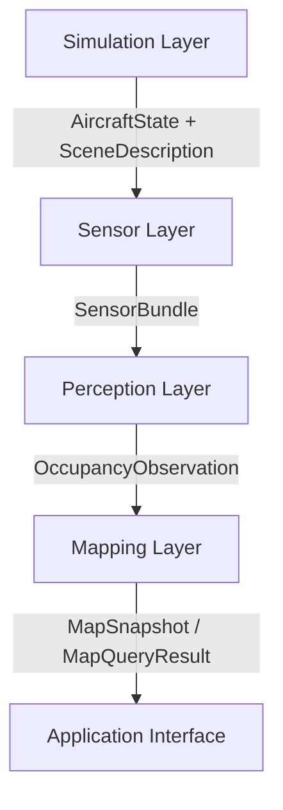

# UAV-FusionMap 系统架构

版本：v0.1；更新日期：2026-10-14；责任角色：system_architect。
状态：工程设计基线；SIM-00A/B、SIM-01A/B及SIM-01C已完成；SIM-01C历史证据
保护偏差已由用户明确接受并保留完整记录；
完整Phase 1及感知/地图运行能力仍待阶段验收。

## 1. 目标与范围

面向高速固定翼无人机，形成仿真状态、传感器、融合感知、三维占据、概率地图、场景
更新及应用接口的数据闭环。计划周期为2026年9月至2027年3月。

工程初始化已完成，当前推进仿真状态与传感器入口。系统应支持无研究算法启动、
占位感知和后续替换算法。
2027年3月的计划验收以仿真条件下感知—地图—应用接口为基线；自主控制、实飞和
完整传感器物理仿真的需求、资源与验收需独立评审，不能从数据闭环推导这些能力。

## 2. 分层与主数据流



| 层 | 职责 | 输入 | 输出 | 责任角色 |
| --- | --- | --- | --- | --- |
| Simulation | PX4、JSBSim、场景及仿真时间 | 飞机/环境配置与运行任务 | 状态、场景和明确标识的真值 | simulation_engineer |
| Sensor | 功能级Radar/IR/IMU、标定、同步、状态适配 | 场景/状态或设备数据 | SensorBundle及原始采集记录 | sensor_engineer |
| Perception | 预处理、多模态融合、占据预测、后端适配 | SensorBundle | OccupancyObservation | perception_engineer |
| Mapping | Local Map、概率、不确定性、Scene Map、后期DEM | 占据观测及上下文、显式地形先验 | MapSnapshot、MapQueryResult | mapping_engineer |
| Application | 规划数据接口、地图查询、可视化适配 | 地图公开接口与查询请求 | 带有效性/时间的应用数据 | integration_engineer |

运行数据字段以[DATA_FORMAT](DATA_FORMAT.md)为准，生产消费及超时行为以
[SENSOR_INTERFACE](SENSOR_INTERFACE.md)为准，变换以[COORDINATE_SYSTEM](COORDINATE_SYSTEM.md)为准。

## 3. 依赖规则

1. 业务模块只消费相邻上游的公开契约；不得跨层导入实现、读私有文件或订阅业务话题。
2. mapping不得读取原始Radar/IR；application不得读取原始传感器、模型张量或地图内部缓存。
3. perception输出必须带同一观测时刻的状态/变换上下文，mapping不用回读仿真或传感器。
4. ros_ws承担消息、节点包装和启动装配；包装节点只调用自己所属模块的业务实现。
5. 公共时钟、诊断和记录传输属于基础设施，不能携带越层感知或地图业务逻辑。
6. configs集中管理配置职责；各模块可读取自己的配置，不复制同一参数的冲突版本。
7. 仿真真值用于传感器模拟和独立实验评价。占位输出若由真值构造必须标为fixture，
   真值不得隐式进入research感知输入。
8. 后期DEM通过mapping的TerrainPrior适配入口接入，具有独立地理基准、时间和质量契约。

ROS承载层并不改变上述层级；离线文件回放也必须经过对应公开入口。

驱动原始载荷与业务契约分层：Radar驱动可发布PointCloud2、IR驱动可发布Image，随后由
sensors设备适配器校验字段、单位、坐标和采集时间并形成RadarFrame/InfraredFrame。
模型特定voxel、归一化、裁剪和张量布局由perception适配器完成，不能下沉到通用驱动。

## 4. 时钟、状态与坐标的责任

simulation提供仿真时间及源状态。sensors负责将源时间和坐标转换为系统约定，保留
原始时间、偏移和同步残差；状态可来自已有PX4估计或仿真真值，必须标识来源。
本阶段不承诺实现新的定位算法。

“定位权威职责”表示对连续odom状态、来源、reset、质量和唯一odom→base_link发布者
负责，不表示当前新增独立Localization层或目录。现有PX4 EKF→AircraftState链继续作为
唯一已实现来源；未来出现第二种定位源时再评审选择/融合模块。当前`state_adapter_node`
可选发布`nav_msgs/Odometry`和唯一动态`odom -> base_link` TF作为ROS兼容镜像，但不能
单独替代AircraftState的run_id、clock_id、sample_id、来源及valid/degraded/unavailable语义。

sensors在参考时刻构建SpatialContext，随SensorBundle传给perception，再随占据输出
传给mapping。当前fixture采用不晚于观测时刻的最近有效历史位姿，年龄上限为10ms；这
不是插值。匀速直线运动下，仅由历史选择产生的位置误差上限为v×10ms，即35/50/70m/s
分别为0.35/0.50/0.70m，必须作为运动基线的误差预算单独报告。动态变换不得用“最新
位姿”替代历史观测时刻的位姿。

初始Local Map使用连续的odom坐标。Scene Map使用map坐标；map与odom的关系只有在
来源明确时才可用。缺少变换时声明不可用，不用单位矩阵掩盖。
重新开始仿真必须更换run_id，旧地图不得继续融合新运行的数据。
mapping不直接订阅最新AircraftState或Odometry；sensors在Radar参考时刻选择权威状态，
当前fixture为不晚于该时刻的最近历史样本，写入SpatialContext，perception随
OccupancyObservation传递给mapping。

## 5. 训练数据生成与在线运行配置

系统明确区分两种启动图：

```text
training_data_generation:
  fake Radar + fake IR -> 模型输入记录
  fake LiDAR -> occupancy target + observed mask监督记录

inference:
  Radar + IR + AircraftState -> SensorBundle -> Perception -> Mapping
```

fake LiDAR只在训练数据生成模式运行，并与fake Radar/IR及状态使用同一run、时钟和标定
关系。LiDAR点云及其派生target/observed mask不得进入在线SensorBundle、定位、mapping或
Radar+IR模型forward输入。无LiDAR回波不自动表示free；监督标签必须保留射线覆盖、遮挡、
量程和FOV形成的observed mask。在线或部署系统不要求搭载LiDAR。

## 6. 三种感知模式

| 模式 | 行为 | 下游语义 | 验收范围 |
| --- | --- | --- | --- |
| disabled | 不加载模型；传递状态上下文与无有效占据的周期消息 | status=unavailable，不产生自由证据；地图仅按策略维护老化和状态 | 无模型启动、状态与异常链路 |
| placeholder | 使用确定性小场景生成标准占据观测 | source_type=fixture，质量来源明确 | 字段、坐标、地图更新、查询和回放 |
| research | 通过适配器调用选定研究后端 | source_type=model；按实际结果标valid/degraded/unavailable | 另验模型质量、时延、资源和持续运行 |

三种模式对外使用同一契约。research后端不满足输入或发生超时，输出不可用状态；
禁止静默切换成未标识的占位结果。占位通过不代表Radar–IR感知目标完成。

## 7. 双仓边界与研究复用

UAV-FusionMap是系统工程主仓。4D-Radar-Diffusion位于同级独立仓库，本机绝对路径为
`/home/zxj/catkin_ws/src/4D-Radar-Diffusion/`；相对UAV-FusionMap根为`../4D-Radar-Diffusion/`。
可复用实现和当前阻断见[algorithms登记](../algorithms/README.md)。

- algorithms登记位置、版本、输入输出和验证证据，不存放整个研究仓库的副本。
- perception负责Radar体素/IR/标定适配和预测结果到系统占据接口的转换。
- 研究地图原型由mapping独立评估；不能使mapping经perception间接依赖研究网络包。
- 研究依赖安装或运行方式在小样本验证时决定，不能成为disabled/placeholder启动前提。
- 当前模型体素使用LiDAR参考系，输出C,Z,X,Y布局；该约定只在研究适配边界保留。
  `model_lidar`是历史模型逻辑参考系，不代表在线硬件；推理适配必须提供该逻辑参考系
  到Body/Radar的已验证关系。LiDAR只作为离线或仿真训练监督，不进入forward。

## 8. 工程目录与唯一职责

simulation/sensors/perception/mapping/application分别对应五层。
ros_ws/src已建立Noetic的uav_fusionmap_msgs、simulation、sensors、perception、mapping五个包；
纯业务逻辑分别归同名业务目录，消息转换归ROS承载。Python默认用户指定的
Conda Radar-Diffusion，不加载研究代码或模型；新构建输出位于.runtime/ros。
tests负责跨模块测试，模块内部测试随实现维护；experiments记录配置、结果和产物位置。
docs维护设计依据；PROJECT_STATUS维护当前事实；configs管理参数和版本组合。
每个目录的AGENTS定义允许与禁止修改范围。
当前不新增localization目录：定位权威职责继续由simulation源处理与sensors状态适配承载；
只有第二种实际定位源及其选择/融合需求成立并获确认时，才评审独立模块迁移。

## 9. 验收与变更

阶段验收见[DEVELOPMENT_PLAN](DEVELOPMENT_PLAN.md)。首先验收Local Map，再验概率、
不确定性、Scene Map和DEM。接口定义、源码存在、运行通过、场景达标分别记录。

架构或公共字段变化须说明生产者、消费者、迁移方式和验证方法，按根AGENTS确认范围，
然后更新[DECISION_LOG](DECISION_LOG.md)。接口版本变化不等于自动接受旧数据。

## 10. 尚待确定

ROS/PX4/JSBSim/桥接版本组合、目标航速、机载算力、探测范围、地图分辨率、同步误差、
更新频率、延迟和质量阈值均未验证。责任、目标日期与阻塞范围见开发计划和决策日志。
已验证的局部入口为[SIM-00B](../simulation/RUN_SIM00B.md)、
[SIM-01A](../simulation/RUN_SIM01A.md)、[SIM-01B](../simulation/RUN_SIM01B.md)及
[SIM-01C](../simulation/RUN_SIM01C.md)，覆盖静止状态/时钟、300秒记录与两种回放、
F0—F7异常以及0.5/1/2倍短窗技术矩阵，非完整系统启动或高速地图验收。

2026-09-11 ENV-02已形成[Phase 1候选与验证方案](SIMULATION_VALIDATION_PLAN.md)：
优先测试Noetic/PX4 v1.13.3/JSBSim 1.1.13/MAVROS 1.20.1，独立动力学主循环与ROS传输，
源状态/时钟提取归simulation，坐标/同步适配仍归sensors。该设计选择不改变五层契约；
独立构建、状态消息编码、静止链路、300秒LIVE/B1/B2回放及SIM-01C异常/
短窗倍速矩阵已通过；SIM-01C证据保护偏差已获用户明确接受，不再阻塞关闭。
SIM-01D持续性及PERF-01仍阻塞正式Phase 1基线。接入及记录回放
细化见ADR-009/010，倍速修复决定见ADR-P013。
bag索引为接收单调经过时间，原业务timestamp/run/clock保持；回放唯一公共clock来自原bag，
B2只重新执行sensors，不再次验证simulation源看门狗。

2026-09-20已通过PERF-01-A静止小负载占位闭环：source fixture→Radar/IR→bundle→
placeholder occupancy→稀疏地图，160样本与真实消息/计时事件闭合，退出清理通过。
接口支持范围见[DATA_FORMAT §12](DATA_FORMAT.md)，运行证据见
[EXP-20260920-001](../experiments/2026-09-20-perf01a-integration.md)。
当前地图是固定odom小格网，保留有限cell及过期检测，不等同于移动窗口、概率融合或完整地图查询。
研究模型质量、高速场景、机载资源和40分钟持续性仍未验收。

2026-10-14完成固定网格单点查询的软件承载子范围：`/uav/map/query`是默认关闭的可选
mapping服务，和地图更新共用实例及锁，向application返回显式五类状态、身份、覆盖、
新鲜度和质量可用性。启用、关闭及未配置分类阈值的ROS fixture均通过，图检查只允许
occupancy和仿真公共`/clock`进入mapping；该`/clock`是ROS仿真基础设施，不是传感器业务
输入。该次固定网格子范围仍无滚动窗口、概率累计、自动坐标转换、真实设备输入或正式性能验收。

2026-10-14追加可选基础滚动Local Map软件子范围：mapping仅从OccupancyObservation
内的观测时刻SpatialContext读取odom中的body位置，以初始锚点进行轴对齐整格
平移。重叠单元保留物理位置/观测时间，移出单元丢弃，新区域保持unknown；
快照和单点查询随当前origin对齐，原有固定模式默认不变。独立ROS fixture与
全仓轻量回归见[EXP-20261014-011](../experiments/2026-10-14-local-map-rolling.md)。
没有加入mapping对AircraftState、Odometry、Radar/IR或训练LiDAR的业务订阅；
尚无概率累计、DEM、真实设备输入、正式PERF-01或自主控制验收。

PERF-01-A异步扩展把fake Radar/IR拆为sensors层两个独立发布进程，sensors匹配节点
订阅原始业务帧并维护有界缓存；source保留唯一clock和状态发布职责。薄ROS包装
调用`sensors/ufm_sensors/perf01a_async.py`，perception和mapping消费接口保持。
本轮时序与核账规则见[PERF01A_ASYNC](PERF01A_ASYNC.md)，不改变五层数据流。

2026-09-23另以功能级直线运动fixture完成35/50/70m/s小图时空一致性短场景，
独立评价使用固定世界障碍物，perception/mapping仍只消费相邻上游公开消息；
640×512负载与20ms指标、SIM-01D及机载能力仍待验。
证据和失败边界见[EXP-20260923-001](../experiments/2026-09-23-perf01a-motion.md)。
