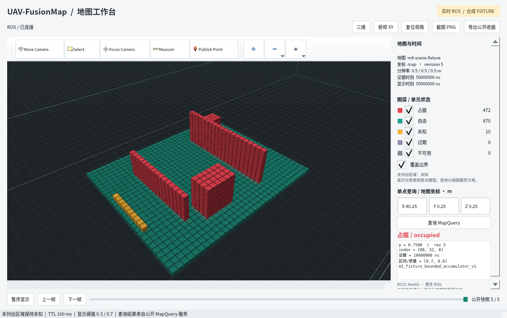
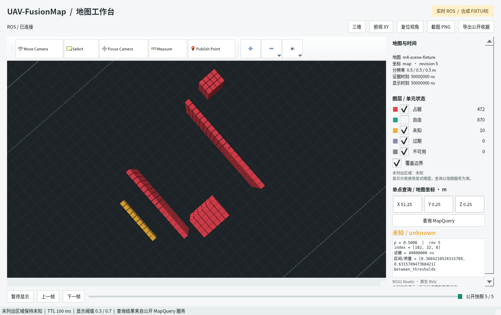

# ROS / RViz报告图片与图注

日期：2026-10-28；主责任：integration_engineer；状态：实际ROS/RViz功能验证通过。
交付时间要求：2026-10-30（本周五）之前；本组图片于10-28完成。

## 主图

本次推荐报告图采用默认Mesa软件渲染；早期系统渲染截图保留原文件，不覆盖历史。

**图1建议图注：** UAV-FusionMap的原生RViz地图可视化与查询界面。左侧显示公开
MapSnapshot转换的三维单元，右侧显示地图坐标、版本、证据时间、图层计数与公开
MapQuery结果。该合成场景包含472个占据单元、870个显式自由单元及10个冲突未知单元，
分辨率为0.5m，地图坐标系为map；未列出的区域保持未知。查询点[40.25,0.25,0.25]m
返回occupied、概率0.75及具名合成区间[0.7,0.8]。本图验证ROS工程接口及界面功能，
不代表Radar–IR模型质量、真实标定、飞行或正式性能验收。

**图2建议图注：** 同一公开地图的RViz俯视图。自由单元图层被显式隐藏，以突出占据
结构和冲突未知单元；右侧图层计数仍来自完整公开快照。查询返回的unknown保留0.5
概率及其区间，不把冲突或图层隐藏解释为无障碍。数据来源为显式fixture，未调用研究模型。

## 可写入报告的说明

已完成基于ROS1 Noetic和原生RViz的地图工作台，支持三维/俯视、状态图层、地图坐标
单点查询、公开快照的暂停/步进/回放，以及带来源记录的PNG导出。界面只消费公开地图
与查询契约；既有Radar/IR占位链的live接入已验证，LiDAR和训练监督未进入在线地图。
在独立合成场景中，五类查询状态、服务停止和时钟断流均通过实际运行检查。
上述结论限于工程软件与可视化，不构成真实感知或机载实时能力证明。

## 原始证据

图片是以下原始PNG的逐字节副本，未重绘或修改数据/标签；未计算无消费者的哈希：

- [图1原图](../../../.runtime/runs/report-rviz-20261028T150952745186/figures/report-20261028T151001522191.png)、[来源/查询/渲染区记录](../../../.runtime/runs/report-rviz-20261028T150952745186/figures/report-20261028T151001522191.json)。
- [图2原图](../../../.runtime/runs/report-rviz-20261028T150952745186/figures/report-20261028T151003321982.png)、[来源/查询/渲染区记录](../../../.runtime/runs/report-rviz-20261028T150952745186/figures/report-20261028T151003321982.json)。
- [过期显示](../../../.runtime/runs/report-rviz-20261028T150952745186/figures/report-20261028T151005727292.png)、[时钟/服务失效显示](../../../.runtime/runs/report-rviz-20261028T150952745186/figures/report-20261028T151012927215.png)。
- [初版系统渲染图1](fig01-rviz-overview.png)、[初版系统渲染图2](fig02-rviz-top-view.png)及[初版运行](../../../.runtime/runs/report-rviz-20261028T143640116229/manifest.json)保留，推荐使用上方默认软件渲染图。
- [完整实验、命令与限制](../../2026-10-28-rviz-report-delivery.md)、[使用说明](../../../docs/ROS_VISUALIZATION.md)。

截图读取本窗口Qt部件及RViz自身Ogre渲染目标，不读取被其他窗口覆盖的桌面图像。
原始窗口与独立viewport PNG及metadata均保留，可据其坐标核对合成位置。
